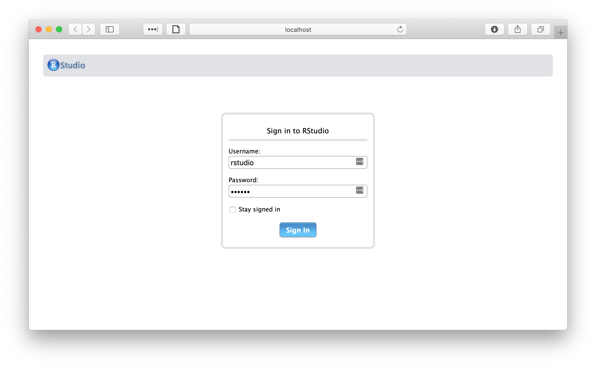
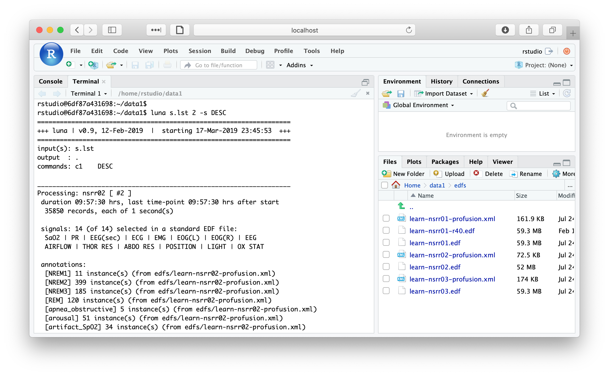

# Docker

The [Docker](https://www.docker.com/) distribution of Luna is designed
to allow users to test both the [_lunaC_](../luna/args.md) and [_lunaR_](../ext/R/index.md), that is, the
C/C++ command-line and the R package versions of Luna.  Although
beyond the scope of this documentation, Docker containers can also
facilitate using Luna in a cloud computing environment, such as [Amazon
Web Services EC2](https://aws.amazon.com/ec2/).

!!! hint "What is Docker?"  
    Docker is a popular tool, increasingly used in cloud-computing, 
    that is used to deploy and run applications on diverse host platforms (i.e. including your computer).
    These [Getting Started](https://docs.docker.com/get-started/) pages will help to
    orient you, although most users of Luna need not read past the
    first page.  From the perspective of a _user_ of Luna, all you'll
    need to do is download the free Desktop version of Docker CE
    (Community Edition) and then use one or two commands to launch the
    _containerized_ version of Luna (which includes a full Linux
    environment comprising [_lunaC_](../luna/args.md),
    [_lunaR_](../ext/R/index.md), the [tutorial data](../tut/tut1.md) as
    well as [R](https://www.r-project.org/) or
    [RStudio](https://www.rstudio.com/).  For those interested in
    learning more about Docker, [this
    tutorial](https://docker-curriculum.com) is a good place to start.

## Available images

We currently support three main Docker images:

 - `remnrem/lunalite` : just the command-line executables (`luna`,
   `destrat` and `behead`) in a lightweight container

 - `remnrem/luna` : Luna, _lunaR_ and RStudio along with the tutorial
   data

 - `remnrem/lunapi` : Luna, _lunaR_ as well as the Python-based
   _lunapi_ wrapper for Luna, including a JupyterLab notebook
   environment, [as described here](https://github.com/remnrem/luna-api-notebooks?tab=readme-ov-file#lunapi-a-python-interface-for-luna)


## Choosing a version

The current stable release of all three images is **1.8.0**. Choose
`remnrem/luna:1.8.0`, `remnrem/lunapi:1.8.0`, or
`remnrem/lunalite:1.8.0` to pin that release. Use the corresponding
`:latest` tag for the unpinned route. Omitting a tag also means `:latest`.
Choose one command from each paired example below.

Pull the chosen image before running it; for the unpinned route, repeat
`docker pull IMAGE:latest` when you want updates. `docker run` can reuse
a locally cached image. Always use the same tag in both commands.
For example:

```bash
# Pinned stable release
docker pull remnrem/luna:1.8.0
docker run --rm -it remnrem/luna:1.8.0 /bin/bash

# Unpinned: fetch and run the latest image
docker pull remnrem/luna:latest
docker run --rm -it remnrem/luna:latest /bin/bash
```

The older console transcripts below are illustrative; version numbers,
build dates, image digests, and download progress vary with the selected image.

## Getting Docker

[Docker](https://www.docker.com/) provides a quick way to run Luna on
any system capable of installing Docker.  Docker containers are
similar in principle to virtual machines that can run on any platform
Docker is installed on.  

Desktop versions of Docker can also be installed (for free) on both
[Mac](https://hub.docker.com/editions/community/docker-ce-desktop-mac)
and
[Windows](https://hub.docker.com/editions/community/docker-ce-desktop-windows) by following 
either one of those links.  Note that the latter requires Windows 10 Professional or Enterprise
64-bit. Follow the extensive documentation on the Docker website to
get up-and-running with Docker.

Docker is available for most Linux machines: for example, here
using `apt-get` on an Amazon Linux EC2 instance:

```
sudo apt-get install docker
```

!!! hint
    Versions of Docker for older Windows or Mac machines are also
    [available](https://docs.docker.com/toolbox/overview/), although we have not 
    tried these and cannot give advice.


## Pulling luna 

Once you have Docker running on your system (the start up can take a
minute or two after installation), the following command (typed in a
terminal/command prompt) will download an _image_ (from [Docker
Hub](https://hub.docker.com)) and create a containerized version of
Luna:

```
# Pinned stable release
docker run --rm -it remnrem/luna:1.8.0 /bin/bash

# Unpinned: latest image
docker run --rm -it remnrem/luna:latest /bin/bash
``` 

(Alternatively, swap in `remnrem/lunalite` for the lightweight version.)

The `remnrem/luna` Docker image contains luna pre-installed within a
Linux environment.  It also includes R with [lunaR](../ext/R/index.md)
pre-installed: both base R and [RStudio](http://www.rstudio.com), as
described [below](#luna-and-rstudio).

You should see something like the following:

```
Unable to find image 'remnrem/luna:latest' locally
latest: Pulling from remnrem/luna
6cf436f81810: Pull complete 
987088a85b96: Pull complete 
b4624b3efe06: Pull complete 
d42beb8ded59: Pull complete 
166613f8d770: Pull complete 
d22664acc861: Pull complete 
dc715f416e3a: Pull complete 
4cb433a57b07: Pull complete 
02ec624d4949: Pull complete 
Digest: sha256:95da9c1a6e2cc7d88123c3bc53776768605fc4e94ae6d058e078b437eb2efd1b
Status: Downloaded newer image for remnrem/luna:latest
root@82bcf5c52204:/data# 
```

The last line of the output above is in fact a prompt running
_inside_ a newly created _container_.  (In Docker terminology, a
_container_ is a particular instantiation of an _image_.)  This container provides a
Linux command line (based on Ubuntu Linux), which has Luna pre-installed.   That is, if 
you type `luna` at the command line, you should see:

```
root@82bcf5c52204:/data# luna
===================================================================
+++ luna | v0.9, 12-Feb-2019  |  starting 11-Mar-2019 19:46:07  +++
===================================================================
usage: luna [sample-list|EDF] [n1] [n2] [@parameter-file] [sig=s1,s2] [v1=val1] < command-file
```

This Luna image also has the [tutorial datasets](../tut/tut1.md) under
the `/tutorial/` folder:

```
root@82bcf5c52204:/data# ls /tutorial/
edfs  s.lst
```

The `s.lst` file is the [sample-list](../luna/args.md#sample-lists)
that describes a project consisting of the three tutorial individuals:


```
root@82bcf5c52204:/data# cat  /tutorial/s.lst 
nsrr01	edfs/learn-nsrr01.edf	edfs/learn-nsrr01-profusion.xml
nsrr02	edfs/learn-nsrr02.edf	edfs/learn-nsrr02-profusion.xml
nsrr03	edfs/learn-nsrr03.edf	edfs/learn-nsrr03-profusion.xml
```

You can run Luna and perform the tutorial actions within this environment:  (note: as the 
`s.lst` file uses [relative paths](../luna/args.md#search-paths) you need to add the `path` 
on the command line):

```
root@82bcf5c52204:/data# luna /tutorial/s.lst 1 path=/tutorial -s DESC
```

```
===================================================================
+++ luna | v0.9, 12-Feb-2019  |  starting 11-Mar-2019 20:00:14  +++
===================================================================
input(s): /tutorial/s.lst
output  : .
commands: c1	DESC	
path    : /tutorial/

___________________________________________________________________
Processing: nsrr01 [ #1 ]
 total duration 11:22:00, with last time-point at 11:22:00
  40920 records, each of 1 second(s)

 signals: 14 (of 14) selected in a standard EDF file:
  SaO2 | PR | EEG(sec) | ECG | EMG | EOG(L) | EOG(R) | EEG
  AIRFLOW | THOR RES | ABDO RES | POSITION | LIGHT | OX STAT

 annotations:
  [NREM1] 109 instance(s) (from /tutorial/edfs/learn-nsrr01-profusion.xml)
  [NREM2] 523 instance(s) (from /tutorial/edfs/learn-nsrr01-profusion.xml)
  [NREM3] 16 instance(s) (from /tutorial/edfs/learn-nsrr01-profusion.xml)
  [NREM4] 1 instance(s) (from /tutorial/edfs/learn-nsrr01-profusion.xml)
  [REM] 238 instance(s) (from /tutorial/edfs/learn-nsrr01-profusion.xml)
  [apnea_obstructive] 37 instance(s) (from /tutorial/edfs/learn-nsrr01-profusion.xml)
  [arousal] 194 instance(s) (from /tutorial/edfs/learn-nsrr01-profusion.xml)
  [artifact_SpO2] 59 instance(s) (from /tutorial/edfs/learn-nsrr01-profusion.xml)
  [desat] 254 instance(s) (from /tutorial/edfs/learn-nsrr01-profusion.xml)
  [hypopnea] 361 instance(s) (from /tutorial/edfs/learn-nsrr01-profusion.xml)
  [wake] 477 instance(s) (from /tutorial/edfs/learn-nsrr01-profusion.xml)
 ..................................................................
 CMD #1: DESC
EDF filename      : /tutorial/edfs/learn-nsrr01.edf
ID                : nsrr01
Duration          : 11:22:00
# signals         : 14
Signals           : SaO2 PR EEG(sec) ECG EMG EOG(L) EOG(R) EEG AIRFLOW THOR RES ABDO RES POSITION LIGHT OX STAT


___________________________________________________________________
...processed 1 EDFs, done.
...processed 1 command set(s),  all of which passed
-------------------------------------------------------------------
+++ luna | finishing 11-Mar-2019 20:00:14                       +++
===================================================================
```


This container also provides the R package `luna`. You can alternatively
[install it directly](lunar.md) without Docker. To start R:

```
root@82bcf5c52204:/data# R
```

To load the R interface and check its Python engine:

```r
library(luna)
luna_config()
```

To open the tutorial project with the 1.8.0 interface:

```r
p <- lp$proj()
p$sample_list("/tutorial/s.lst", path = "/tutorial/")
```

To attach, for example, the second individual `nsrr02`:
```r
i <- p$inst(2)
i$desc()
```

## Container contents

- _mount points:_ `/data/`, `/data1/` and `/data2/` allow different
  folders on the host machine to be mapped to these folders within the
  container

- _text editors:_ `emacs` (powerful but complicated to use if you
  are not familiar with it) and `nano` (simple) are pre-installed

- _build directory:_ `/build/`, this folder contains the source code used to build
   the command-line tools and R package, and can be ignored by most users


## Luna and RStudio

As well as the basic container `remnrem/luna`, we also have generated
an image that bundles RStudio with a pre-installed version of _lunaC_
and _lunaR_.  To obtain this:

```
# Pinned stable release
docker run  -e PASSWORD=abc123 -p 8787:8787 remnrem/luna:1.8.0

# Unpinned: latest image
docker run  -e PASSWORD=abc123 -p 8787:8787 remnrem/luna:latest
```

If this command is successful, then after it downloads and installs, you will be able 
to go to your web browser and visit the URL: `localhost:8787`

{width="100%"}

Log in with username `rstudio` and the password you specified above (i.e. `abc123`).   You will
then have an interactive environment, for which both the command prompt (for _lunaC_) and R (for _lunaR_) 
are available, along with the tutorial data.  For example, we can run _lunaC_ in the terminal:

{width="100%"}

In the R console, analyze the tutorial data with the 1.8.0 interface:

```r
library(luna)
p <- lp$proj()
p$sample_list("/tutorial/s.lst", path = "/tutorial")
inst <- p$inst("nsrr02")
r <- inst$proc("EPOCH & MASK ifnot=N2 & RE & PSD sig=EEG spectrum")
psd <- r$table("PSD", "CH_F")
lp$psd(psd, "EEG", dB = TRUE)
```

The commands for mapping local folders to the Docker container
(i.e. so that your own data are visible whilst in the container, and
so that your output will be saved back on the host machine) are the
same as for the standard Luna image.

## _luna.docker_

The older `luna.docker` wrapper targets historical container images.
For current installations, use the direct `docker pull` and `docker run`
commands in [Choosing a version](#choosing-a-version) and
[Luna and RStudio](#luna-and-rstudio). These provide both pinned 1.8.0
and unpinned routes.

Mount your local data with `-v` as shown in the
[Windows examples](#windows-machines) and the
[lightweight-container examples](#remnremlunalite).

## Windows machines

It is possible to run Docker on recent Windows machines, although you
may need to consult the Docker website for exact information.  As the
`luna.docker` script above will not work for Windows/DOS, you'll need
to type the exact Docker commands, including mapping any volumes or
ports between the host and the container, as detailed below.

__LunaR__

At the Command Prompt, to open a new container and map the `D:\luna`
folder on the host to `/data/` in the container, and `C:\mydata\work` to `/data1` type:

```
# Pinned stable release
docker run --rm -it -v D:/luna:/data -v C:/mydata/work:/data1 remnrem/luna:1.8.0 /bin/bash

# Unpinned: latest image
docker run --rm -it -v D:/luna:/data -v C:/mydata/work:/data1 remnrem/luna:latest /bin/bash
```

By default, the container has folders `/data`, `/data1` and `/data2`
to allow three volumes to be mounted, i.e.  folders on the host machine
to be shared with the Luna container.

__LunaRStudio__ 

At the Command Prompt, to open a new container and map the `D:\luna`
folder on the host to `/data/` in the container, type:

```
# Pinned stable release
docker run --rm -e PASSWORD=abc123 -p 8787:8787 -v D:/luna:/data remnrem/luna:1.8.0

# Unpinned: latest image
docker run --rm -e PASSWORD=abc123 -p 8787:8787 -v D:/luna:/data remnrem/luna:latest
```

and then open your web-browser at `http://localhost:8787` and enter
username `rstudio` and password `abc123`.


__Listing/killing/attaching to containers__

To list all containers:
```
docker ps
```

To clean up everything:
```
docker system prune
```

To kill a particular container, e.g. with name `kind_herschel`
```
docker container rm -f kind_herschel
```

To open another terminal/connection to an existing container, e.g. called `kind_herschel`

```
docker exec -i -t kind_herschel bash -l
```


__Hints__

- Docker takes a while (minutes) to start running, so be sure that it
  is running before you try to launch Luna

- anecdotally, on Windows I've had issues getting any Docker command
  to run that were solved by simply restarting Docker (i.e. look to
  the Docker small icon in your task bar)

- if you have problems, try Docker's
  [hello-world](https://docs.docker.com/get-started/) example/tutorial

- expect to run into issues if your institution/machine has particular
  firewalls or other types of network security features, or if you are
  trying to mount folders on access-protected shared volumes, etc.
  These types of issues are completely beyond the scope of Luna and
  this documentation, and things you'll need to work with your IT team
  to fix

- the whole point of Luna Docker is that it is _meant_ to provide a
  quick, out-of-the-box way to run/test Luna.  If you are having trouble
  try using a binary version, or a different operating system.

- in general, you'll likely have a better Luna experience if you use a
  Unix-like operating system, i.e. macOS or Linux.  Of course, use
  whatever works best for you, but if you're working with large
  amounts of data there are numerous reasons to consider alternatives
  to Windows that may work better...


## remnrem/lunalite

To obtain the lightweight version:
```
# Pinned stable release
docker pull remnrem/lunalite:1.8.0

# Unpinned: latest image
docker pull remnrem/lunalite:latest
```

To run Luna from the host:
```
# Pinned stable release
docker run --rm -it remnrem/lunalite:1.8.0 luna -v

# Unpinned: latest image
docker run --rm -it remnrem/lunalite:latest luna -v
```
```
luna-base version v1.8.0
```

To run interactively:
```
# Pinned stable release
docker run --rm -it remnrem/lunalite:1.8.0

# Unpinned: latest image
docker run --rm -it remnrem/lunalite:latest
```
which will give a prompt within the container (note: `/data #` is part of the shell prompt here, not part of the
command to be entered):
```
/data #  luna -v
```
```
luna-base version v1.8.0
```

To be practically useful, one would also bind a local folder to a container volume: e.g. if the tutorial `s.lst`
data exist in the current local folder.  Locally:

```
cd ~/tutorial
cat s.lst 
```
```
nsrr01	edfs/learn-nsrr01.edf	edfs/learn-nsrr01-profusion.xml
nsrr02	edfs/learn-nsrr02.edf	edfs/learn-nsrr02-profusion.xml
nsrr03	edfs/learn-nsrr03.edf	edfs/learn-nsrr03-profusion.xml
```
We can start a Luna session, binding the current directory (`${PWD}` on Posix systems) to `/data/` inside the container:
```
# Pinned stable release
docker run --rm -it -v ${PWD}:/data remnrem/lunalite:1.8.0

# Unpinned: latest image
docker run --rm -it -v ${PWD}:/data remnrem/lunalite:latest
```
where we can now run commands:
```
/data #  cat s.lst 
```
```
nsrr01	edfs/learn-nsrr01.edf	edfs/learn-nsrr01-profusion.xml
nsrr02	edfs/learn-nsrr02.edf	edfs/learn-nsrr02-profusion.xml
nsrr03	edfs/learn-nsrr03.edf	edfs/learn-nsrr03-profusion.xml
```
and Luna will be automatically available:
```
/data #  luna s.lst 1 -s DESC
```
```
 CMD #1: DESC
    options: sig=*
    EDF filename      : edfs/learn-nsrr01.edf
    ID                : nsrr01
    Clock time        : 21.58.17 - 09.20.17
    Duration          : 11:22:00  40920 sec
    # signals         : 14
    Signals           : SaO2[1] PR[1] EEG_sec[125] ECG[250] EMG[125] EOG_L[50]
                        EOG_R[50] EEG[125] AIRFLOW[10] THOR_RES[10] ABDO_RES[10] POSITION[1]
                        LIGHT[1] OX_STAT[1]
```

Any files written to `/data/` will be available on the host machine
after quitting the container.  You can mount multiple volumes to
different points in the container (some of which can be readonly,
e.g. for the EDF data).  See Docker documentation for details.  Use
Ctrl-D to quit the Docker container (which will then be removed, as we
specified `--rm`).

## Reference: Dockerfile

This [github repository](https://github.com/remnrem/luna-docker)
contains the latest version of the `Dockerfile`, and the corresponding
`luna.docker` wrapper.  Pre-built images are sent to the
`remnrem/luna` [Docker Hub page](https://hub.docker.com/u/remnrem)
for distribution.
