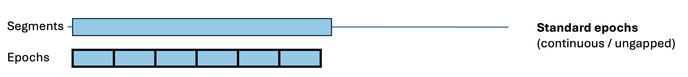
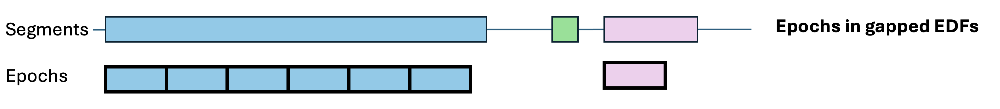
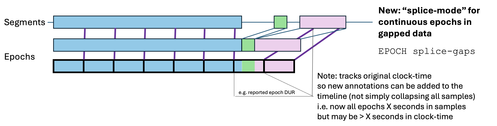
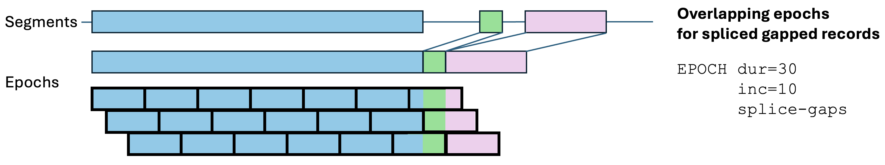

# Epochs

_Commands to define epochs for an EDF, and to attach annotations after loading an EDF_

Epochs are time windows that Luna uses to organize a recording for analysis — by default fixed-length, non-overlapping 30-second intervals, matching AASM sleep staging convention. Most commands that operate on time-series data require epochs to be defined first, either explicitly with [`EPOCH`](epochs.md#epoch) or implicitly (Luna applies a 30-second default if none has been set). [`EPOCH`](epochs.md#epoch) also supports overlapping windows (e.g. 4-second epochs in 2-second steps) and annotation-based generic epochs. `EPOCH-ANNOT` loads an epoch-level annotation file in `.eannot` format, attaching stage or other labels to each epoch.

| Command   | Description |
|------|---|
| [Epoch definitions](#epoch-types) | Overview of epochs |
| [`EPOCH`](#epoch) | Specify epochs |
| [`EPOCH-ANNOT`](#epoch-annot) | Load epoch-wise annotations from a [`.eannot`](annotations.md#eannot-files)-format file | 
| [Command table](#command-epoch-types) | Behavior of commands w.r.t. epochs & masks |


## Epoch types

_Epochs_ are time intervals selected from a recording. Many Luna
commands either explicitly or implicitly rely on epochs being
defined. Epoching an EDF is often a first step that is required for
many other Luna functions that work with epoched data.

In most instances, if epochs have not been specifically defined (by
the [EPOCH command](#epoch)), they will _default_ to non-overlapping
30-second intervals, i.e. mirroring traditional (AASM) sleep staging.

By default, epochs are non-overlapping, of fixed duration (30 seconds)
and contiguous with respect to clock-time (i.e.  not spanning gaps in
the recording). These epoch properties can be changed in various ways:

 - `len` (or `dur`): set the epoch duration in seconds, e.g. `EPOCH len=5`
   for 5-second epochs.

 - `inc`: set the interval between successive epoch starts. By default,
   this equals the epoch duration, giving adjacent, non-overlapping epochs.
   For example, `EPOCH len=30 inc=15` defines overlapping intervals of
   0–30, 15–45, 30–60 seconds, and so on. An increment greater than the
   duration leaves spaces between epochs.

 - `annot`: define __generic__ (annotation-based) epochs from existing
   [annotations](annotations.md), rather than a regularly spaced grid.
   For example, `EPOCH annot=Obstructive_Apnea,Hypopnea flatten=F` makes
   each distinct matching annotation interval an epoch, using the event's
   start and stop times. These epochs can vary in duration, overlap, and
   leave parts of the recording outside any epoch. By default (`flatten=T`),
   overlapping or contiguous source intervals are merged first. Generic epochs
   allow epoch-based analyses to follow
   events of interest; optional windows can extend each event or center an
   epoch on its start, midpoint, or stop, as illustrated below.

 - `contig`: define one generic epoch per contiguous segment of available
   signal data, with potentially different durations between segments.

 - `splice-gaps`: allow fixed-length epochs to combine signal data across
   gaps in an EDF+D recording, excluding the gap duration from the epoch.
   By default, epochs do not span recording gaps.


{width="100%"}
{width="100%"}
{width="100%"}
{width="100%"}

Some commands (in particular [`HYPNO`](hypnograms.md#hypno)) require standard,
non-overlapping epochs (otherwise, the resulting hypnogram metrics would
not be appropriately defined). Most but not all commands can work with generic
epochs, [as detailed below](#command-epoch-types).  Luna will give an error message if trying
to use generic epochs with a command that does not accept them.

## EPOCH 

_Divides the time series into epochs_

This command defines standard fixed-length epochs, annotation-based generic epochs, or one generic epoch per contiguous data segment.

<h3>Methods</h3>

Standard epochs advance a fixed-length window through the recording at a
specified increment. Equal length and increment give non-overlapping epochs;
a smaller increment gives overlapping epochs. The grid can start at an
explicit offset or align to the first matching annotation. By default,
epochs do not cross recording gaps; `splice`/`splice-gaps` instead construct
epochs from available signal data across those gaps.

With `annot=`, existing annotation intervals define generic epochs. Source
intervals are merged by default, then optionally reduced to an anchor point,
expanded, shifted, or truncated. `fixed=` subdivides the resulting intervals
into equal-length epochs. These remain generic epochs even when their lengths
are equal. Alternatively, `contig` creates one generic epoch for each
contiguous segment of available data.

<h3>Parameters</h3>

<h4>Standard epoch length and spacing</h4>

Without parameters, `EPOCH` uses 30-second, non-overlapping epochs starting
at the beginning of the EDF. If the increment is omitted, it equals the
specified epoch length.

| Parameter | Example | Description |
| --- | --- | --- |
| `len` | `len=30` | Epoch length in seconds; default 30 |
| `dur` | `dur=30` | Alias for `len` |
| `inc` | `inc=15` | Increment between epoch starts in seconds; defaults to the epoch length |
| `epoch` | `epoch=30,15` | Epoch length and optional increment, equivalent to `len=30 inc=15` |

<h4>Standard epoch alignment and gaps</h4>

| Parameter | Example | Description |
| --- | --- | --- |
| `offset` | `offset=10` or `offset=22:00:00` | First epoch start as elapsed seconds or clock time; fractional seconds are supported |
| `align` | `align=N1,N2,N3,R,W,?` | Start the epoch grid at the first matching annotation |
| `splice` | | Construct fixed-length epochs across EDF+D gaps, counting available data rather than gap duration |
| `splice-gaps` | | Alias for `splice` |

`offset` and `align` cannot be combined. Clock-time offsets require a valid
EDF start time and cannot precede it. A bare `align` defaults to
`N1,N2,N3,R,W,?,L,U,M`.

<h4>Generic epoch sources and merging</h4>

| Parameter | Example | Description |
| --- | --- | --- |
| `annot` | `annot=Obstructive_Apnea,Hypopnea` | Define generic epochs from matching annotation classes; accepts comma-separated labels and wildcards |
| `flatten` | `flatten=F` | Merge overlapping or contiguous source intervals before further adjustments; default `T`. Set `F` to keep distinct intervals separate |
| `else` | `else=OTHER` | Add complementary epochs and a new annotation class for recording regions not covered by the adjusted event intervals; respects recording gaps |
| `contig` | | Instead of annotation-based epochs, define one generic epoch per contiguous segment of available data |

Use `annot` or `contig` to select a generic epoch mode. The remaining generic
options apply to `annot`, not `contig`. The label supplied to `else` must not
already exist, and `else` cannot be combined with `fixed`.

<h4>Generic epoch anchors and windows</h4>

| Parameter | Example | Description |
| --- | --- | --- |
| `start` | | Reduce each source interval to its start before expanding a window |
| `midpoint` | | Reduce each source interval to its midpoint before expanding a window |
| `stop` | | Reduce each source interval to its stop before expanding a window |
| `w` | `w=5` | Expand by this many seconds on both sides of the interval or selected anchor |
| `w-before` | `w-before=2` | Expand the left side by this many seconds |
| `w-after` | `w-after=5` | Expand the right side by this many seconds |
| `shift` | `shift=0.25` | Shift the adjusted interval in seconds; positive moves later, negative moves earlier |
| `trunc` | `trunc=0.1` | Remove this many seconds from the end of the adjusted interval; must be nonnegative |

Choose at most one anchor option. Without an anchor option, window expansion
extends the original interval. `w` cannot be combined with `w-before` or
`w-after`; window values must be nonnegative.

These anchor and window options take effect only with `annot=`. For example,
`EPOCH start w-after=5` succeeds but ignores both options, creating standard
30-second epochs (`GENERIC=0`).

With `annot=`, using `start`, `midpoint`, or `stop` requires a combined
before/after window duration of at least 0.001 seconds. Either side may be
zero or omitted: `start w-after=5` defines the 5 seconds following the event
start, while `stop w-before=5` defines the 5 seconds preceding its end.
With `w=5`, the combined duration is 10 seconds. The separate `min` duration
filter still applies after window adjustments.

Earlier builds incorrectly required both sides to be nonzero and rejected
one-sided anchored windows; this validation was corrected on 21 November 2026.

<h4>Generic epoch duration and subdivision</h4>

| Parameter | Example | Description |
| --- | --- | --- |
| `fixed` | `fixed=5` | Divide each adjusted source interval into complete epochs of this duration in seconds; discard any shorter remainder. Must exceed 0.001 seconds |
| `only-one` | | With `fixed`, retain only the first complete epoch from each adjusted source interval |
| `min` | `min=0.1` | Minimum duration of event-derived epochs in seconds, before adding any `else` intervals; default 0.1, minimum permitted value 0.001 |
| `debug` | | Log details of annotation-based epoch construction |

With `flatten=T`, fixed-size subdivision operates on merged source intervals.
Set `flatten=F` to subdivide each distinct source interval separately.
`only-one` requires `fixed`.

The processing order is: source merging/intersection with available data
(unless `flatten=F`), anchor selection, window expansion, shift, end
truncation, then fixed-size subdivision if requested. Resulting epochs that
extend outside available data or span recording gaps are skipped. Merging
occurs before window adjustments, so expanded or shifted epochs can overlap
even with the default `flatten=T`.

<h4>Epoch requirements and reset</h4>

| Parameter | Example | Description |
| --- | --- | --- |
| `require` | `require=10` | Stop processing the current EDF if fewer than this many epochs are available; supported in standard, annotation-based, and contiguous-segment modes |
| `clear` | | Remove existing epoch definitions, leaving signals unepoched |

A standalone `EPOCH require=N` checks an existing epoch definition without
redefining it. If none exists, the check sees zero epochs; run `EPOCH` first to define
default epochs. To clear
an epoch definition, use `EPOCH clear` separately from the generic modes.

<h4>Inspection and output control</h4>

| Parameter | Example | Description |
| --- | --- | --- |
| `verbose` | | Emit per-epoch information when defining epochs |
| `dump` | | Report the current epoch table without changing the epoch definition |
| `table` | | Alias for `dump` |
| `masked` | | With `dump`/`table`, include masked epochs and report their mask status |
| `min` | | In standard mode, write only the number of epochs to standard output |

`dump`/`table` take precedence over epoch-definition options. If no epochs
exist, they report that fact without creating any. By default, inspection
shows only unmasked epochs. **`min` has two meanings:** with `annot`, it
requires a numeric minimum duration; in standard mode, it is the minimal
output flag shown above.

<h3>Outputs</h3>

Summary information (strata: _none_)

| Variable | Description |
| --- | --- |
| `NE` | Number of unmasked epochs |
| `NE_MASKED` | Number of masked epochs, when inspecting with `masked` |
| `DUR` | Epoch duration in seconds; emitted for standard epochs and generic epochs created with `fixed` |
| `INC` | Epoch increment in seconds; standard epochs only |
| `OFFSET` | Offset from EDF start in seconds; standard epochs only |
| `GENERIC` | 1 for generic epochs, including `fixed` annotation-based and `contig` epochs; otherwise 0 |
| `FIXED_DUR` | Fixed epoch duration in seconds, or 0 for variable-length epochs; currently reported as an integer, truncating fractional seconds |
| `CONTIG` | 1 when epochs were defined with `contig`; otherwise 0 |

!!! note "Generic epoch duration summaries"
    In the current implementation, summary `DUR` and `FIXED_DUR` can be 0
    even for generic epochs created with `fixed`. Use the per-epoch `DUR`
    values to obtain their actual durations.

Recording coverage (strata: _none_; durations in seconds)

| Variable | Description |
| --- | --- |
| `TOT_DUR` | Sum of epoch durations; overlapping time is counted once per epoch |
| `TOT_SPANNED` | Duration covered by at least one epoch, counting overlapping time only once |
| `TOT_UNSPANNED` | Recording duration not covered by any epoch |
| `TOT_REC` | Available recording duration |
| `TOT_PCT` | Fraction of available recording duration covered by epochs, from 0 to 1; despite the name, this is not multiplied by 100 |

Coverage summaries normally include only unmasked epochs. With `dump masked`
(or `table masked`), they include both masked and unmasked epochs.

Per-epoch interval information (option: `verbose`, `dump`, or `table`; strata: `E`)

| Variable | Description |
| --- | --- |
| `E1` | Current epoch number, which may differ from `E` after restructuring |
| `EMASK` | 1 if the epoch is masked, otherwise 0; emitted with `dump masked`/`table masked` |
| `DUR` | Epoch duration in seconds |
| `LABEL` | Epoch label; annotation-based epochs use a combined label identifying the selected source annotation classes |
| `HMS` | Clock time for epoch start, when the EDF start time is valid |
| `INTERVAL` | Start and stop in elapsed seconds |
| `MID` | Epoch midpoint in seconds from EDF start |
| `START` | Epoch start in seconds from EDF start |
| `STOP` | Epoch stop in seconds from EDF start |
| `TP` | Epoch interval in time-points (1 TP = 1e-9 seconds) |

<h3>Example</h3>

<h4>Fixed epochs</h4>

To set epochs of 10-seconds, each with a 5-second overlap (output
showing the first six epochs):

```
luna my.edf -o out.db -s ' EPOCH len=10 inc=5 verbose ' 
```

The following extracts selected summary columns:
```
destrat out.db +EPOCH -v DUR GENERIC INC NE OFFSET
```
```
ID      DUR   GENERIC   INC     NE   OFFSET
nsrr01   10         0     5   8183        0
```
To get the exact location of each epoch: 	
```
destrat out.db +EPOCH -r E
```

```
ID     E  DUR E1      HMS      INTERVAL LABEL  MID START  STOP                        TP
nsrr01 1   10  1 21:58:17   0.00->10.00    E1    5     0    10            0->10000000000
nsrr01 2   10  2 21:58:22   5.00->15.00    E2   10     5    15   5000000000->15000000000
nsrr01 3   10  3 21:58:27  10.00->20.00    E3   15    10    20  10000000000->20000000000
nsrr01 4   10  4 21:58:32  15.00->25.00    E4   20    15    25  15000000000->25000000000
nsrr01 5   10  5 21:58:37  20.00->30.00    E5   25    20    30  20000000000->30000000000
nsrr01 6   10  6 21:58:42  25.00->35.00    E6   30    25    35  25000000000->35000000000
... (etc) ...
```

If we instead first applied a [`MASK`](masks.md#mask) (which implicitly run [`EPOCH`](epochs.md#epoch)
if the data aren't already epoched), [`RESTRUCTURE`](masks.md#restructure)ed the data,
and then requested information only (`table`) from [`EPOCH`](epochs.md#epoch):
```
MASK epoch=10-14 & RE & EPOCH table
```
the output would be (i.e. note the difference between `E` and `E1`):
```
ID       E DUR E1      HMS        INTERVAL LABEL  MID START STOP                         TP
nsrr01  10  30  1 22:02:47  270.00->300.00   E10  285   270  300 270000000000->300000000000
nsrr01  11  30  2 22:03:17  300.00->330.00   E11  315   300  330 300000000000->330000000000
nsrr01  12  30  3 22:03:47  330.00->360.00   E12  345   330  360 330000000000->360000000000
nsrr01  13  30  4 22:04:17  360.00->390.00   E13  375   360  390 360000000000->390000000000
nsrr01  14  30  5 22:04:47  390.00->420.00   E14  405   390  420 390000000000->420000000000
```

!!! info
    The above command implicitly ran an [`EPOCH`](epochs.md#epoch) command prior to the [`MASK`](masks.md#mask); the 
    above output will be from the second [`EPOCH`](epochs.md#epoch).  Here, using 
    [`TAG`](summaries.md#tag)s can keep track of the various outputs: e.g. 
    ```
    TAG R/1 & EPOCH & MASK epoch=10-14 & RE & TAG R/2 & EPOCH table
    ```
    Output from the first (untagged) [`EPOCH`](epochs.md#epoch):
    ```
    destrat out.db +EPOCH -r R -v DUR GENERIC INC NE OFFSET
    ```
    ```
    ID      R  DUR  GENERIC  INC    NE  OFFSET
    nsrr01  1   30        0   30  1364       0
    nsrr01  2   30        0   30     5       0
    ```
    i.e. note the difference in `NE`.


<h4>Annotation-based epochs</h4>

To treat each distinct respiratory-event interval as an epoch:

```
EPOCH annot=Obstructive_Apnea,Hypopnea flatten=F verbose
```

Epoch duration follows each event's duration. Overlapping event intervals
remain separate with `flatten=F`; omitting it merges overlapping or contiguous
source intervals before constructing epochs.

For a 10-second window centered on each event's midpoint:

```
EPOCH annot=Obstructive_Apnea,Hypopnea flatten=F midpoint w=5 verbose
```

For a 5-second window beginning at each event's start:

```
EPOCH annot=Obstructive_Apnea,Hypopnea flatten=F start w-after=5 verbose
```

Here the before-window is omitted and defaults to zero. To instead take the
5 seconds ending at each event's stop:

```
EPOCH annot=Obstructive_Apnea,Hypopnea flatten=F stop w-before=5 verbose
```

For an asymmetric window extending 2 seconds before and 5 seconds after
each event's start:

```
EPOCH annot=Obstructive_Apnea,Hypopnea flatten=F start w-before=2 w-after=5 verbose
```

These windows are 7 seconds long. Unlike the default annotation-sized epochs,
their boundaries are determined by the selected anchor and window sizes.
Windows that would extend outside available data or span a recording gap
are skipped.

<h4>Fixed-length epochs within annotations</h4>

To split each distinct respiratory-event interval into complete 5-second epochs:

```
EPOCH annot=Obstructive_Apnea,Hypopnea flatten=F fixed=5 verbose
```

For example, a 13-second event yields two 5-second epochs; the final 3 seconds
are discarded. Add `only-one` to keep just the first 5-second epoch from each
interval:

```
EPOCH annot=Obstructive_Apnea,Hypopnea flatten=F fixed=5 only-one verbose
```

These commands do not expand short events to 5 seconds: an event shorter
than `fixed` yields no epoch. The resulting epochs remain generic for
command-compatibility purposes.

<h4>Complementary and contiguous-segment epochs</h4>

To define event epochs and epochs for the remaining recording regions,
creating a new `OTHER` annotation class for those complementary intervals:

```
EPOCH annot=Obstructive_Apnea,Hypopnea else=OTHER verbose
```

This uses the default source merging and respects recording gaps.
`OTHER` must not already be an annotation class. To subsequently select only
the complementary epochs, use the new annotation class with `MASK`.

To define one epoch per contiguous segment of available data instead:

```
EPOCH contig verbose
```

An uninterrupted recording yields one epoch; a recording with gaps yields
one per continuous segment. These epochs are generic and may differ in length.

<h4>Inspecting masked epochs</h4>

After applying a mask, inspect all current epochs without changing their
definition:

```
EPOCH dump masked
```

The per-epoch table includes `EMASK`, and the summary reports `NE` and
`NE_MASKED`. Omitting `masked` reports only unmasked epochs. `EPOCH table masked`
is equivalent.


## EPOCH-ANNOT

_Attach epoch-level annotations from a file, to an epoched EDF_

This command reads a __plain-text__ file from disk, expecting the
[`.eannot`](annotations.md#eannot-files) format.  It is possible to
apply multiple sets of annotations to epochs with multiple
`EPOCH-ANNOT` commands.

The behavior of this command is similar but not identical to what would
happen if the `.eannot` file were directly specified in the
[_sample-list_](../luna/args.md#sample-lists) (i.e. as any other XML,
`.annot` annotation file).  As this command can be performed
after the EDF has been loaded and manipulated (e.g. via
[`RESTRUCTURE`](masks.md#restructure)), the number of epochs
(i.e. rows in the file) should _match exactly_ the number of epochs
given the _current state_ of the in-memory EDF (i.e. after any
restructuring, and with the current epoch definitions).  
           
That is, if [`EPOCH`](epochs.md#epoch) generates 1022 epochs for a given EDF, then
the annotation file must be _exactly_ 1022 epochs. Luna will give an
error if the [`EPOCH`](epochs.md#epoch) command has not been performed prior to
`EPOCH-ANNOT`.

_In contrast_, when attaching an `.eannot` file via the sample-list,
Luna assumes the `.eannot` file corresponds to the entire _on-disk_
EDF (typically with the default 30-second epochs).  (When attaching
initially from a sample list (not `EPOCH-ANNOT`) the tolerance
for exact matching can be altered with the 
[special variables](../luna/args.md#special-variables)
`no-epoch-check` and `epoch-check`.)

An optional `recode` parameter can be used to translate annotations on-the-fly.

!!! danger "Make sure to use plain-text files"
    Annotation files should be plain-text ASCII files
    with no special encodings, not RTF (rich text format), etc.
    Please see [this FAQ](../faq.md#windows-line-endings).

<h3>Methods</h3>

Epoch-level annotations are loaded from a plain-text file in which each row corresponds to one epoch in the current in-memory EDF, and the row value specifies the annotation label for that epoch. The mapping is positional: row _i_ is assigned to epoch _i_ in the current epoch structure. Because epoch identity depends on any prior restructuring operations, the file must reflect the post-restructuring epoch count exactly. Optional label recoding translates annotation values from file-specific conventions to standard labels without modifying the source file.

<h3>Parameters</h3>

| Parameter | Example | Description |
| --- | --- | --- |
| `file`   | `file=annots/id1.epochs` | File path/name to read annotations from (required) |
| `recode` | `recode=ST1=N1,ST2=N2` | Optional, comma-delimited list of recodings (_from_=_to_) |

<h3>Outputs</h3>

This command does not produce any output _per se_, other than noting
the number of epoch/annotations read in the log/console, e.g.

```
 CMD #2: EPOCH-ANNOT
 mapping 2 distinct epoch-annotations (1022 in total) from annots/test.eannot
```

<h3>Example</h3>

Here we attach epoch-annotations to an epoched EDF and use them to
[_mask_](masks.md) out certain epochs.  For example, here we have a
dummy annotation file, that contains an annotation of either `T` or
`A` for each epoch.  This particular EDF has 1022 30-second epochs,
and so the file `epoch1.eannot` is the same length:

``` 
$ sort epoch1.eannot | sort | uniq -c 
102 A 
920 T
```

The file `epoch1.eannot` is a simple text-file, with either an
`A` or a `T` on each line, and nothing else.

!!! note 
    Annotations are not restricted to `A` or `T` or single
    characters: they can be any text string, but should not contain
    spaces or special characters.  A common use may be if sleep
    staging has been performed, so each row indicates _N1_, _N2_,
    _N3_, _REM_ or _Wake_, etc.


To attach this file, and use it to select only `A` epochs:

```
luna my.edf -s ' EPOCH & EPOCH-ANNOT file=epoch1.eannot & MASK ifnot=A & RE '
```

```
 ..................................................................
 CMD #1: EPOCH
 set epochs, length 30 (step 30), 1022 epochs
 ..................................................................
 CMD #2: EPOCH-ANNOT
 mapping 2 distinct epoch-annotations (1022 in total) from epoch1.eannot
 ..................................................................
 CMD #3: MASK
 set masking mode to 'mask' (default)
 based on A 102 epochs match;  920 newly masked, 0 unmasked, 102 unchanged
 total of 102 of 1022 retained
 ..................................................................
 CMD #4: RESTRUCTURE
 restructuring as an EDF+ : keeping 3060 records of 30664, resetting mask
 retaining 102 epochs
```

Having selected epochs based on these external annotations, 
one might subsequently apply other analysis commands, or write out a new EDF (see
[`WRITE`](outputs.md#write)), for example.

!!! hint "Working with multiple EDFs"
    When using [sample-lists](../luna/args.md#sample-lists) to
    work with multiple EDFs, it is often convenient to use the `^`
    special character in a script, which is replaced with the ID (from
    the first column of the sample-list, not the EDF header) for that
    individual.  This enables the same script to point to different
    annotations files for different individuals (assuming 
    that those annotation files are named based on the IDs).
   
Here is an example of using a script (instead of the `-s` option) to
achieve the same result as above, but here using a sample list and
renaming the annotation file to, for example,
`annots/id001.epoch.eannot`.  We might specify the sample list `s.lst`
as follows, to assign the ID `id001` to the EDF:

``` 
id001    my.edf 
```

The Luna script (`extract.txt`) below
also illustrates using a [_variable_](../luna/args.md#variables)
to specify more flexibly the required annotation,
and writing a new EDF (with the [`WRITE`](outputs.md#write) command):

```
% Epoch the data (default 30 sec)

EPOCH

% Attach the matching file in the annots/ folder for this individual
% i.e. requires that files are named 

EPOCH-ANNOT file=annots/^.eannot

% Set this mask, where the value of ${x} will be specified 
% on the command line

MASK ifnot=${x}

% Apply the mask, actually restructuring the internal EDF
% (Note, RESTRUCTURE can be abbreviated as RE)

RESTRUCTURE

% Write a new EDF back to disk

WRITE edf-dir=edfs/            % write new EDFs in this directory/folder
      edf-tag=extract-${x}     % add this tag to the filename for each EDF
      sample-list=s-${x}.lst   % make a new sample-list to point to the new EDFs
```

Note how the `^` character is used to specify the individual/EDF
ID. We can then run Luna, setting the `x` variable to `A`:

```
luna s.lst x=A < extract.txt 
```

For individual `id001`, for example, Luna searches for
`annots/id001.eannot` and then masks epochs that do not match the
value specified by the variable `${x}` (here set to `A`).

After [`RESTRUCTURE`](masks.md#restructure)-ing, it [`WRITE`](outputs.md#write)s an EDF to `edfs/my-extract-A.edf`
and creates a matching sample list `s-A.lst`. As a sanity check,
running [`DESC`](summaries.md#desc) on the new project:

```
luna s-A.lst -s DESC
```
correctly shows a 51-minute (i.e. 102 30-second epochs) EDF:
```
EDF file          : edfs/my-extract-A.edf
ID                : id001
Duration          : 00:51:00
Number of signals : 6
Signals           : EOG-L[256] EOG-R[256] EMG[256] EEG1[256] EEG2[256] EEG3[256]
```


## Command & epoch types

Not all commands can be combined with generic epochs.  Here we list the current constraints
of particular commands with respect to epoch definitions. These fall into the following classes:

 - commands that ignore epoch definitions

 - commands that work with any epoch definition

 - commands that cannot use generic epoch definitions

Generally, Luna will tell you if there is a problem, but the detailed
tables below are included for reference.

<h4>Commands that ignore epoch definitions</h4>

The following primarily do not touch signal-level data and are therefore
not impacted by the presence or absence of any type of epoching:

``` 
ALIASES  ALIGN ANNOTS ANON CANONICAL CLOCS CONTAINS 
CPT CWT-DESIGN DESC EDF ENFORCE-SR FILTER-DESIGN HEADERS 
MAKE-ANNOTS MEANS OVERLAP RECORD-SIZE REMAP RENAME
SET-HEADERS SET-TIMESTAMPS SET-VAR SIGGEN SIGNALS
SIMUL SL SUMMARY TAG  TIME-TRACK TYPES  VARS  WRITE-ANNOTS
```

The following pull the entire signal and treat it as a continuous
time-series - i.e. they effectively ignore any epoch definitions.
Typically, commands that manipulate/generate an EDF signal do not work
with epochs, as they must replace the whole signal in the EDF.
```
1FNORM A2S ACF ADJUST ALTER COPY CWT DUMP-RECORDS
EMD FFT FILTER FLIP FREEZE HILBERT ICA MINMAX
mV OTSU RECS RECTIFY REFERENCE RESAMPLE
REVERSE S2A SEGMENTS SPANNING
THAW TLOCK TRANS TV uV WRITE Z-PEAKS
```

<h4>Commands that work with any epoch definitions</h4>

These commands will not consider signal data outside of unmasked epochs.

Of these, the following allow generic (variable-sized) epochs:

| Command | Notes |
|----|----|
|[`CHEP`](masks.md#chep)| Variable epoch size allowed, but not directly accounted for in analysis |
|`CHEP-MASK`|    (makes more sense w/ equal sized : epochs weighted equally) |
|`DUMP-MASK`| | 
|[`DUPES`](summaries.md#dupes)| |    
|[`EPOCH`](epochs.md#epoch)| |    
|`EPOCH-ANNOT`| If no epochs defined, adds as fixed default (30s) |
|[`GP`](cc.md#gp)|     |
|[`HEAD`](outputs.md#head)| Select which epoch w/ "epoch" arg; always dump from epoch |
|[`INTERPOLATE`](spatial.md#interpolate)|    |
|[`MASK`](masks.md#mask)| |
|[`MATRIX`](outputs.md#matrix)| Only outputs epoched data |
|[`MSE`](power-spectra.md#mse)|    |
|[`MTM`](power-spectra.md#mtm)| | Also has a concept of _segments_ | 
|[`PSC`](psc.md#psc)| Only works on stats, which may be epoch level but size etc is arbitrary; they will be equally weighted in analyses however |
|[`PSD`](power-spectra.md#psd)|     |
|`RESTRUCTURE / RE`| |
|[`SEDF`](outputs.md#sedf)| (but drops epoch timing information in output .sedf) |
|[`SIGSTATS`](summaries.md#sigstats)|  Outputs simple, unweighted epoch means |
|[`TABULATE`](summaries.md#tabulate)| |
|[`XCORR`](cc.md#xcorr)| |
```

Allow whole-recording, or epoch-level analysis, and allow variable-sized epochs:

| Command | Notes |
|-----|-----|
|`CORREL`| (w/ `epoch` or `ch-epoch`) |
|`EVAL`| `interval` for whole-recording |
|`EXE`|    (w/ `epoch`) |
|`LZW`|    (w/ `epoch`) |
|`MI`|    (w/ `epoch`) |
|`MS`|    (w/ `epoch`) |
|`PSI`|    (w/ `epoch`) |
|`SO`| Extra output only |
|`SPINDLES`| Assumes fixed epoch length for spindle/SO shuffling within-epoch (gives warning/error) : otherwise okay (for basic spindle counting per epoch) |
|`STATS`|  (w/ `epoch`) |


<h4>Commands that only work with uniform-sized epochs</h4>

Epoch-level commands that do not allow variable-sized epochs:

| Command | Notes |
|----|-----|
|`ARTIFACTS` | |
|`EVAL-STAGES` | |
|`HYPNO` | |
|`PLACE` | |
|`POPS` | |
|`REBASE` | |
|`SOAP` | |
|`STAGE` | |

These commands can be run in either whole-signal mode, but if run in epoch-level mode, they do not allow variable-sized epochs:

| Command | Notes |
|-----|-----|
|`CC`| w/ `epoch` |  Assumes epochs have equal sizes |
|`COH`|    w/ `epoch` | Assumes epochs have equal sizes |
|`IRASA`| Ignores any offset; assumes fixed epoch len, no overlap + zero offset |
|`LINE-DENOISE`| Assumes epochs are contiguous and no offset (and spans whole record, or last few points uncorrected) |
|`MOVING-AVERAGE`| w/ `epoch`, assumes epochs are contiguous and no offset (and spans whole record, or last few points uncorrected) |
|`PEAKS`| w/ `epoch`, assumes contiguous epochs |
|`ROBUST-NORM`| w/ `epoch`, assumes epochs are contiguous and no offset (and spans whole record, or last few points uncorrected) |
|`SUPPRESS-ECG` |  Command currently forces 30s epochs after pulling whole signal |
|`ZC`| w/ `epoch`, assumes epochs are contiguous and no offset (and spans whole record, or last few points uncorrected) |
