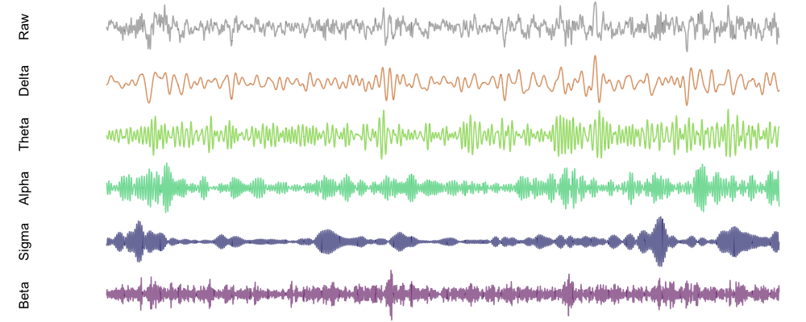
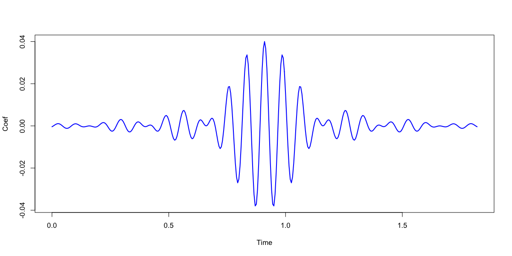
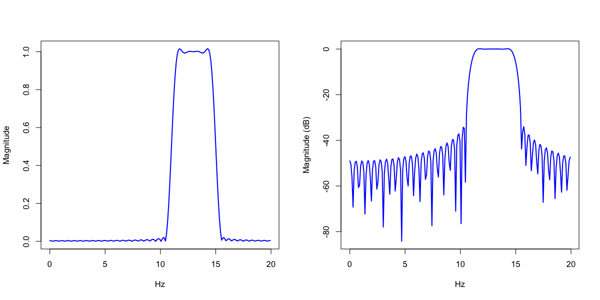

# FIR filters

_Linear-phase signal filters_

Luna uses finite impulse response (FIR) filters, which provide linear-phase responses with no phase distortion. [`FILTER`](fir-filters.md#filter) applies a low-pass, high-pass, band-pass or band-stop FIR filter to one or more channels; filter coefficients are derived using the Kaiser window method (specified via ripple and transition width), with alternatives including fixed-order window methods (Bartlett, Hann, Blackman) or coefficients read from a file. `FILTER-DESIGN` reports filter properties — order, transition widths, frequency response — without modifying any signal, and is useful for verifying filter parameters before applying them.

| Command   | Description |
|------|---|
| [`FILTER`](#filter)  | Apply a FIR filter to one or more signals |
| [`FILTER-DESIGN`](#filter-design) | Display filter properties | 

## FILTER

_Applies a linear-phase FIR filter to a signal_

This command modifies the in-memory signal, by applying a finite
impulse response (FIR) filter, which can be either a _low-pass_,
_high-pass_, _band-pass_ or _band-stop_ filter.

<h3>Methods</h3>

Signals are filtered using linear-phase finite impulse response (FIR) filters, which preserve the phase relationships of all frequency components by applying a symmetric, zero-phase (or constant-delay) kernel. Filter coefficients are derived from the Kaiser window method by default, where the window shape and filter order are determined from the specified passband ripple and transition bandwidth, ensuring a predictable trade-off between stopband attenuation and transition sharpness. Alternatively, filter coefficients can be specified using a fixed-order window method (Bartlett, Hann, or Blackman taper) or loaded directly from a file. Filtering is implemented via fast convolution using the FFT by default, which is computationally efficient for the filter orders required at typical EEG/PSG sampling rates.

<h3>Parameters</h3>

Core parameters are as follows:

| Parameter | Example | Description |
| --- | --- | --- |
| `sig`     | `sig=C3,F3` | Restrict analysis to these channels | 
| `bandpass` | `bandpass=0.3,35` | Band-pass filter between 0.3 and 35 Hz |
| `lowpass`  | `lowpass=35` | Low-pass filter with cutoff of 35 Hz |
| `highpass` | `highpass=0.3` | High-pass filter with cutoff of 0.3 Hz |
| `bandstop` | `bandstop=55,65` | Band-stop filter between 55 and 65 Hz |
| `fft`      | Use FFT to implement the filter (this is now the default) |

By default, the [`FILTER`](fir-filters.md#filter) command uses the Kaiser window approach to
define the filter, which requires the two following parameters:

| Parameter | Example | Description |
| --- | --- | --- |
| `ripple`   | `ripple=0.01` | Ripple (as a proportion) |
| `tw`       | `tw=1` | Transition width (in Hz) | 
| `tw`       | `tw=0.5,5` | Separate lower and upper transition widths for a bandpass filter (in Hz) | 

Note that if using `bandpass tw=lwr,upr` then you need to specify two values for `ripple` also (although
these can be similar).

!!! info "Ripple and stopband attenuation"
    The `ripple` parameter is related to stopband attenuation by the relation
    `A = -20log10(ripple)`, such that a `ripple=0.01` corresponds to -40 dB stopband attenuation.


_Alternative filters_

Alternatively, it is possible to

 - read the FIR coefficients in from a `file`

 - use the window method to design a FIR with a fixed filter order,
  using either a Bartlett, Hann, Blackman or rectangular window

 - use a narrow-band Gaussian filter, defined by a center frequency and
   FWHM (full-width half-maximum) bandwidth, with `ngaus`

 - use an IIR Butterworth or Chebyshev filter

| Parameter | Example | Description |
| --- | --- | --- |
| `file`   | `file=fir1.txt` | Read FIR coefficients from a file |
| | | | 
| `order`  | `order=30` | Fix the FIR filter order |
| `rectangular` | | Specify a rectangular window |
| `bartlett` | | Specify a Bartlett window |
| `hann` | | Specify a Hann window |
| `blackman` | | Specify a Blackman window |
| `ngaus` | `ngaus=12,2` | Specify a narrow-band Gaussian filter (center frequency, FWHM) | 
| `butterworth` | `butterworth=4` | A Butterworth IIR filter of fixed order (see below) |
| `chebyshev` | `chebyshev=4,1` | A Chebyshev IIR filter of fixed order and ripple factor (see below) |

_IIR filters_

[Butterworth](https://en.wikipedia.org/wiki/Butterworth_filter) and
[Chebyshev](https://en.wikipedia.org/wiki/Chebyshev_filter) (type I)
filters require one of `bandpass=f1,f2`, `bandstop=f1,f2`,
`lowpass=f1` and `highpass=f1` options.  Butterworth takes a single
parameter, the filter order; Chebyshev takes two: order and the ripple
factor epsilon - see the above link for a definition of how the ripple
factor relates to passband ripple in dB.  Chebyshev filters are
sharper than the Butterworth filter, whereas Butterworth filters
control passband ripple.  Note that both IIR filters introduce phase delays:
in general, FIR filters are probably preferable choices.
 
<h3>Output</h3>

After running [`FILTER`](fir-filters.md#filter), the in-memory signal for a filtered channel
will represent the filtered signal.  No explicit output is generated
by the [`FILTER`](fir-filters.md#filter) command.

<h3>Examples</h3>

As a first example, here we apply a bandpass filter to the EEG channel
`C3`, with transition frequencies of 0.3 and 35 Hz, using a FIR filter
designed via the Kaiser window method with a ripple parameter
(`ripple`) of 0.01 and a transition width parameter (`tw`) of 0.5 Hz:

```
FILTER sig=C3 bandpass=0.3,35 ripple=0.01 tw=0.5
```

In this second example, use the [R package `luna`](../ext/R/index.md)
to copy the EEG into five frequency bands and plot one epoch. Run R
from the tutorial directory containing `s.lst`:

```r
library(luna)
proj <- lp$proj()
proj$sample_list("s.lst")
inst <- proj$inst("nsrr02")
inst$eval("SIGNALS keep=EEG")
bands <- list(DELTA = c(0.5, 4), THETA = c(4, 8), ALPHA = c(8, 12),
              SIGMA = c(12, 15), BETA = c(15, 30))
for (band in names(bands)) {
  label <- paste0("EEG_", band)
  limits <- bands[[band]]
  inst$eval(sprintf(
    "COPY sig=EEG new=%s & FILTER sig=%s bandpass=%s,%s tw=1 ripple=0.02",
    label, label, limits[1], limits[2]
  ))
}
inst$chs()
inst$epoch("len=30")
d <- inst$slice(inst$e2i(135), inst$chs()$Channels, time = TRUE)
head(d)
```

Each channel is a column in the returned data frame; `T` gives seconds
from recording start. Plot the raw EEG and its filtered copies:

```r
par(mfrow = c(6, 1), mar = c(2, 4, 1, 1))
for (ch in c("EEG", paste0("EEG_", names(bands)))) {
  plot(d$T, d[[ch]], type = "l", xlab = "Seconds", ylab = ch)
}
par(mfrow = c(1, 1))
```

The panels have separate vertical scales, as in this illustration:

{width="100%"}


## FILTER-DESIGN

_Frequency and impulse responses for FIR filters designed via the Kaiser window method_

Filters specified by the [`FILTER`](#filter) command use the [Kaiser
window](https://www.mathworks.com/help/signal/ref/kaiserord.html)
method to design the filter.  The `FILTER-DESIGN` command (or Luna
`--fir-design` option) can be used to show the properties of these filters.

This command does not depend on any EDFs to be present, and so can be
run without a sample-list or EDF (see the example below).

<h3>Methods</h3>

Filter design parameters — including filter order (number of taps), frequency response at each frequency bin, and impulse response coefficients — are computed analytically from the specified window method and cutoff frequencies without requiring EDF data. The frequency response is evaluated across the full Nyquist range at the specified sample rate, enabling verification of passband flatness, transition bandwidth, and stopband attenuation before filter application.

<h3>Parameters</h3>

| Parameter | Example | Description |
| --- | --- | --- |
| `fs`       | `fs=256` | Sampling rate |
| | | 
| `bandpass` | `bandpass=0.3,35` | Band-pass filter between 0.3 and 35 Hz |
| `lowpass` | `lowpass=35` | Low-pass filter with cutoff of 35 Hz |
| `highpass` | `highpass=0.3` | High-pass filter with cutoff of 0.3 Hz |
| `bandstop` | `bandstop=55,65` | Band-stop filter between 0.3 and 35 Hz |

The FIR design approaches are as for the [`FILTER`](fir-filters.md#filter) command: either through the window method
(with either a Kaiser window -- `tw` and `ripple` -- or fixing the FIR `order`) or reading from a file:

| Parameter | Description |
| --- | --- | 
| `ripple`   | Ripple (as a proportion) |
| `tw`       | Transition width (in Hz) | 
| | | 
| `file`     | Read FIR coefficients from a file |
| | |
| `order`    | Fix FIR order |
| `rectangular` | Specify a rectangular window |
| `bartlett` | Specify a Bartlett window |
| `hann` | Specify a Hann window |
| `blackman` | Specify a Blackman window |


<h3>Output</h3>

Per-filter basics (strata: _none_)

| Variable | Description |
| --- | --- |
| `FIR`    | Label for FIR filter (constructed from input parameters) |
| `FS`    | Sampling rate (from `fs` input parameter) |
| `NTAPS` | Filter order (number of taps) |

Filter coefficients (strata: `F` x `TAP`)

| Variable | Description |
| --- | --- |
| `TAP`     | Tap |
| `W`   |  Filter coefficient |


Frequency response characteristics (strata: `F` x `FIR`)

| Variable | Description |
| --- | --- |
| `F`     |   Frequency (Hz) |
| `FIR`   |  FIR filter label |
| `MAG`   |  Magnitude |
| `MAG_DB`|  Magnitude (dB) |
| `PHASE` |  Phase |

Impulse response (strata: `FIR` x `SEC`)

| Variable | Description |
| --- | --- |
| `F`     |  Time (seconds) |
| `FIR`   |  FIR filter label |
| `IR`   |  Impulse response |

<h3>Example</h3>

Consider a band-pass filter in the sigma band, 11 to 15Hz, applied to
a signal with 200 Hz sampling rate.  Transition frequencies 11Hz and
15Hz have -6dB attenuation (i.e. 50% amplitude ratio).

If specifying the `--fir-design` option, Luna expects the parameters above
via standard input, e.g. piped from the `echo` shell command, with the
output still sent to a database `out.db`:

```
echo "fs=200 bandpass=11,15 ripple=0.02 tw=1" | luna --fir-design -o out.db
```

Examining the `out.db`, we see that this command produces the following output:

```
destrat out.db
```

```
--------------------------------------------------------------------------------
out.db: 1 command(s), 1 individual(s), 7 variable(s), 4207 values
--------------------------------------------------------------------------------
  command #1:	c1	Mon Feb 25 16:11:40 2019	FIR-DESIGN	
--------------------------------------------------------------------------------
distinct strata group(s):
  commands      : factors           : levels        : variables 
----------------:-------------------:---------------:---------------------------
  [FIR-DESIGN]  : FIR               : 1 level(s)    : FS NTAPS
                :                   :               : 
  [FIR-DESIGN]  : F FIR             : 1025 level(s) : MAG MAG_DB PHASE
                :                   :               : 
  [FIR-DESIGN]  : FIR TAP           : 365 level(s)  : W
                :                   :               : 
  [FIR-DESIGN]  : FIR SEC           : 765 level(s)  : IR
                :                   :               : 
----------------:-------------------:---------------:---------------------------
```

The first stratum (`FIR`) gives the sampling rate (`FS`) as input, and
the derived order of the filter (`NTAPS`):

```
destrat out.db +FIR-DESIGN -r FIR 
```

```
ID    FIR                        FS      NTAPS
.     BANDPASS_11..15_0.02_1     200     365
```

The actual filter coefficients are in the stratum defined by `FIR` x `TAP`:
```
destrat out.db +FIR-DESIGN -r FIR TAP > fir.txt
```

In R, we can plot the filter coefficients:
```
w <- read.table("fir.txt",header=T)
plot( w$TAP/200 , w$W , type="l", lwd=2, col="blue", ylab="Coef", xlab="Time" ) 
```

{width="100%"}
 

The amplitude (magnitude) response of the filter is in the `F` x `FIR` stratum:
```
destrat out.db +FIR-DESIGN -r F FIR > fir2.txt
```
In R:
```
d <- read.table("fir2.txt", header=T)
d <- d[ d$F < 20 , ]
par(mfcol=c(1,2))
plot(d$F, d$MAG   , type="l",lwd=2,col="blue", xlab="Hz",ylab="Magnitude")
plot(d$F, d$MAG_DB, type="l",lwd=2,col="blue", xlab="Hz",ylab="Magnitude (dB)")
```

{width="100%"}
