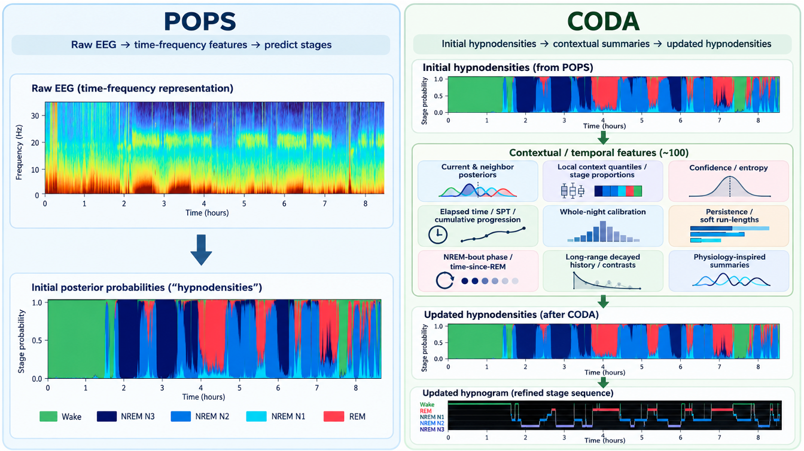

# POPS

_Prediction of sleep stages_

POPS (POPulation-level Sleep Stager) is Luna's automated sleep staging system, designed to be flexible enough to be trained on different signal types and applied to diverse datasets. In prediction mode, POPS takes one or more channels, computes a feature set, and applies a pre-trained model to generate epoch-level stage predictions. Pre-made models are available for single-channel EEG and can be applied directly via [`RUN-POPS`](#run-pops). For quality control of existing staging, see also the companion [SOAP](soap.md) command; a [vignette](../vignettes/soap-pops.md) covers both in detail.

!!! tip "LunaScope"
    [LunaScope](https://zzz-luna.org/lunascope/) provides a point-and-click interface
    to POPS and can be a convenient way to apply the model to a small number of recordings.

| Command | Description |
| ---- | ------ |
| [_POPS and CODA_](#pops-and-coda) | The two-stage POPS/CODA staging model |
| [_Models_](#models) | An overview of the current POPS models and expected signals |
| [`RUN-POPS`](#run-pops) | __A high-level convenience wrapper around [`POPS`](pops.md#pops-prediction)__ |
| [_Emitting hypnodensities_](#emitting-hypnodensity-signals) | Write POPS posterior probabilities to EDF signals at 30- or 5-second resolution |
| [`RUN-POPS`](#hypnodensity-mode) _hypnodensity mode_ | Write per-stage posterior probability signals into the EDF at sub-epoch resolution |
| [`HDSTATS`](#hdstats) | Analyse hypnodensities: dynamics, soft timing, long-range, and ultradian structure |
| [`POPS`](#pops-prediction) _prediction mode_ | Apply automated sleep stage _prediction_ |
| [`EVAL-STAGES`](#eval-stages) | Apply POPS evaluation metrics to external predictions |
| [`--eval-stages`](#eval-stages) | Similar to above, but without an attached EDF |
| [`POPS train`](#pops-training) _training mode (1)_| Create level 1 feature matrices for training |
| [`--pops`](#pops-training) _training mode (2)_ | Combine trainers for level 2 features and train POPS models |

## POPS and CODA

POPS/CODA is a two-stage sleep-staging model. In the first stage, POPS
transforms raw EEG into epoch-level posterior probabilities for Wake, N1, N2,
N3, and REM (the *hypnodensity*). In the second stage, CODA uses those initial
probabilities and their temporal context to produce updated probabilities and a
refined stage sequence.



The original distributed POPS model, `s2`, was a single-stage model. The
rebuilt `s2a` first-stage model was trained on more people, uses a revised
feature set, and can be paired with a second-layer CODA model. CODA
does not re-analyse the raw EEG: it rescales the `s2a` hypnodensity using
information such as neighboring posterior probabilities, local stage context,
confidence, elapsed time, persistence, and longer-range sleep structure.

CODA is optional. When enabled with `coda=<model>`, its output is the standard
final POPS result. Add `pre-coda=T` to retain the original first-stage output
as `CODA=0` alongside the CODA result (`CODA=1`). See
[RUN-POPS](#run-pops) for use and output details.

## Models

Download the POPS model package from the latest `luna-resources` release:

[luna-resources-pops.zip](https://github.com/remnrem/luna-resources/releases/latest/download/luna-resources-pops.zip)

Both `s2` and the rebuilt `s2a` are single-EEG models. `s2` remains available
for legacy workflows; use `s2a` and its matching CODA model for the new
two-stage workflow.

`RUN-POPS` also supports the separate `hyp1` library, which accepts up to ten
input signals. Unlike the classical `s2`/`s2a` pipeline, `hyp1` performs its
own resampling and normalization; `RUN-POPS` therefore does not filter or
normalize its inputs (although optional re-referencing still applies).

Download this ZIP file, and extract it to give a `pops/` folder.

The original `s2` model was trained on ~3500 individuals from the
[NSRR](http://sleepdata.org); although the model is a single-EEG
model, both `C3-M2` and `C4-M1` channels were used, i.e. with the
assumption that they are effectively interchangeable in this context.
The models were trained using the workflow as described below.  The
next sections using either [RUN-POPS](#run-pops) or the lower-level
[POPS](#pops-prediction) interface shows how to use these models for
prediction.

The core `s2` model requires the following:

 - a single central EEG, based on a contralateral mastoid reference,
   i.e. C3-M2 or C4-M1.  In practice, similar EEG channels can be
   swapped in and should still perform similarly, e.g. F3-M2

 - channels must be band-pass filtered 0.3 - 35 Hz and sampled at 128 Hz

 - as well as this primary channel (which is given the placeholder label _CEN_
   below), the `s2` model expects a parallel, standardized version
   (called _ZEN_ below), which can be obtained via the `ROBUST-NORM`
   Luna command

The `s2` model can be used in two different ways in a point-and-click
LunaScope workflow, although both are based on the same underlying
`s2` model.

 - The default use takes a single EEG channel from the test subject and makes predictions

 - Alternatively, one can pass multiple comparable EEG channels to the
   prediction modules (e.g. `C3-M2` and `C4-M1`); this uses the
   `equiv` POPS option to take _both_ EEG channels, predict from each
   separately, and automatically select (epoch-by-epoch) the most
   "confident" prediction for each epoch


### POPS files

When unzipping `luna-resources-pops.zip` (or creating new models from scratch), you'll see the following file types:

| File | Description |
| ---- | ----- |
| `s2.ftr` | _Feature file_, specifying which features to compute per epoch from the raw EEG |
| `s2.mod` | _Model file_, generated by LightGBM after training the model |
| `s2.conf` | _Configuration file_, to control aspects of LightGBM when fitting the model |
| `s2.ranges` | _Ranges file_, represents the distribution of the training data |
| `s2.wgts` | Optional posterior-calibration weights (five values in W,R,N1,N2,N3 order) |
| `s2.*.svd` | _SVD files_, specified by `s2.ftr` (used to project new data into the SVD component space ) |

When present, `<lib>.wgts` recalibrates the final five-state posterior stream before POPS writes output or makes hard calls: it divides each posterior by its class weight and renormalizes the row. It contains one row for POPS and, optionally, a second row for CODA; each row has five positive weights in W,R,N1,N2,N3 order. `weights=` overrides the file, and `unweighted=T` disables either form of correction.

Most users will only use POPS in _prediction_ mode, which is
simpler. Given a pre-trained model (as can be downloaded above) the
core [RUN-POPS](#run-pops) command is in its most basic form just, e.g.:

```
RUN-POPS path=pops sig=C3_M2
```

See [below](#run-pops) for more details.

### Training new models

However, if you want to train your own models (e.g. based on other
populations, etc), you can use POPS in _training mode_ without too
much effort.  The basic workflow for _training_ POPS models is
two-step:

```
  POPS train
    - inputs: signals (EDFs) plus a feature definition file (.ftr)
    - output: epoch by (level 1) feature matrices (binary files)

  --pops
    - inputs: concatenated binary feature matrices & LGBM config (.conf) file
    - output: a `.mod` file (LGBM model) plus several auxiliaries, as above
```

The basic workflow for _prediction_ using a previously created POPS model is a single step:

```
   POPS (or RUN-POPS)
    - inputs: signals (EDFs), feature, model files (.ftr,  .mod) & auxiliaries
    - output: posterior probabilities & most likely stages per epoch
```

That is, the _feature file_ (here `s2.ftr`) is a text file with a
special syntax to specify which epoch-level features to extract from
the raw signals. We use this `s2.ftr` feature file to both train
models, and then also to predict in new individuals.  That is, the
_feature files_ are the key link between the raw signal data, and the
epoch-level feature matrix that is the fundamental data used in sleep
staging by Luna. It is used both in training and in prediction. See
[below](#feature-files) for a detailed overview.  The `.mod` file is
generated by LightGBM (the engine used to power POPS) and need not be
inspected manually. The `.conf` file is not necessary when using
`RUN-POPS`/[`POPS`](pops.md#pops-prediction) to predict sleep stages; otherwise, if the above
files reside in the folder `pops/` then

## RUN-POPS

_Wrapper around POPS for prediction_

If using the standard [POPS](#pops-prediction) for prediction, it is
necessary to perform a few steps to align signals with the channels
that the `s2` model is expecting, to mirror what was done during
training:

 - create copies of the signals

 - to filter channels to the correct sample rate (128 Hz EEGs by default) (called `CEN`)

 - normalize a second copy of the signal using `ROBUST-NORM` (called `ZEN`)

 - to use the POPS model to make predictions

The `RUN-POPS` wrapper (the preferred way to use POPS) simplifies
this, such that staging (for the `s2` model) requires only a) one or
more EEG signals and b) the location of the downloaded POPS models to
be specified (e.g. assuming the base `s2` model exists in the folder `pops/`):

```
luna s.lst -s ' RUN-POPS path=pops sig=C3_M2 '
```

In contrast, if using the lower-level [`POPS`](pops.md#pops-prediction) command, one might need
to run something like this:

```
luna s.lst -s ' FILTER sig=C3_M2 bandpass=0.3,35 tw=0.5 ripple=0.02
                COPY sig=C3_M2 tag=NORM
                ROBUST-NORM sig=C3_M2_NORM epoch winsor=0.005 second-norm=T
                POPS alias=CEN,ZEN|C3_M2,C3_M2_NORM path=pops lib=s2 '
```
and this would become more involved if applying multiple _equivalence_ channels.

<h3>Methods</h3>

For the classical `s2`/`s2a` libraries, `RUN-POPS` bandpass-filters the requested
EEG (0.3–35 Hz), prepares standard and robustly normalized copies, maps them to
the channel names expected by the model, and invokes POPS. It can also apply
EDGER before staging. The `hyp1` library instead maps up to ten input signals
directly to its model slots and performs its own resampling and normalization.

### Standard and diagnostic output

The default output is deliberately compact: whole-record metrics, per-stage (`SS`)
summaries, one epoch-level (`E`) posterior/prediction stream, and the final
`OBS,PRED` confusion table. If multiple equivalent EEG channels are supplied,
the wrapper still scores and combines them, but does not emit a separate posterior
stream for each candidate channel.

With `coda`, that standard stream is the final CODA result. Add `pre-coda` to
compare both stages explicitly: the original POPS result is `CODA=0` and the
rescored result is `CODA=1`. Without `pre-coda`, no duplicate pre-CODA stream is
written.

`verbose` enables feature-definition/QC, channel-equivalence (`CHEQ`), and
error-type diagnostics. It does not emit raw feature matrices. Use
`output-features` for the stage-1 matrix and `coda-output-features` for the CODA
matrix. Model diagnostics use `CODA` and the unique model-input column `COL` as
strata; `FTR` is a regular descriptive variable, because feature labels are not
guaranteed to be unique.

<h3>Parameters</h3>

Epoch-level confusion matrix (strata: `OBS` x `PRED`)

| Parameter | Example | Description |
| ---- | ---- | ----  |
| `path` | `/home/user/data/pops/` | Path to POPS model folder (downloaded) |
| `lib` | `s2a` | Optionally select a POPS model (default `s2a`; `hyp1` supports up to ten signals) |
| `sig` | `C3` | One or more EEG signals |
| `ref` | `M2` | Optionally, one or more references (matching `sig`) |
| `args` |  `args="op1=val1 op2=val2"` | Pass other arguments to POPS |
| `ignore-obs` | `T` | Ignore any observed staging (default: `F`) |
| `filter` | `F` | Filter signals 0.3 - 35 Hz (default: `T` ) |
| `edger` | `F` | Whether to perform [EDGER](artifacts.md#edger) trimming prior to prediction (default: `T`) |
| `resolution` | `5` | Run staggered 30-second POPS windows every 5 seconds and generate the 5-second posterior stream (see [below](#hypnodensity-mode)); default: `30` |
| `emit-pp` | `T` | Write posterior probabilities to in-memory EDF signals at the selected resolution |
| `smooth-pp` | `F` | Disable default output smoothing for 5-second posteriors (diagnostic use only) |
| `prefix` | `PP` | Prefix for 5-second emitted posterior signals (default: `PP`) |
| `add-nrem123` | `T` | Add individual N1/N2/N3 posterior channels when emitting 5-second posteriors (default: `T`) |
| `add-nrem` | `F` | Add a summed `NR`=N1+N2+N3 posterior channel when emitting 5-second posteriors (default: `F`) |
| `posterior-channels` | `E`, `CODA`, or `BOTH` | Select stage-1, CODA, or both 30-second posterior channel sets |
| `posterior-prefix` | `PP,CP` | One prefix for both 30-second sets, or separate stage-1 and CODA prefixes |
| `coda` | `coda.mod` | Apply the second-stage CODA rescoring model |
| `pre-coda` | `T` | With `coda`, retain stage-1 output as `CODA=0` alongside the final `CODA=1` result |
| `weights` | `1,1,1,1,1` | Direct inverse posterior-calibration weights in W,R,N1,N2,N3 order |
| `unweighted` | `T` | Disable posterior calibration from `weights` or an optional `<lib>.wgts` file |
| `verbose` | | Emit feature/QC, `CHEQ`, and error-type diagnostics; does not emit raw feature matrices |
| `output-features` | | Emit the raw stage-1 feature matrix (`CODA=0`, `E,COL`) |
| `coda-output-features` | | Emit the raw CODA feature matrix (`CODA=1`, `E,COL`) |
| `pops-SHAP`, `coda-SHAP` | | Emit SHAP values for the first-stage POPS or CODA model only |
| `pops-importance`, `coda-importance` | | Emit LightGBM gain/split importance for the first-stage POPS or CODA model |
| `epoch-SHAP` | | Emit epoch-level SHAP values (`SHAP-epoch` is an alias) |
| `coda-context` | `20` | CODA context window in 30-second epochs |

<h3>Outputs</h3>

See the [POPS](#pops-prediction) command outputs below. In standard mode, use
the unstratified, `E`, `SS`, and `OBS,PRED` tables only. `CODA` is added to those
same tables only when `pre-coda` requests both scoring stages.

<h3>Example</h3>

If we need to reference the channel on-the-fly:

```
luna s.lst -s ' RUN-POPS path=pops sig=C3 ref=M2 '
```

For multiple equivalence channels:

```
luna s.lst -s ' RUN-POPS path=pops sig=C3_M2,C4_M1 '
```

For multiple equivalence channels and also perform re-referencing (the i-th entry in `sig` is referenced against the i-th entry in `ref`):

```
luna s.lst -s ' RUN-POPS path=pops sig=C3,C4 ref=M2,M1 '
```

---

For a specific example, applied to a tutorial dataset EDF:

```
luna s.lst 2 -o out.db -s RUN-POPS sig=EEG path=~/dropbox/pops
```

This shows the steps `RUN-POPS` performs in the log:

```
 CMD #1: RUN-POPS
   options: path=/Users/smp37/dropbox/pops sig=EEG
  ------------------------------------------------------------
  making copies of original signals (appending _F)
  copying EEG to EEG_F
  ------------------------------------------------------------
  resampling EEG_F to 128 Hz if needed
  resampling channel EEG_F from sample rate 125 to 128
  ------------------------------------------------------------
  bandpass filtering signals
  filtering channel(s): EEG_F
  ------------------------------------------------------------
  making time-domain normalized signals
  copying EEG_F to EEG_F_N
  set epochs to default 30 seconds, 1195 epochs
  iterating over epochs
  robust standardization of 1 signals, winsorizing at 0.002
  ------------------------------------------------------------
  scanning to trim excess leading/trailing wake/artifact
  skipping... cache ec1 not found for this individual...
  set 0 leading/trailing sleep epochs to '?' (given end-wake=120 and end-sleep=5)
  anchoring on sleep epochs only for normative ranges, using 715 of 1195 epochs
  for EEG_F, flagged 340 epochs (H1=270, H3=96)
  H(1) bounds: 3.58812 .. 6.97429
  H(3) bounds: 0.299615 .. 0.928851
  setting cache ec1 to store times
  lights-on=05.13.06 (skipping 244 epochs from end)
  ------------------------------------------------------------
```

It then applies the [`POPS`](pops.md#pops-prediction) command:
```
  running POPS
  reading feature specification from /Users/smp37/dropbox/pops/s2.ftr
   396 level-1 features, 109 level-2 features
   113 of 505 features selected in the final feature set
  read 65 valid feature mean/SD ranges from /Users/smp37/dropbox/pops/s2.ranges
  from TRIM cache, setting lights_on = 28500 secs, 475 mins from start
  set 245 final epochs to L based on a lights_on time of 28500 seconds from EDF start
  set 0 leading/trailing sleep epochs to '?' (given end-wake=120 and end-sleep=5)
  existing staging found: will calculate predicted/observed agreement metrics
  expecting 396 level-1 features (for 1195 epochs) and 2 signals
  applying Welch with 4s segments (2s overlap), using median over segments
  pruning rows from 1195 to 950 epochs
  feature matrix: 950 rows (epochs) and 113 columns (features)
  set 20 ( prop = 0.000186306) data points to missing
  read model from /Users/smp37/dropbox/pops/s2.mod (1000 iterations)
  adding POPS annotations (pN1, pN2, pN3, pR, pW, p?)

  kappa = 0.830578; 3-class kappa = 0.860016 (n = 950 epochs)

  Confusion matrix:
       Pred:    W      R     N1     N2     N3     Tot
  Obs:   W    224      1      8      3      0    0.25
         R      1     99      4     16      0    0.13
        N1      4      0      5      2      0    0.01
        N2     14     18      8    329     29    0.42
        N3      2      0      0      6    177    0.19
      Tot:   0.26   0.12   0.03   0.37   0.22    1.00
```

The output database will now have the same output as described for
[`POPS`](pops.md#pops-prediction) below, except the command name is `RUN-POPS` here and not
[`POPS`](pops.md#pops-prediction):

```
destrat out.db +RUN-POPS -v K K3
```
```
ID        K           K3
nsrr02    0.830578    0.860016
```

The epoch-level predictions are obtained as follows:

```
destrat out.db +RUN-POPS -r E -v PP_N1 PP_N2 PP_N3 PP_R PP_W PRED PRIOR
```
```
ID      E     PP_N1   PP_N2   PP_N3    PP_R    PP_W  PRED PRIOR
   ...
nsrr02  553   0.004   0.673   0.318   0.002   0.003    N2    N2
nsrr02  554   0.002   0.511   0.482   0.001   0.003    N2    N2
nsrr02  555   0.002   0.369   0.627   0.001   0.002    N3    N2
nsrr02  556   0.003   0.591   0.402   0.001   0.003    N2    N2
nsrr02  557   0.002   0.525   0.470   0.001   0.002    N2    N3
nsrr02  558   0.002   0.548   0.445   0.001   0.003    N2    N2
nsrr02  559   0.001   0.327   0.669   0.001   0.002    N3    N2
nsrr02  560   0.002   0.351   0.644   0.001   0.002    N3    N3
nsrr02  561   0.004   0.341   0.651   0.002   0.003    N3    N2
nsrr02  562   0.002   0.270   0.725   0.001   0.002    N3    N2
nsrr02  563   0.002   0.250   0.745   0.001   0.002    N3    N2
nsrr02  564   0.002   0.251   0.744   0.001   0.002    N3    N2
nsrr02  565   0.002   0.345   0.649   0.001   0.002    N3    N2
nsrr02  566   0.002   0.279   0.715   0.001   0.003    N3    N3
nsrr02  567   0.002   0.337   0.657   0.001   0.002    N3    N2
nsrr02  568   0.001   0.194   0.802   0.001   0.002    N3    N2
nsrr02  569   0.001   0.164   0.833   0.001   0.002    N3    N3
nsrr02  570   0.003   0.300   0.693   0.002   0.003    N3    N2
nsrr02  571   0.001   0.282   0.713   0.001   0.002    N3    N3
nsrr02  572   0.002   0.307   0.687   0.002   0.002    N3    N3
nsrr02  573   0.001   0.284   0.711   0.002   0.002    N3    N3
nsrr02  574   0.003   0.322   0.670   0.002   0.002    N3    N2
nsrr02  575   0.005   0.317   0.672   0.003   0.003    N3    N2
nsrr02  576   0.010   0.711   0.269   0.005   0.005    N2    N2
nsrr02  577   0.002   0.311   0.683   0.002   0.003    N3    N3
nsrr02  578   0.001   0.232   0.764   0.002   0.002    N3    N2
nsrr02  579   0.003   0.294   0.698   0.002   0.004    N3    N3
nsrr02  580   0.005   0.520   0.469   0.003   0.003    N2    N2
nsrr02  581   0.004   0.647   0.344   0.002   0.003    N2    N2
nsrr02  582   0.002   0.329   0.663   0.002   0.003    N3    N3
nsrr02  583   0.004   0.455   0.532   0.005   0.004    N3    N2
nsrr02  584   0.003   0.147   0.838   0.007   0.005    N3    N3
nsrr02  585   0.008   0.202   0.765   0.017   0.009    N3    N3
nsrr02  586   0.026   0.236   0.692   0.032   0.014    N3    N3
nsrr02  587   0.021   0.037   0.005   0.009   0.926     W     W
nsrr02  588   0.021   0.017   0.002   0.005   0.955     W     W
...
```

---

## Hypnodensity mode

_Generate per-stage posterior probability signals at sub-epoch resolution_

Standard `RUN-POPS` (and [`POPS`](pops.md#pops-prediction)) produce a single stage prediction per 30-second epoch —
the argmax of the posterior distribution — along with per-epoch posteriors in the output
database. Hypnodensity mode instead writes those posteriors back into the in-memory EDF as
continuous signals at a higher temporal resolution, making the full time course of model
uncertainty directly available for downstream analysis with [`HDSTATS`](#hdstats), interactive
visualisation in LunaScope, or any other Luna signal-processing pipeline.

Hypnodensity mode is enabled with `resolution=5 emit-pp` on `RUN-POPS`.

### Emitting hypnodensity signals

POPS always writes posterior probabilities to its usual output tables, but it
only adds them as EDF signals when requested. Use `emit-pp` to create `PP_*`
signals in the in-memory EDF, then use [`WRITE`](outputs.md#write) to preserve
them. There are two export resolutions:

| Resolution | Command | Result |
| ---- | ---- | ---- |
| 30 seconds (default) | `RUN-POPS ... emit-pp` | One posterior value per standard 30-second epoch |
| 5 seconds | `RUN-POPS ... resolution=5 emit-pp` | A dense posterior stream from overlapping 30-second windows, sampled every 5 seconds |

For 30-second export, the EDF must be continuous, have fixed non-overlapping
30-second epochs, and have one 30-second EDF record per epoch. The output is
the active final stream: stage-1 POPS unless `coda=` is used. To choose the
30-second stream explicitly, use `posterior-channels=E`, `CODA`, or `BOTH`;
`posterior-prefix=PP,CP` assigns separate prefixes to the stage-1 and CODA
sets.

For a conventional 1-second-record EDF, this example restructures the in-memory
EDF, generates one posterior sample per 30-second epoch, retains only the new
posterior signals, and writes a new EDF plus sample list:

```
luna s.lst -s '
  RECORD-SIZE dur=30 continue
  EPOCH dur=30
  RUN-POPS path=pops sig=C3_M2 emit-pp
  SIGNALS keep=PP_*
  WRITE edf-dir=pp-30/ sample-list=pp-30.lst'
```

For 5-second output, use the same record layout and add `resolution=5`. This
creates a 0.2-Hz posterior signal for each stage:

```
luna s.lst -s '
  RECORD-SIZE dur=30 continue
  RUN-POPS path=pops sig=C3_M2 resolution=5 emit-pp
  SIGNALS keep=PP_*
  WRITE edf-dir=pp-5/ sample-list=pp-5.lst'
```

In both cases, omit `SIGNALS keep=PP_*` if the rewritten EDF should retain its
original signals as well. Posterior values are stored in `PP_W`, `PP_R`,
`PP_N1`, `PP_N2`, and `PP_N3` (or `PP_NR` for a three-class 30-second model).
`PP_INVALID` marks posterior samples that were unavailable or filled rather
than directly estimated.

### Five-second posterior stream

Standard POPS generates one posterior per non-overlapping 30-second epoch.
With `resolution=5`, it evaluates staggered 30-second windows every five seconds
to create a dense posterior time series. Any leading or trailing samples filled
from the nearest valid posterior are marked by `{prefix}_INVALID` and a
`{prefix}/edge` annotation.

The output signals have a sample rate of 0.2 Hz (one sample every 5 seconds). Because the EDF
record duration must be divisible by the 5-second stride, 1-second EDF records may require a
prior `RECORD-SIZE dur=30 continue` before calling `RUN-POPS resolution=5`.

!!! note
    Hypnodensity mode requires a 5-class model. It is not compatible with the `3-class` POPS option.
    EDGER defaults to `T`; set `edger=F` if the 5-second stream should retain
    its untrimmed edges. Any zero-order-hold-filled edge samples are marked.

<h3>Outputs (added to EDF as signals)</h3>

| Signal | Description |
| ---- | ---- |
| `{prefix}_W` | Posterior probability for wake (default: `PP_W`) |
| `{prefix}_N1` | Posterior probability for N1 (default: `PP_N1`) |
| `{prefix}_N2` | Posterior probability for N2 (default: `PP_N2`) |
| `{prefix}_N3` | Posterior probability for N3 (default: `PP_N3`) |
| `{prefix}_R` | Posterior probability for REM (default: `PP_R`) |
| `{prefix}_NR` | Summed NREM = N1+N2+N3 posterior (only if `add-nrem=T`) |
| `{prefix}_INVALID` | `1` for unavailable or zero-order-hold-filled samples, otherwise `0` |

The `{prefix}/edge` annotation marks any leading or trailing zero-order-hold-filled regions.

!!! warning
    These signals are written to the **in-memory EDF only**. Use [`WRITE`](outputs.md#write) to save them to disk,
    or pipe directly into [`HDSTATS`](pops.md#hdstats) (or another Luna command) in the same script.

<h3>Example</h3>

Run hypnodensity mode (5-second stride, output rate = 0.2 Hz):

```
luna s.lst -o out.db -s '
  RUN-POPS path=pops sig=C3_M2 resolution=5 emit-pp
  HDSTATS
  WRITE edf-dir=hd/ sample-list=hd.lst'
```

With two equivalence EEG channels and a custom prefix:

```
luna s.lst -s 'RUN-POPS path=pops sig=C3_M2,C4_M1 resolution=5 emit-pp prefix=HD'
```

To suppress the individual N1/N2/N3 channels but keep only the summed NREM trace:

```
luna s.lst -s 'RUN-POPS path=pops sig=C3_M2 resolution=5 emit-pp add-nrem123=F add-nrem=T'
```

---

## POPS (prediction)

_Single observation stage accuracies and probabilities_

Note that the [`RUN-POPS` wrapper](#run-pops) provides a simpler way
to call the POPS stager in prediction mode, and should generally be
the preferred route.

<h3>Methods</h3>

POPS predicts sleep stages from a set of epoch-level features derived from one or more EEG channels using a gradient-boosted decision tree classifier (LightGBM). Features are specified in a feature definition file and include spectral power at individual frequency bins, relative power, intra-epoch power variance, band power, Hjorth parameters, spectral slope, signal moments, and inter-channel coherence, among others. Optionally, temporal smoothing and PCA-based dimensionality reduction are applied to the feature matrix. At inference time, the trained model outputs a posterior probability vector over five sleep stages (W, N1, N2, N3, REM) for each epoch; the most probable stage is assigned as the predicted label. When observed staging is available, agreement is evaluated as Cohen's kappa and stage-specific accuracy metrics, and a confusion matrix is reported.

<h3>Parameters</h3>

Primary options:

| Option | Example | Description |
| ---- | ---- | ---- |
| `path` | `/path/to/pops` | Folder where POPS feature, model files, etc reside |
| `lib` | `s2a` | Name of library in `path` folder (i.e. root for `.ftr`, `.mod`, etc.) |
| `alias` | `CEN,ZEN|C3_M2,C3_M2_NORM` | Assign `CEN` (from `.ftr`) to be `C3_M2` (from EDF), etc |
| `equiv` | `CEN,ZEN|C4_M1,C4_M1_NORM` | Use `C4_M1` as a second _equivalent_ alongside the original `CEN`; likewise for `C4_M1_NORM` and `ZEN` |
| `replace` | `CEN,C3` | Replace EDF channel `CEN` with `C3` |
| `lights-off` | `23:00:00` | Lights off time (ignore epochs before) |
| `lights-on` | `08:00:00` | Lights on time (ignore epochs after) |
| `SHAP` | | Estimate SHAP information scores (takes longer to run) |
| `SHAP-epoch` | | Estimate epoch-level SHAP information scores (takes longer to run & verbose output) |
| `resolution` | `30` or `5` | Posterior resolution; `5` runs overlapping 30-second windows every 5 seconds |
| `emit-pp` | | Add the active posterior stream to the in-memory EDF as `PP_*` signals |
| `smooth-pp` | `F` | Disable default smoothing of 5-second posterior output (diagnostic use) |
| `posterior-channels` | `E`, `CODA`, or `BOTH` | Select stage-1, CODA, or both 30-second posterior channel sets |
| `posterior-prefix` | `PP,CP` | One prefix for both 30-second sets, or separate stage-1 and CODA prefixes |
| `coda` | `coda.mod` | Apply a second-stage CODA rescoring model |
| `pre-coda` | `T` | With `coda`, also write stage-1 results as `CODA=0` |
| `predict-coda` | | Rescore an attached `PP_*` stream, or the table supplied by `posteriors=`, without rerunning first-stage POPS |
| `posteriors` | `pops.txt` | Posterior table for standalone CODA prediction or training |
| `weights` | `W,R,N1,N2,N3` | Direct inverse posterior-calibration weights |
| `unweighted` | `T` | Disable calibration from `weights` or an optional `<lib>.wgts` file |
| `pops-SHAP`, `coda-SHAP` | | Emit SHAP values for the first-stage POPS or CODA model only |
| `pops-importance`, `coda-importance` | | Emit LightGBM gain/split importance for the first-stage POPS or CODA model |
| `epoch-SHAP` | | Emit epoch-level SHAP values (`SHAP-epoch` is an alias) |

<h3>Output</h3>

The primary output of running POPS in prediction mode is a set of posterior probabilities for each epoch, along with the most likely stage.

If the dataset contained manual staging, Luna will also report a suite
of accuracy measures and print confusion matrices to the console
(i.e. on the __assumption__ that the original staging represents a
_gold standard_).

In addition, POPS adds a set of [annotations](annotations.md) - labelled either `N1`, `N2`, `N3`, `R` and `W` (if no original staging present), or `pN1`, `pN2`, `pN3`,`pR` and `pW` if there was original staging.   In practice, one may then want to add a command such as
```
WRITE-ANNOTS annot=pN1,pN2,pN3,pR,pW file=^-pops.annot hms '
```
after running POPS to make predictions.   If output with `p` (POPS) prefixes, you can tell Luna to use those as the standard staging annotations via `ss-prefix=p` (or `ss-pops=T`: i.e. this will use POPS staging if the file `pops.annot` was previously generated in `id1-pops.annot`:
```
luna s.lst ss-prefix=p annot-file=id1-pops.annot -s HYPNO
```

Individual-level output (strata: _none_)

| Variable | Description |
| ---- | ---- |
| `ACC` | Accuracy |
| `ACC3` | 3-class accuracy (NR/R/W) |
| `K` | Kappa |
| `K3` | 3-class Kappa |
| `MCC` | Matthew's correlation coef. |
| `MCC3` | 3-class MCC |
| `F1` | F-1 score |
| `F13` | 3-class F-1 score |
| `F_WGT` | Weighted F-1 |
| `RECALL` | Recall |
| `RECALL3` | 3-class recall |
| `RECALL_WGT` | Weighted recall |
| `PREC` | Precision |
| `PREC3` | 3-class precision |
| `PREC_WGT` | Weighted precision |
| `REM_LAT_OBS` | Observed REM latency |
| `REM_LAT_PRD` | Predicted REM latency |
| `SLP_LAT_OBS` | Observed sleep latency |
| `SLP_LAT_PRD` | Predicted sleep latency |


Epoch-level outputs (stratum: `E`)

| Variable | Description |
| ---- | ---- |
| `PRIOR` | Prior staging, if present |
| `PRED` | Predicted (most likely) stage |
| `CONF` | Confidence score (highest posterior) |
| `FLAG` | Flagged if an issue/outlier (0/1) |
| `START` | Start time of epoch |
| `STOP` | Stop time of epoch |
| `PP_N1` | Posterior probability, N1 |
| `PP_N2` | Posterior probability, N2 |
| `PP_N3` | Posterior probability, N3 |
| `PP_R` | Posterior probability, REM |
| `PP_W` | Posterior probability, wake |


Stage-specific metrics (stratum: `SS` )

| Variable | Description |
| ---- | ---- |
| `ORIG` | Stage duration, original staging |
| `PRF` | Stage duration, predicted, weighted by posteriors |
| `PR1` | Stage duration, predicted, counting most-likely epochs |
| `F1` | F-1 score |
| `PREC` | Precision |
| `RECALL` | Recall |
| `OBS` | Number of observations |


Feature-level summaries (stratum: `FTR`)

| Variable | Description |
| ---- | ---- |
| `LABEL` | Feature label |
| `LABEL_ORIG` | Original label |
| `INC` | Included? 0/1 |
| `DROPPED` | Dropped? 0/1 |
| `FINAL` | Column number in final feature matrix, if present |
| `LEVEL` | Level 1 or level 2 feature? |
| `BAD` | Bad feature (outliers)? |
| `BLOCK` | Block label |
| `PROP` | Proportion of missing observations |
| `ROOT` | Label root name |


Epoch-level accuracy by transition class (stratum: `ETYPE`)

| Variable | Description |
| ---- | ---- |
| `ACC` | Accuracy |
| `N` | Number of events |

_See the [`SOAP`](soap.md#soap) documentation for a description of the various `ETYPE` levels._

Stage-specific epoch-level accuracy by transition class (strata: `SS` x `ETYPE`)

| Variable | Description |
| ---- | ---- |
| `ACC` | Accuracy |
| `N` | Number of events |


Model SHAP information scores (strata: `CODA` x `SS` x `COL`)

| Variable | Description |
| ---- | ---- |
| `FTR` | Feature label. This is descriptive metadata, not a stratum, because labels can repeat. |
| `SHAP` | Mean absolute SHAP value for that stage/model-input column. |

For model diagnostics, `CODA=0` identifies the stage-1 POPS model and `CODA=1`
the CODA model. Intrinsic feature importance uses strata `CODA,COL` and reports
the same `FTR` metadata plus `RANK`, `GAIN`, `GAIN_PCT`, and `SPLIT`. Epoch-level
SHAP uses `CODA,E,SS,COL`.


Epoch-level confusion matrix (strata: `OBS` x `PRED`)

| Variable | Description |
| ---- | ---- |
| `N` | Number of epochs |
| `P_COND_OBS` | Probability of predicted stage, conditional on observed stage |
| `P_COND_PRED` | Probability of observed stage, conditional on predicted stage |


<h3>Example</h3>

Taking the second individual from the tutorial dataset:

```
luna s.lst 2 -o out.db \
            -s ' FILTER sig=EEG bandpass=0.3,35 tw=0.5 ripple=0.02
                 COPY sig=EEG tag=NORM
                 ROBUST-NORM sig=EEG_NORM epoch winsor=0.005 second-norm=T
                 POPS alias=CEN,ZEN|EEG,EEG_NORM path=pops lib=s2
                 WRITE-ANNOTS annot=pN1,pN2,pN3,pR,pW file=pops.annot hms '
```

This gives some verbose information to the console, describing the creation of the feature matrix:
```
  reading feature specification from pops/s2.ftr
   396 level-1 features, 109 level-2 features
   113 of 505 features selected in the final feature set
  read 65 valid feature mean/SD ranges from pops/s2.ranges
  set 0 leading/trailing sleep epochs to '?' (given end-wake=120 and end-sleep=5)
  expecting 396 level-1 features (for 1195 epochs) and 2 signals
  applying Welch with 4s segments (2s overlap), using median over segments
  resampling channel EEG from sample rate 125 to 128
  resampling channel EEG_NORM from sample rate 125 to 128
  pruning rows from 1195 to 1195 epochs
   - adding level-2 feature SVD: SPEC1 (n=98) --> SPEC1.SVD (n=6, cols:396-401)
   - reading SVD W and V from pops/s2.spec1.svd
   - adding level-2 feature SVD: SPEC2 (n=98) --> SPEC2.SVD (n=6, cols:402-407)
   - reading SVD W and V from pops/s2.spec2.svd
   - adding level-2 feature SVD: RSPEC1 (n=98) --> RSPEC1.SVD (n=4, cols:408-411)
   - reading SVD W and V from pops/s2.rspec1.svd
   - adding level-2 feature SVD: RSPEC2 (n=98) --> RSPEC2.SVD (n=4, cols:412-415)
   - reading SVD W and V from pops/s2.rspec2.svd
   - adding level-2 feature SMOOTH: SPEC1.SVD (n=6) --> SPEC1.SVD.SMOOTHED1 (n=6, cols:416-421)
   - adding level-2 feature SMOOTH: SPEC2.SVD (n=6) --> SPEC2.SVD.SMOOTHED1 (n=6, cols:422-427)
   - adding level-2 feature SMOOTH: MISC1 (n=4) --> MISC1.SMOOTHED1 (n=4, cols:428-431)
   - adding level-2 feature SMOOTH: SPEC1.SVD (n=6) --> SPEC1.SVD.SMOOTHED2 (n=6, cols:432-437)
   - adding level-2 feature SMOOTH: SPEC2.SVD (n=6) --> SPEC2.SVD.SMOOTHED2 (n=6, cols:438-443)
   - adding level-2 feature SMOOTH: MISC1 (n=4) --> MISC1.SMOOTHED2 (n=4, cols:444-447)
   - adding level-2 feature SMOOTH: SPEC1.SVD (n=6) --> SPEC1.SVD.SMOOTHED3 (n=6, cols:448-453)
   - adding level-2 feature SMOOTH: SPEC2.SVD (n=6) --> SPEC2.SVD.SMOOTHED3 (n=6, cols:454-459)
   - adding level-2 feature SMOOTH: MISC1 (n=4) --> MISC1.SMOOTHED3 (n=4, cols:460-463)
   - adding level-2 feature SMOOTH: RSPEC1.SVD (n=4) --> RSPEC1.SVD.SMOOTHED1 (n=4, cols:464-467)
   - adding level-2 feature SMOOTH: RSPEC2.SVD (n=4) --> RSPEC2.SVD.SMOOTHED1 (n=4, cols:468-471)
   - adding level-2 feature SMOOTH: RSPEC1.SVD (n=4) --> RSPEC1.SVD.SMOOTHED2 (n=4, cols:472-475)
   - adding level-2 feature SMOOTH: RSPEC2.SVD (n=4) --> RSPEC2.SVD.SMOOTHED2 (n=4, cols:476-479)
   - adding level-2 feature SMOOTH: RSPEC1.SVD (n=4) --> RSPEC1.SVD.SMOOTHED3 (n=4, cols:480-483)
   - adding level-2 feature SMOOTH: RSPEC2.SVD (n=4) --> RSPEC2.SVD.SMOOTHED3 (n=4, cols:484-487)
   - adding level-2 feature NORM: MISC1 (n=4) --> ZMISC1 (n=4, cols:488-491)
   - adding level-2 feature NORM: MISC1.SMOOTHED1 (n=4) --> ZMISC1.SMOOTHED1 (n=4, cols:492-495)
   - adding level-2 feature NORM: MISC1.SMOOTHED2 (n=4) --> ZMISC1.SMOOTHED2 (n=4, cols:496-499)
   - adding level-2 feature NORM: MISC1.SMOOTHED3 (n=4) --> ZMISC1.SMOOTHED3 (n=4, cols:500-503)
   - adding level-2 feature TIME: --> TIME1 (n=1, cols:504-504)
  feature matrix: 1195 rows (epochs) and 113 columns (features)
  set 1765 ( prop = 0.0130707) data points to missing
  read model from pops/s2.mod (1000 iterations)
```

After making the predictions, POPS creates the annotations, and outputs the kappa (if there are observed staging data);

```
  adding POPS annotations (pN1, pN2, pN3, pR, pW)
  kappa = 0.821632; 3-class kappa = 0.871336 (n = 1195 epochs)
```

Note that these are the same kappas output by LunaScope above.

This also prints the 5-class confusion matrix:

```
  Confusion matrix:
       Pred:      W      R    N1      N2     N3    Tot
  Obs:  W       465      1    13       1      0    0.4
        R         0    117     2       1      0    0.1
       N1         5      1     4       1      0   0.01
       N2        14     53    11     312      9   0.33
       N3         1      0     0      37    147   0.15
     Tot:      0.41   0.14   0.03   0.29   0.13    1.0
```

```
  Confusion matrix:
    Pred:      W      R     N1     N2     N3    Tot
  Obs:   W   465      1     13      1      0    0.4
         R     0    117      2      1      0    0.1
        N1     5      1      4      1      0   0.01
        N2    14     53     11    312      9   0.33
        N3     1      0      0     37    147   0.15
       Tot: 0.41   0.14   0.03   0.29   0.13    1.0
```


In this instance, the kappa is quite high (0.82 for 5-class, and 0.87
for the 3-class instance).  Naturally, depending on a) the
depth/consistency of sleep, b) the quality of the signals and c) any
other technical differences between the test data and the training
data, the performance might not be as good.

For example, applying the same model to the first tutorial individual,
the initial kappa is much lower (<0.4).  However, this is in large
part because of an extended period of artifact after the _lights-on_
period of the recording.  Setting the `lights-on` option to exclude
that increases the accuracy of prediction quite a lot.  (This is
because of the normalization step involved in pre-processing.)  We'll
be adding some vignettes in the future to consider best practice for
applying POPS, adding new models (e.g. including EOGs, EMGs, etc).


!!! tip "LunaScope"
    [LunaScope](https://zzz-luna.org/lunascope/) provides a point-and-click interface
    to POPS and can be a convenient way to apply the model to a small number of recordings.

## EVAL-STAGES

_Evaluates an external set of stages against the internal set_

Given an external file (in [`.eannot`](annotations.md#eannot-files) format) of predicted stages, this
command will read those, and compare them to the observed stages
(i.e. from the original annotations) and generate the same table of
statistics as POPS outputs.

<h3>Methods</h3>

Stage labels from an external file are aligned epoch-by-epoch to the observed staging annotations and the same agreement statistics as POPS are computed: overall accuracy, three-class accuracy (NREM/REM/Wake), five-class and three-class Cohen's kappa, and a confusion matrix. This enables direct comparison of any external stager's output against the same reference using the POPS evaluation framework.

<h3>Parameters</h3>

| Option | Example | Description |
| ---- | ---- | ---- |
| `file` | `stage.txt` | File with staging |


<h3>Output</h3>

The key outputs are also for POPS (kappas, accuracies and confusion matrices). See above.

<h3>Example</h3>

If we had extracted the annotations from the previous POPS predictions into the file `stage.txt` as an `.eannot`, the following command would
give the same metrics as the original POPS command:

```
luna s.lst 2 -o out.db -s EVAL-STAGES file=stage.txt
```
```
  kappa = 0.821632; 3-class kappa = 0.871336 (n = 1195 epochs)
  Confusion matrix:
    Pred:      W       R     N1     N2     N3    Tot
  Obs:   W   465       1     13      1      0    0.4
         R     0     117      2      1      0    0.1
        N1     5       1      4      1      0   0.01
        N2    14      53     11    312      9   0.33
        N3     1       0      0     37    147   0.15
      Tot:   0.41   0.14   0.03   0.29   0.13   1.00
```

i.e. `EVAL-STAGES` just performs the last comparison steps of POPS,
but rather than using the POPS model to generate the predictions, it
swaps in an external set of predictions.  This can be useful, for
example, if you want to compare the performance of another stager, on
the same exact set of metrics as POPS.


## --eval-stages

_Evaluates an external set of stages against another external set_

This is similar to [`EVAL-STAGES`](#eval-stages) except there is no attached EDF/annotation set.
It simply takes two [`.eannot`](annotations.md#eannot-files)
style files of stages (one row per epoch) of the same length, and
generates agreement statistics.

<h3>Parameters</h3>

| Option | Example | Description |
| ---- | ---- | ---- |
| `file` | `stage.txt` | File with staging |
| `file2` | `stage2.txt` | Second file with staging |

<h3>Output</h3>

As above.

<h3>Example</h3>

```
luna --eval-stages --opt file=stages1.txt file2=stages2.txt
```


## POPS (training)

_Flexibly specify and train new POPS models_

This is an advanced section that covers using POPS to generate one's own stager.

<h3>Methods</h3>

Model training follows a two-stage feature extraction pipeline. In the first stage, epoch-level features are computed from each training EDF and written to disk; features may include spectral power, relative power, intra-epoch variance, band power, coherence, spectral slope, and time-domain statistics, each optionally smoothed across neighboring epochs. In the second stage, these per-individual feature matrices are concatenated, dimensionality-reduced by PCA (optionally per feature block), and the resulting components are used to train a LightGBM gradient-boosted classifier with a softmax objective across the five sleep stages. Model hyperparameters (number of trees, learning rate, regularization) are specified in the feature file. The trained model, feature definition, and normalization parameters are saved as a library that can be loaded at inference time by the POPS prediction command.

### Feature files

Although understanding the details of POPS feature files is not
necessary in order to use POPS to predict new stages, it is useful to
review briefly.

Here are the features understood by POPS:

_Level 1 features:_

| Features | Arguments | Description |
| ----- | ----- | ----- |
|`SPEC`| | Power (default 0.25 Hz bins from 4-sec window) |
|`RSPEC`| | Relative power |
|`VSPEC`| | Intra-epoch variance in power |
|`BAND`| | Band power |
|`RBAND`| | Relative band power |
|`VBAND`| | Intra-epoch variance in band power |
|[`COH`](cc.md#coh)| | Magnitude-squared coherence |
|`SLOPE`| | Spectral slope (30-45 Hz) |
|`SKEW`| | Skewness |
|`KURTOSIS`| | Kurtosis |
|`HJORTH`| | Hjorth parameters |
|`FD`| | Fractal dimension |
|`PE`| `from` `to` | Permutation entropy (order 3 to 7) |
|`MEAN`| | Epoch mean |
|`OUTLIERS`| `th` | Remove outlier epochs |
|`COVAR`| | Individual-level/demographic covariates (from `vars`) |

_Level 2 features:_

| Feature | Arguments | Description |
| ----- | ------ | ----- |
|`TIME` | `order` | Time track |
|`SMOOTH` | `block` `half-window` `a` | Smoothing window |
|`DENOISE` | `block` `lambda=0.5` | Total-variation denoiser |
|[`SVD`](ica.md#svd) | `block` `nc` `file` | PCA/SVD |
|`NORM` | `block` | Normalize |
|`RESCALE` | `block` | | Rescale |
|`CUMUL` | `block` | Make epoch-level cumulative features |
|`DERIV` | `block` | Make epoch-level derivative features |


Here is the main `s2.ftr` file (with comments
interleaved):

```
% --------------------------------------------------------------------------------
% Declare any channels used (required), sample rates
% --------------------------------------------------------------------------------

% trained channel label = generic 'CEN'
%  CEN central EEG, filtered
%  ZEN central EEG, normed

CH CEN 128 uV
CH ZEN 128 uV
```

It is possible to specify _aliases_ for `CEN` and `ZEN` (i.e. these
are effectively placeholder labels) in the `.ftr` file (e.g. `CH CEN
C3_M2 C4_M1 128 uV`) but as above, we can also use the `alias` option
for [`POPS`](pops.md#pops-prediction) to do this for a given dataset.

Next, we specify some main _level 1_ features: i.e. the core features calculated
independently per individual:

```
% --------------------------------------------------------------------------------
% Level 1 features
%  block : feature {key=value key=value}
% --------------------------------------------------------------------------------

spec1: SPEC     CEN lwr=0.75 upr=25
spec2: SPEC     ZEN lwr=0.75 upr=25

rspec1: RSPEC    CEN lwr=0.75 upr=25 z-lwr=0.75 z-upr=25
rspec2: RSPEC    ZEN lwr=0.75 upr=25 z-lwr=0.75 z-upr=25

misc1: FD       ZEN
misc1: PE       ZEN from=4 to=4
misc1: HJORTH   ZEN
```

The full table of features is given below.  Note that the features are assigned to a _block_ (e.g. `spec1`).  This is
an arbitrary label that can be used in the _feature definition file_ to refer to the set of features.  For example, `spec1`
maps to 98 columns from 0.75 Hz to 25 Hz in (by default) 0.25 Hz increments.

We next specify that epochs will be removed if _any_ feature contains an extreme outlier value (10 SD units):

```
% --------------------------------------------------------------------------------
% Epoch/row exclusions based on level-1 features
% --------------------------------------------------------------------------------

misc1: OUTLIERS th=10

```

Level 2 features are based on level 1 features for one or more individuals.  These are calculated _on-the-fly_ when training models; they may also involve
data reduction methods (SVD) that depend on multiple individuals, as below:

```
% --------------------------------------------------------------------------------
% Level 2 features:
%  to-block: feature block=from-block {key=value}
% --------------------------------------------------------------------------------

spec1.svd:  SVD block=spec1  nc=6 file=s2.spec1.svd
spec2.svd:  SVD block=spec2  nc=6 file=s2.spec2.svd

rspec1.svd:  SVD block=rspec1  nc=4 file=s2.rspec1.svd
rspec2.svd:  SVD block=rspec2  nc=4 file=s2.rspec2.svd
```

That is, the [`SVD`](ica.md#svd) command takes all the variables in the `spec1`
block, normalizes within individual, fits a single SVD across all
epochs/all individuals, and then extracts the top 6 components; in
_training_ mode, Luna will save the SVD to the file `s2.spec1.svd`; in
_prediction_ mode, Luna will read `s2.spec1.svd` and use it to project
to derive the 6 new variables (i.e. summaries of the original 98
spectral values, in this case).

Next, we apply some temporal smoothing -
```
% --------------------------------------------------------------------------------
% Temporal smoothing
% --------------------------------------------------------------------------------

spec1.svd.smoothed1:  SMOOTH block=spec1.svd  half-window=2
spec2.svd.smoothed1:  SMOOTH block=spec2.svd  half-window=2
misc1.smoothed1:      SMOOTH block=misc1      half-window=2

spec1.svd.smoothed2:  SMOOTH block=spec1.svd  half-window=10
spec2.svd.smoothed2:  SMOOTH block=spec2.svd  half-window=10
misc1.smoothed2:      SMOOTH block=misc1      half-window=10

spec1.svd.smoothed3:  SMOOTH block=spec1.svd  half-window=25
spec2.svd.smoothed3:  SMOOTH block=spec2.svd  half-window=25
misc1.smoothed3:      SMOOTH block=misc1      half-window=25

rspec1.svd.smoothed1:  SMOOTH block=rspec1.svd  half-window=2
rspec2.svd.smoothed1:  SMOOTH block=rspec2.svd  half-window=2

rspec1.svd.smoothed2:  SMOOTH block=rspec1.svd  half-window=10
rspec2.svd.smoothed2:  SMOOTH block=rspec2.svd  half-window=10

rspec1.svd.smoothed3:  SMOOTH block=rspec1.svd  half-window=25
rspec2.svd.smoothed3:  SMOOTH block=rspec2.svd  half-window=25
```

We next normalize some of the smooth metrics:
```
% --------------------------------------------------------------------------------
% Normalize
% --------------------------------------------------------------------------------

zmisc1:   NORM block=misc1
zmisc1.smoothed1:   NORM block=misc1.smoothed1
zmisc1.smoothed2:   NORM block=misc1.smoothed2
zmisc1.smoothed3:   NORM block=misc1.smoothed3
```

We add a time track (elapsed time from EDF start, scaled from -0.5 to +0.5):

```
% --------------------------------------------------------------------------------
% Time track
% --------------------------------------------------------------------------------

time1: TIME
```

Finally, we select the subset of _blocks_ to be used in the final model:
```
% --------------------------------------------------------------------------------
%
% Final feature selection (blocks as defined above)
%
% --------------------------------------------------------------------------------

SELECT spec1.svd  spec1.svd.smoothed1 spec1.svd.smoothed2 spec1.svd.smoothed3
SELECT spec2.svd  spec2.svd.smoothed1 spec2.svd.smoothed2 spec2.svd.smoothed3

SELECT rspec1.svd  rspec1.svd.smoothed1 rspec1.svd.smoothed2 rspec1.svd.smoothed3
SELECT rspec2.svd  rspec2.svd.smoothed1 rspec2.svd.smoothed2 rspec2.svd.smoothed3

SELECT  misc1      misc1.smoothed1     misc1.smoothed2     misc1.smoothed3
SELECT zmisc1     zmisc1.smoothed1    zmisc1.smoothed2    zmisc1.smoothed3

SELECT time1
```


<h3>Parameters</h3>

_to be completed_

<h3>Output</h3>

_to be completed_


<h3>Example</h3>

Here we generate a __toy__ POPS model based on just 3 individuals
(e.g. from the tutorial dataset).  Of course, in practice, models
should be trained on orders-of-magnitude larger datasets.

Assuming that a) `s.lst` is a sample list pointing to these EDFs & annotations, and b)
all studies have existing manual staging data.   Given a feature file `a.ftr`, this
first step generates _level 1_ features for each individual, in the folder `data/`

```
mkdir data
```

```
luna s.lst -o out1.db  -s POPS train features=pops/a.ftr data=data/^
```

```
ls data
```
```
nsrr01   nsrr02   nsrr03
```

These are binary files (for compactness and speed of reading) - i.e. you cannot edit/view these with typical tools.
```
xxd  < data/nsrr01  | head
```
```
00000000: 066e 7372 7230 3154 0500 00c4 0000 0000  .nsrr01T........
00000010: 0000 0000 0000 008a cca4 e871 c82d 4030  ...........q.-@0
00000020: 4b74 2dec 1226 40ca 8c96 54ae 182e 40e4  Kt-..&@...T...@.
00000030: 2cca eadb 052a 4034 6c83 d8f1 7f22 40f3  ,....*@4l...."@.
00000040: 5450 3873 1f25 404f 0765 4568 d724 408f  TP8s.%@O.eEh.$@.
00000050: 1372 65e9 5d23 40cb 40d4 7899 b31e 40d2  .re.]#@.@.x...@.
00000060: 788f 9aa1 161d 4012 f8f9 da70 7eeb bfdf  x.....@....p~...
00000070: 5551 4b82 3617 4063 7558 d5fd 2e22 40a7  UQK.6.@cuX..."@.
00000080: d51f db9e b10f 401c f1a4 f8c0 3718 40dc  ......@.....7.@.
00000090: 2a9d 05f4 7e00 4098 f66a c532 48bb 3fea  *...~.@..j.2H.?.
```

The next step is to create a single training feature matrix, by concatenating the binary files for individuals who will be trainers:
```
cat data/nsrr01 data/nsrr03 > all.dat
```

We now a) generate the level 2 features, and b) fit the LightGBM model with the `--pops` command:

```
luna --pops -o out.db --options data=all.dat path=pops lib=a iterations=100
```

Please note that one would __never__ use such a small training set in
practice... i.e. the `.conf` file for the LightGBM training would
certainly be not applicable, etc.  Please consider these only as
place-holder notes for now.

The above generates the `pops/a.mod` file (and some auxiliaries we can
ignore for now).  These can then be used to make predictions in new
samples: for example, we exclude the second individual from the
training dataset:

```
luna s.lst 2 -o out2.db -s POPS path=pops lib=a
```

```
  kappa = 0.502582; 3-class kappa = 0.713572 (n = 1195 epochs)
  Confusion matrix:
    Pred:        W      R   N1     N2   N3    Tot
  Obs:   W     476      1    0      3    0    0.4
         R      68     28    0     24    0    0.1
        N1       9      0    0      2    0   0.01
        N2      84      2    0    313    0   0.33
        N3       2      0    0    183    0   0.15
       Tot:   0.53   0.03    0   0.44    0   1.00
```

The kappa here is lower than before - 0.50 - although the 3-class
kappa is not terrible (0.71).  However, with such a small training
set, and no attention to tuning parameters, this is still a
_garbage-in / garbage-out_ example...  Fully describing the process is
beyond the scope of this documentation page however.

Note that if you tried to predict the first individual (who was also in the training dataset),
you'll see inflated, unrealistic kappa values:
```
  kappa = 0.877568; 3-class kappa = 0.912719 (n = 1364 epochs)
  Confusion matrix:
      Pred:    W      R     N1     N2   N3   Tot
  Obs:  W    467      3      2      5   0   0.35
        R     12    215      0     11   0   0.17
       N1     25      7     55     22   0   0.08
       N2      7      2      0    514   0   0.38
       N3      0      0      0     17   0   0.01
     Tot:   0.37   0.17   0.04   0.42   0   1.00
```


### Further points

This documentation will be updated in due time:

 - a held-out set of _validation_ individuals can be specified
   alongside the primary training and test datasets

 - weights can be applied to labels and/or training individuals

 - covariate information (e.g. age/sex) can be added with the `COVAR`
   feature and using the `vars` special variable to attach
   individual-level variables

 - creating different models using the diverse set of features (and
   multi-channel extensions) as described above - that is, _as is_
   POPS provides the framework for developing efficient, robust
   stagers, and the current model (`s2`) is only the first step.


## HDSTATS

_Posterior-based sleep dynamics: ambiguity, instability, timing, and organisation_

`HDSTATS` describes the *hypnodensity*: the time series of probabilities for Wake, N1, N2, N3, and REM. At each time point, these five values say how strongly the stager supports each state; they are not yet a hard stage label. For example, a row with N2=0.85 is more certain than a row split between N1=0.35, N2=0.35, and REM=0.25. HDSTATS preserves that information and summarizes how the probability distribution changes across the night.

It works at the native posterior sampling interval—one value per conventional 30-second epoch or a finer stream such as 5-second posteriors. A useful two-step workflow first creates a small EDF containing only the posterior signals, then runs HDSTATS on that new EDF.

First, create and save the 5-second hypnodensity EDF:

```
luna s.lst -s '
  RECORD-SIZE dur=30 continue
  RUN-POPS path=pops sig=C3_M2 resolution=5 emit-pp
  SIGNALS keep=PP_*
  WRITE edf-dir=pp-edf/ sample-list=pp.lst'
```

`SIGNALS keep=PP_*` retains the five posterior channels and `PP_INVALID`, but drops the original physiological signals. `WRITE` creates the posterior-only EDFs and `pp.lst`, their sample list. Then analyse those EDFs:

```
luna pp.lst -o out.db -s 'HDSTATS'
```

This writes HDSTATS results to `out.db`. Keeping the posterior EDF is useful for rerunning HDSTATS with different settings without rerunning POPS.

<h3>Methods</h3>

<h4>What HDSTATS measures</h4>

HDSTATS has several complementary domains. They answer different questions about the same posterior stream; a high value in one domain is not automatically good or bad.

| Domain | Question | Main outputs |
| ---- | ---- | ---- |
| **Ambiguity** | How decisive is the staging evidence at a time point? | `H` (entropy), `CONF` (largest posterior), `MG` (gap between the two leading states), and posterior mixing. |
| **Instability** | How much does staging evidence move from one sample to the next? | `PS`, `PS_LAG`, stable versus unstable summaries, and stage-conditioned values. |
| **Transitions and bouts** | Where are directional changes, and do they connect settled periods? | `TRANS`, `BOUT_TRANS`, their direction-specific counts and shapes, and aligned `SEC` profiles. |
| **Soft sleep timing and composition** | When does probabilistic sleep begin/end, and how much posterior mass belongs to each state? | `HD_SOL`, `HD_SPT`, `HD_WASO`, `HD_SME`, `HD_MINS`, `MIX`. |
| **Overnight organisation** | How does the posterior stream persist, drift, or redistribute over tens of minutes to hours? | lagged `PS`, `SIM`, `ACF`, `SLOPE`, `COM`, `T50`, `WITHIN_SD`, `BETWEEN_SD`. |
| **Ultradian organisation** | Is there a slower recurring sleep-depth pattern, and do ambiguity or instability vary by its phase? | `U_MAG`, `U_COVERAGE`, `U_NCYC`, `UVAR`, `UQ`. |
| **Reference scores and quality control** | How does a night project onto a reference panel, and were measurements estimable? | HDSTATS-PC scores and `QC` output. |

The first two domains are the building blocks. **Ambiguity** describes the shape of one posterior row: diffuse rows have high entropy and low confidence. **Instability** describes change between rows: a high posterior shift means that the evidence changed sharply, even when both rows are individually confident. A noisy or difficult recording can have both; a clean but genuine stage change can have low ambiguity on either side and high instability at the boundary.

HDSTATS then uses these continuous quantities to identify stable core, directional transitions, and longer settled bouts. The later sections specify the exact rules and thresholds; the most useful way to begin is with the compact whole-night ambiguity/instability summaries, then inspect transition, long-range, or ultradian output when those are the scientific questions.

<h4>Inputs and validation</h4>

By default, the input signals are `PP_W`, `PP_N1`, `PP_N2`, `PP_N3`, and `PP_R`. They must have the same sampling rate and come from a single uninterrupted EDF segment. Use `W=`, `N1=`, `N2=`, `N3=`, and `R=` to supply different labels.

If the matching invalidity signal is present (normally `PP_INVALID`), samples with a value of at least 0.5 are excluded from summaries. This prevents the zero-order-hold edge fill produced by `RUN-POPS resolution=5 emit-pp` from being treated as observed posterior data. `VALID=` overrides the inferred invalidity-signal label.

Posterior rows are checked for gross errors and normalized when their sum differs from one by more than 1e-4. With `qc=T`, the `QC=1` output reports `N_VALID`, `PCT_VALID`, and, when applicable, the leading, trailing, and interior invalid counts.

`emit-nr-pp` can create an NREM posterior channel before analysis by summing whichever of N1, N2, and N3 are available. It writes `PP_NR` by default, or the label supplied by `NR=`.

<h4>Posterior calibration</h4>

`weights=` applies an inverse class-weight correction before every HDSTATS calculation. Supply five positive values in **W, R, N1, N2, N3** order; each posterior row is reweighted and renormalized. This is useful when the input posteriors were trained with known class weights and should be returned to the target class prior before deriving sleep-dynamics measures.

By default this correction is internal to `HDSTATS`. Add `update-pp=T` to replace the selected posterior signals in memory with the corrected values; samples marked invalid are not changed. This does not itself save an EDF: use `WRITE` later in the script if the updated channels should be written to disk.

<h4>Core terms: ambiguity and instability</h4>

For every valid posterior row, HDSTATS first calculates a few simple quantities. They are the vocabulary used throughout the rest of the command.

| Quantity | Definition | Meaning |
| ---- | ---- | ---- |
| `H` | $-\sum_k p_k(t)\ln p_k(t)$ | Entropy: higher when probability is spread over several states, lower when one state dominates. |
| `CONF` | $\max_k p_k(t)$ | The probability of the leading state. A value near 1 is decisive; a lower value is ambiguous. |
| `MG` | Largest posterior minus the second-largest posterior | Leading-state margin. It distinguishes a close two-state contest from a clear winner, even if `CONF` is similar. |
| `PS` | $\tfrac12\sum_k\lvert p_k(t)-p_k(t-1)\rvert$ | One-sample posterior shift, from 0 (no change) to 1 (complete redistribution). `PS=0` at the first sample. |
| `PS_LAG` | $\tfrac12\sum_k\lvert p_k(t)-p_k(t-L)\rvert$ | Same shift measure over `lag` seconds, where $L=\max(1,\mathrm{round}(lag\times F_s))$. It is zero before sample $L$. |
| `ARGMAX` | $\operatorname*{argmax}_k p_k(t)$ | The single most likely state, used for labels and some stage-conditioned summaries; five-state codes are 0=W, 1=N1, 2=N2, 3=N3, 4=R. |

All primary analyses use the five states W/N1/N2/N3/R. By default, `3state` also repeats them for a collapsed W/NR/R representation, where NR=N1+N2+N3. Output rows use `NSS=5` and `NSS=3` to identify the representation; set `3state=F` to omit the latter. `H3`, `CONF3`, `PS3`, `PS3_LAG`, and `ARGMAX3` are available in verbose output; three-state codes are 0=W, 1=NR, and 2=R. Ties in an argmax resolve to the lower state index.

<h4>Stable samples, transitions, and bouts</h4>

This domain separates three related ideas. **Stable core** is a period where the model is both confident and not changing. A **transition** is a directional shift in the posterior evidence, such as N2-to-REM. A **settled bout** is a longer stable period dominated by one stage; a **bout transition** connects two such periods. Thus, a brief posterior flicker can be a transition without being a bout transition.

`IS_STABLE` identifies stable-core samples. A sample belongs to stable core only when it lies in a contiguous run lasting at least `stable-min` seconds in which `PS < stable-ps` and `CONF > stable-conf`. Defaults are 30 seconds, 0.05, and 0.70 respectively. In plain terms, the stage evidence must be reasonably decisive and must remain almost unchanged for at least 30 seconds.

Directional transition events are found from weighted posterior support on the left and right of every possible sample boundary. The left and right support windows each span `shift-win` seconds; weights increase toward the boundary. A candidate must meet all of these conditions:

- Its half-L1 left/right posterior shift is at least `min-shift`.
- The dominant left and right states differ, and each side has a dominance margin of at least half `min-shift`.
- It is a local maximum of shift among candidates with the same direction within `shift-win` seconds.

Nearby events with the same direction are consolidated, retaining the larger shift (then the larger local `PS`). The minimum separation is the larger of `shift-win` and `window`. Each accepted event has a direction such as `N2toR`.

An event is marked as having stable flanks when both adjacent `stable-min` windows are stable-core and carry its respective left and right dominant states. `IS_TRANS` marks every sample within ±`window` seconds of any directional event. Transition-zone membership removes those samples from `IS_STABLE`, so the summaries form a binary `STABLE=1` versus `STABLE=0` partition: stable core versus everything else, including transitions and ambiguous/variable periods.

HDSTATS also identifies longer settled bouts. For this step only, `PS` and `CONF` are centered-smoothed with a half-window of `bout-smooth` seconds (default 15 seconds) before applying the stable criterion. Stable runs are assigned their most frequent argmax state, adjacent same-state runs separated by at most `bout-gap` seconds are merged, and a merged span must last at least `bout-min` seconds (defaults: 30 and 120 seconds). A `BOUT_TRANS` is a change between adjacent qualifying bouts. It is anchored at the strongest directional transition event in the gap, or at the highest-PS sample when the gap contains none. `IS_BOUT_TRANS` marks its ±`window`-second neighbourhood.

<h4>Summary measures</h4>

The ordinary output has three useful levels. First, an overall row describes the selected night. Second, HDSTATS repeats the same measures for stable core (`STABLE=1`) and everything outside it (`STABLE=0`), when each has at least `min-samples` samples (default 20). Third, it can restrict those summaries to the most likely stage (`SS`) or to intervals from an existing annotation class (`annot=CLASS`, reported under `ANNOT`).

The core quantities are `N`, `H`, `H_P90`, `CONF`, `FRAC_LOW_CONF`, `MG`, `PS`, `PS_P90`, `PS_LAG`, and mean posterior values (`P_W`, `P_N1`, `P_N2`, `P_N3`, `P_R`, or `P_W`, `P_NR`, `P_R` for three-state). The `P90` measures show the upper tail: for example, `PS_P90` is useful for detecting intermittent high-instability periods that a mean can hide.

The overall context also reports `CORR_H_PS`, `PCT_STABLE`, and the stable-versus-unstable contrasts `H_RATIO_UN_ST`, `CONF_DIFF_UN_ST`, and `PS_RATIO_UN_ST`. Stage-conditioned rows use `SS` for the most likely state and provide the same core summary measures. `annot=CLASS` repeats the summaries within each level of an annotation class, under the `ANNOT` stratum.

`TRANS` and `BOUT_TRANS` have parallel transition summaries. Each reports its count, density, entropy-defined width, peak entropy, minimum confidence, and total `PS` in the ±`window`-second transition window. `BOUT_TRANS` measures these quantities around the anchor between two qualifying settled bouts; its duration is not the duration of the intervening gap. Direction-specific rows use `TRANS` or `BOUT_TRANS`, for example `TRANS=N2toR` or `BOUT_TRANS=N2toR`.

`TRANS_N_MATCHED` and `TRANS_PCT_MATCHED` additionally show how many directional transition events occur in a gap between matching settled bouts. A low percentage indicates that many directional crossings occur outside a settled bout-to-bout change, which is useful for characterising fragmented dynamics.

By default, the direction-specific summary tables emit only observed pairs. `emit-all-trans` pads both `TRANS` and `BOUT_TRANS` summary tables with every possible directed pair (20 for `NSS=5`; 6 for `NSS=3`), setting counts and densities to zero and shape measures to `NA` for an unobserved pair. This supports rectangular cohort-level transition matrices. It does not pad SEC profiles.

<h4>Soft sleep timing and mixing</h4>

This domain is the probabilistic counterpart of familiar hypnogram measures. Rather than declaring an epoch wholly N2 or wholly Wake, it credits each state with its posterior probability. For example, a 30-second sample with N2=0.8 contributes 24 expected seconds of N2. With `hd-metrics=T` (the default), HDSTATS sums that posterior mass into expected minutes (`HD_MINS`) for W, N1, N2, N3, R, NR, and sleep (`S`), plus `HD_PCT` and `HD_DENS` under the `SS` stratum.

Sleep onset is the first sample whose forward `hd-onset-win` minute average of smoothed sleep mass reaches `hd-sleep-mass-th`. The final sustained sleep point uses the corresponding backward average and `hd-offset-mass-th`. These define `HD_SOL`, `HD_SPT`, `HD_WASO`, and `HD_SME`. REM onset uses smoothed REM mass and `hd-rem-mass-th`, producing `HD_REM_LAT` and `HD_REM_LAT2`. The smoothing window is `hd-smooth` seconds. A measure is omitted when its required onset, offset, or REM event cannot be identified.

The `MIX` table summarizes specific kinds of ambiguity rather than ambiguity in general. It integrates the minimum posterior across a state set as expected jointly ambiguous minutes (`HD_MINS`): for example, high N2 and N3 probability together contributes to the N2/N3 mixture. Five-state sets include every pair plus N1/N2/N3 and W/N1/R; three-state sets include every pair and W/NR/R. `HD_DENS` is also reported for an unstratified context when soft timing is available.

<h4>Analysis interval</h4>

By default (`spt=T`), substantive HDSTATS summaries use the soft sleep period: the interval from sustained soft sleep onset through final sustained sleep, with a 5-minute flank on each side. `spt-flank=` sets both flanks; `spt-flank-pre=` and `spt-flank-post=` set them separately. This limits dynamics measures to the nocturnal sleep opportunity while retaining a small amount of the transition into and out of sleep.

Set `spt=F` to analyse the complete recording. Alternatively, `fixed=N` selects an exact `N`-hour interval beginning at sustained soft sleep onset. A recording that does not contain the complete interval is excluded from that analysis; `qc=T` reports this as `HD_FIXED_SKIPPED`. The selected physical interval constrains ordinary summaries, long-range measures, and ultradian measures. `HD_SOL` deliberately remains measured from recording start.

<h4>Long-range organisation</h4>

Long-range measures ask how the sleep-state distribution is organized over tens of minutes to hours, rather than sample-to-sample. For example: does the posterior state at one time resemble that 30 minutes later; does REM probability accumulate late; and is a state variable stable within versus between large windows? Long-range analysis is enabled by default (`longrange=T`) when the selected interval is sufficiently long. At each `lr-lags` offset (default 10, 30, 60, and 90 minutes), HDSTATS reports posterior shift (`PS`) and similarity (`SIM`), together with argmax-stage autocorrelation (`ACF`). It also reports per-state overnight slope, posterior-mass centre of mass, and half-mass timing. The latter two are expressed both relative to the analysis interval (`COM`, `T50`, 0--1) and in minutes from its start (`COM_M`, `T50_M`).

For each `lr-windows` duration (default 30 and 60 minutes), the selected interval is tiled at all possible sample offsets. `WITHIN_SD` summarizes posterior variation within tiles and `BETWEEN_SD` variation among tile means; values are averaged over the retained tilings rather than depending on an arbitrary first tile boundary.

The strict minimum duration is `lr-min-duration=16200` seconds (4.5 hours). `gap-aware=T` is the default: it retains valid runs and observes elapsed recording time across internal invalid stretches. Set `gap-aware=F` for a strict contiguous-valid-core analysis. `fail-on-empty=T` turns a night without estimable long-range values into an error; otherwise, long-range rows are simply absent. `qc=T` adds interval/run diagnostics, and detailed estimability diagnostics are emitted in the long-range `QC` tables.

<h4>Soft ultradian organisation</h4>

Ultradian analysis describes a slower recurring pattern of sleep depth across the night. It is not scored NREM cycles: it is a continuous pattern inferred from the posterior probabilities, and is only defined where there is adequate sleep support. Ultradian analysis is enabled by default (`ultradian=T`). HDSTATS forms a continuous sleep-depth trajectory from the posterior stream, smooths it with a Gaussian kernel, and identifies alternating trough-to-peak and peak-to-trough half-cycles. The default depth weights, in W/N1/N2/N3/R order, are `0,-1,1,2,-2`; use `ultra-weights=` to change them. The default smoothing width is `ultra-fwhm=600` seconds. A local sleep-support fraction of at least `ultra-min-sleep-support=.25` and a turning-point prominence of at least `ultra-prominence=1` are required, so low-support wakeful portions are not assigned a spurious phase.

The compact whole-night outputs are `U_MAG`, sleep-mass-normalized ultradian amplitude; `U_COVERAGE`, the proportion of sleep mass with defined ultradian phase; and `U_NCYC`, the fractional phase progression in cycles. `U_NCYC` is the primary effective-cycle measure and can be fractional when a cycle is truncated at an interval boundary or interrupted by unsupported data.

HDSTATS also models how posterior properties vary with ultradian phase. The `UVAR` rows cover `H`, `CONF`, `MG`, `PS`, and their three-state counterparts where applicable. Each is fitted as a time trend plus sine and cosine of phase, yielding `U_SLOPE`, `U_MOD`, `U_PEAK`, `U_R2`, and `U_PARTIAL_R2`. The HDSTATS-PC feature representation also retains the separate cosine and sine coefficients. This conditioning is enabled by default; use `ultra-condition=F` to suppress it, `ultra-condition-weighted=T` to weight the fit by local support, and `ultra-condition-max=` to bound its condition number (default 12).

`UQ` rows divide defined phase into four regions: descending early (`D1`), descending late (`D2`), rising early (`L1`), and rising late (`L2`). For each `UMETRIC`, `U_MEAN` gives the phase-region mean. Set `ultra-regions=F` to suppress these descriptive rows. `qc=T verbose=T` adds support, phase-coverage, half-cycle, and strict complete-cycle diagnostics; `U_STRICT_NCYC` is intentionally more conservative than `U_NCYC`.

<h4>HDSTATS-PC</h4>

`pc-out=FILE` writes one compact, level-1 HDSTATS-PC feature line per individual to `FILE`. These files can be combined to build a cohort reference model with `luna --hdstats-pc`; `luna --hdstats-pc-desc` prints the component registry for a saved model. The PC features use the same HDSTATS parameterization as the current run, including the fixed ultradian feature schema.

`pc-proj=MODEL.json` evaluates a saved HDSTATS-PC reference model for the current recording, emitting named PC scores and contributions from features whose oriented loading has absolute value at least `pc-min-loading` (default 0.10). With a projection, ordinary HDSTATS output is suppressed by default so the result is a compact score panel; add `pc-all=T` to retain every ordinary metric as well. `model-desc=T` includes the optional descriptions and associations embedded in a self-contained model. The helper `luna --hdstats-desc MODEL.json` prints a model and its available descriptions.

<h4>Transition-aligned profiles</h4>

`TRANS,SEC` and `BOUT_TRANS,SEC` provide parallel profiles around regular directional events and settled bout-to-bout changes, respectively. In each table the transition factor has an `ALL` level for its pooled profile and direction-specific levels such as `N2toR`. `N` is the number of events with a complete ±`window`-second window that contribute to the profile; it is repeated at every `SEC` offset. `H`, `CONF`, `MG`, and `PS` are available for all levels. Mean state posteriors are available only for named directional-pair levels, since pooling directions would make them uninterpretable. Profile rows are emitted only when at least `min-events` complete events are available; the default is 3. The offset is centered on the boundary between samples, so zero lies halfway between the preceding and following sample.

<h3>Parameters</h3>

| Parameter | Default | Description |
| ---- | ---- | ---- |
| `W`, `N1`, `N2`, `N3`, `R` | `PP_W`, `PP_N1`, `PP_N2`, `PP_N3`, `PP_R` | Input posterior channels. |
| `VALID` | inferred from channel prefix | Invalidity channel; values ≥0.5 are excluded. |
| `weights` | empty | Five positive inverse class weights in **W,R,N1,N2,N3** order; reweights and renormalizes posteriors before analysis. |
| `update-pp` | `F` | With `weights=`, replace selected posterior signals in memory; invalid samples are unchanged. |
| `3state` | `T` | Also compute W/NR/R results. |
| `lag` | `30` | Longer-lag `PS_LAG` interval in seconds. |
| `spt` | `T` | Analyse the soft SPT plus flanks; set `F` for the full recording. |
| `fixed` | empty | Exact N-hour analysis interval from sustained soft sleep onset; incomplete recordings are excluded. |
| `spt-flank` | `300` | Pre- and post-SPT flank in seconds. |
| `spt-flank-pre`, `spt-flank-post` | `300`, `300` | Separate pre- and post-SPT flanks in seconds. |
| `longrange` | `T` | Compute long-range lag, trend, and tiled-window measures. |
| `lr-lags` | `600,1800,3600,5400` | Long-range lags in seconds. |
| `lr-windows` | `1800,3600` | Tiled long-range window lengths in seconds. |
| `lr-min-duration` | `16200` | Minimum long-range analysis duration in seconds. |
| `gap-aware` | `T` | Use valid runs while respecting elapsed time across internal invalid gaps; `F` requires a strict contiguous-valid core. |
| `fail-on-empty` | `F` | Error rather than omit long-range results when no values are estimable. |
| `conf-th` | `0.8` | Threshold used by `FRAC_LOW_CONF`. |
| `stable-min` | `30` | Required duration of a stable-core flank, in seconds. |
| `stable-ps` | `0.05` | Maximum `PS` for stable core. |
| `stable-conf` | `0.70` | Minimum `CONF` for stable core. |
| `min-shift` | `0.10` | Minimum left/right posterior shift for a directional event. |
| `shift-win` | `30` | Left and right support-window duration, in seconds. |
| `window` | `60` | Transition and profile half-width, in seconds. |
| `bout-min` | `120` | Minimum duration of a settled bout, in seconds. |
| `bout-gap` | `30` | Maximum gap for merging same-state stable runs into a bout, in seconds. |
| `bout-smooth` | `15` | Centered smoothing half-window for bout formation only; 0 disables it. |
| `min-samples` | `20` | Minimum samples required for a summary row. |
| `min-events` | `3` | Minimum complete events required for an aligned profile. |
| `emit-all-trans` | `F` | Emit every directed `TRANS` and `BOUT_TRANS` pair in the pair-summary tables; bare implies `T`. Unobserved pairs have zero count/density and `NA` shape measures. |
| `annot` | empty | Annotation class used to create `ANNOT`-stratified summaries. |
| `hd-metrics` | `T` | Emit soft sleep timing and state-mass measures. |
| `hd-smooth` | `30` | Centered smoothing window for soft timing, in seconds. |
| `hd-onset-win`, `hd-offset-win` | `10`, `10` | Forward and backward soft sleep support windows, in minutes. |
| `hd-sleep-mass-th`, `hd-offset-mass-th` | `0.60`, `0.60` | Soft sleep-mass thresholds for onset and final sleep. |
| `hd-rem-mass-th` | `0.30` | Soft REM-mass threshold for REM onset. |
| `ultradian` | `T` | Compute soft ultradian phase, amplitude, and derived summaries. |
| `ultra-weights` | `0,-1,1,2,-2` | Depth weights in **W,N1,N2,N3,R** order. |
| `ultra-fwhm` | `600` | Gaussian depth-smoothing width in seconds. |
| `ultra-prominence` | `1` | Minimum depth turning-point prominence. |
| `ultra-min-sleep-support` | `0.25` | Minimum local sleep-support fraction for defined phase. |
| `ultra-condition` | `T` | Emit phase-conditioned `UVAR` model results. |
| `ultra-condition-weighted` | `F` | Weight phase-conditioned fits by local sleep support. |
| `ultra-condition-max` | `12` | Maximum accepted condition number for phase-conditioned fits. |
| `ultra-regions` | `T` | Emit four phase-region `UQ` summaries. |
| `emit-nr-pp` | `F` | Create the `NR` channel by summing available N1/N2/N3 channels. |
| `emit-stats` | `T` | Emit normal summaries and tables; set `F` for an in-memory `emit-nr-pp`, posterior-correction, or ultradian-signal-only operation. |
| `emit-sigs` | empty | Add derived signals as `{prefix}_PS`, `{prefix}_H`, and `{prefix}_CONF`; also `PS3`, `H3`, and `CONF3` when applicable. Bare `emit-sigs` uses `hd`. |
| `emit-annots` | empty | Add event and interval annotations with this class-name prefix; bare uses `hd`. |
| `emit-annots-by-type` | `F` | Put each directional event type in a separate annotation class. |
| `emit-spt` | `hd` | Emit soft-onset, final-wake, and SPT annotations under this root; `F` disables them. |
| `emit-cycles` | `F` | Emit complete soft-ultradian cycle annotations as `{root}_cycle`; bare or `T` uses `hd`. These are not HYPNO NREM cycles. |
| `emit-ultradian` | `F` | Add `U_PHASE`, `U_PHASE_VALID`, and `U_AMP` signals; requires a subsequent `WRITE` to save them. |
| `ultra-diagnostics` | `F` | With `emit-ultradian=T`, also add `U_DEPTH` and `U_AMP_RAW`. |
| `pc-out` | empty | Write one compact HDSTATS-PC feature line per individual. |
| `pc-proj` | empty | Project a saved HDSTATS-PC JSON model. |
| `model-desc` | `F` | With `pc-proj=`, emit model descriptions and associations embedded in the model. |
| `pc-min-loading` | `0.10` | Minimum absolute oriented loading for reported PC feature contributions. |
| `pc-all` | `F` | With `pc-proj=`, also emit all ordinary HDSTATS metrics. |
| `qc` | `F` | Emit operational, long-range, and ultradian diagnostics under `QC=1`. |
| `emit-hypnogram` | empty | Emit five-state hard-call annotations pooled to 30-second epochs; a value prefixes their class names. |
| `verbose` | `F` | Emit the per-sample `TIME` table. |

<h3>Outputs</h3>

<h4>Emitted signals and annotations</h4>

`emit-sigs=hd` adds `hd_PS`, `hd_H`, and `hd_CONF`; with `3state`, it also adds `hd_PS3`, `hd_H3`, and `hd_CONF3`. Existing signal labels are left unchanged.

`emit-annots=hd` adds point-event classes `hd_trans_event` and `hd_bout_trans_event`, plus interval classes `hd_stable`, `hd_trans`, and `hd_bout_trans`. Three-state mode adds matching `hd_3_*` classes. Point-event instances carry directions such as `N2toR`; stable intervals carry their dominant-state label. `emit-annots-by-type=T` incorporates the direction into the point-event class name.

Unless disabled (`emit-spt=F`), HDSTATS also emits `hd_sleep_onset`, `hd_final_wake`, and `hd_spt`, based on the soft timing criteria. `emit-spt=ROOT` changes the root. If `fixed=` is used and its interval is available, it additionally emits `ROOT_fixed`. These annotations are independent of `emit-annots`.

`emit-cycles=hd` adds `hd_cycle` intervals for complete, supported trough-to-peak-to-trough soft ultradian cycles within the selected analysis interval. They do not represent canonical scored NREM cycles and are not emitted across unsupported, invalid, or boundary-partial segments.

`emit-ultradian=T` adds the native-resolution signals `U_PHASE`, `U_PHASE_VALID`, and `U_AMP`. `U_PHASE` is in radians from 0 to $2\pi$; undefined samples use `-1`, and `U_PHASE_VALID` explicitly marks defined phase. `U_AMP` is the support-qualified ultradian amplitude. `ultra-diagnostics=T` additionally writes `U_DEPTH` and `U_AMP_RAW`. Use `WRITE` after `HDSTATS` to save any emitted signals.

`emit-hypnogram=hd` writes `hd_W`, `hd_N1`, `hd_N2`, `hd_N3`, and `hd_R` annotations. Calls are made from the mean posterior in each 30-second epoch, so they remain aligned with conventional staging epochs.

<h4>Output strata</h4>

`NSS` identifies the posterior representation: `5` for W/N1/N2/N3/R and `3` for W/NR/R. `ANNOT` is present only with `annot=`. `SS` is a stage label, `STABLE` is 1 or 0, `TRANS` and `BOUT_TRANS` are either `ALL` or a directional label such as `N2toR`, and `SEC` is the time offset in seconds.

Unstratified output (strata: _none_)

| Variable | Description |
| ---- | ---- |
| `HD_TWT` | Posterior-weighted wake time in the selected analysis interval (minutes). |
| `HD_SOL` | Soft sleep latency from recording start (minutes). |
| `HD_SPT` | Soft sleep-period time from first to final sustained sleep (minutes). |
| `HD_WASO` | Posterior-weighted wake after soft sleep onset (minutes). |
| `HD_SME` | Soft sleep-maintenance efficiency (%). |
| `HD_REM_LAT` | Soft REM latency from sleep onset (minutes). |
| `HD_REM_LAT2` | Soft REM latency measured as accumulated sleep mass (minutes). |
| `U_MAG` | Sleep-mass-normalized soft-ultradian amplitude. |
| `U_COVERAGE` | Fraction of sleep mass with defined ultradian phase. |
| `U_NCYC` | Fractional supported ultradian phase progression, in cycles. |
| `HD_FIXED_AVAILABLE_HOURS`, `HD_FIXED_OK` | With `fixed=`, available duration after soft onset and whether the requested complete window was analysed. |

Overall posterior summaries (strata: `NSS`; also `ANNOT,NSS` with `annot=`)

| Variable | Description |
| ---- | ---- |
| `N` | Number of included samples. |
| `H`, `H_P90` | Mean and 90th percentile posterior entropy. |
| `CONF`, `FRAC_LOW_CONF` | Mean maximum posterior and fraction below `conf-th`. |
| `MG` | Mean difference between the largest and second-largest posterior. |
| `PS`, `PS_P90`, `PS_LAG` | Mean, 90th percentile, and longer-lag posterior shift. |
| `P_W`, `P_R` | Mean Wake and REM posterior probability. |
| `P_N1`, `P_N2`, `P_N3` | Mean N1, N2, and N3 posterior probability (`NSS=5`). |
| `P_NR` | Mean NREM posterior probability (`NSS=3`). |
| `CORR_H_PS` | Pearson correlation of entropy and posterior shift. |
| `PCT_STABLE` | Percentage of the context classified as stable core. |
| `H_RATIO_UN_ST` | Mean entropy ratio, unstable divided by stable. |
| `CONF_DIFF_UN_ST` | Mean confidence difference, unstable minus stable. |
| `PS_RATIO_UN_ST` | Mean posterior-shift ratio, unstable divided by stable. |
| `TRANS_N`, `TRANS_DENS` | Directional transition count and density per hour. |
| `BOUT_TRANS_N`, `BOUT_TRANS_DENS` | Settled bout-to-bout transition count and density per hour. |
| `TRANS_DUR` | Mean duration above the transition entropy threshold (seconds). |
| `TRANS_PEAK_H`, `TRANS_MIN_CONF` | Mean peak entropy and minimum confidence in transition windows. |
| `TRANS_TOT_PS` | Mean posterior-shift area in a transition window (seconds). |
| `BOUT_TRANS_DUR` | Mean entropy-defined width around each bout-transition anchor (seconds). |
| `BOUT_TRANS_PEAK_H`, `BOUT_TRANS_MIN_CONF` | Mean peak entropy and minimum confidence in bout-transition windows. |
| `BOUT_TRANS_TOT_PS` | Mean posterior-shift area in a bout-transition window (seconds). |
| `TRANS_N_MATCHED`, `TRANS_PCT_MATCHED` | Event count and percentage corroborated by a matching settled bout-to-bout change. |

Stable/unstable summaries (strata: `STABLE,NSS`; also `STABLE,ANNOT,NSS`)

| Variable | Description |
| ---- | ---- |
| `N`, `H`, `H_P90`, `CONF`, `FRAC_LOW_CONF`, `MG`, `PS`, `PS_P90`, `PS_LAG` | The corresponding overall posterior-summary measures within `STABLE=1` or `STABLE=0`. |
| `P_W`, `P_R`, `P_N1`, `P_N2`, `P_N3`, `P_NR` | Mean state posteriors within the stable or unstable subset; the applicable variables depend on `NSS`. |

Stage-conditioned posterior summaries (strata: `NSS,SS`; also `ANNOT,NSS,SS`, `STABLE,NSS,SS`, and `STABLE,ANNOT,NSS,SS`)

| Variable | Description |
| ---- | ---- |
| `N`, `H`, `H_P90`, `CONF`, `FRAC_LOW_CONF`, `MG`, `PS`, `PS_P90`, `PS_LAG` | Posterior-summary measures restricted to samples whose argmax is `SS`. |
| `P_W`, `P_R`, `P_N1`, `P_N2`, `P_N3`, `P_NR` | Mean state posterior values in that argmax-defined subset; the applicable variables depend on `NSS`. |

Soft stage durations (strata: `SS`)

| Variable | Description |
| ---- | ---- |
| `HD_MINS` | Expected duration from posterior mass (minutes). |
| `HD_PCT` | Expected duration as a percentage of total recording time for W and S, or total sleep mass for N1/N2/N3/NR/R. |
| `HD_DENS` | Expected duration as a proportion of `HD_SPT`. |

Directional transition summaries (strata: `NSS,TRANS`; also `ANNOT,NSS,TRANS`)

| Variable | Description |
| ---- | ---- |
| `TRANS_N`, `TRANS_DENS` | Count and density per hour for the directional pair in `TRANS`, such as `N2toR`. |
| `TRANS_DUR` | Mean transition duration (seconds). |
| `TRANS_PEAK_H`, `TRANS_MIN_CONF` | Mean peak entropy and minimum confidence in transition windows. |
| `TRANS_TOT_PS` | Mean posterior-shift area in a transition window (seconds). |
| `TRANS_N_MATCHED`, `TRANS_PCT_MATCHED` | Count and percentage of events that fall in a matching settled bout-to-bout gap. |

Settled bout-transition summaries (strata: `NSS,BOUT_TRANS`; also `ANNOT,NSS,BOUT_TRANS`)

| Variable | Description |
| ---- | ---- |
| `BOUT_TRANS_N`, `BOUT_TRANS_DENS` | Count and density per hour for the settled bout pair in `BOUT_TRANS`, such as `N2toR`. |
| `BOUT_TRANS_DUR` | Mean entropy-defined width around the bout-transition anchor (seconds). |
| `BOUT_TRANS_PEAK_H`, `BOUT_TRANS_MIN_CONF` | Mean peak entropy and minimum confidence in the bout-transition windows. |
| `BOUT_TRANS_TOT_PS` | Mean posterior-shift area in a bout-transition window (seconds). |

Joint mixing (strata: `NSS,MIX`; also `ANNOT,NSS,MIX`)

| Variable | Description |
| ---- | ---- |
| `HD_MINS` | Expected minutes jointly ambiguous across the state set in `MIX`, calculated from the minimum posterior across that set. |
| `HD_DENS` | `HD_MINS` as a proportion of `HD_SPT`; emitted only for unstratified `NSS,MIX` rows when soft timing is available. |

Directional transition profiles (strata: `NSS,TRANS,SEC`; also `ANNOT,NSS,TRANS,SEC`)

| Variable | Description |
| ---- | ---- |
| `N` | Number of events with a complete profile window contributing at this `SEC` offset. |
| `H`, `CONF`, `MG`, `PS` | Mean entropy, confidence, margin, and posterior shift at the `SEC` offset for `TRANS=ALL` or the named directional pair. |
| `P_W`, `P_R`, `P_N1`, `P_N2`, `P_N3`, `P_NR` | Mean posterior values at that offset for named directional-pair levels only; the applicable variables depend on `NSS`. |

Settled bout-transition profiles (strata: `NSS,BOUT_TRANS,SEC`; also `ANNOT,NSS,BOUT_TRANS,SEC`)

| Variable | Description |
| ---- | ---- |
| `N` | Number of events with a complete profile window contributing at this `SEC` offset. |
| `H`, `CONF`, `MG`, `PS` | Mean entropy, confidence, margin, and posterior shift at the `SEC` offset for `BOUT_TRANS=ALL` or the named settled-bout pair. |
| `P_W`, `P_R`, `P_N1`, `P_N2`, `P_N3`, `P_NR` | Mean posterior values at that offset for named directional-pair levels only; the applicable variables depend on `NSS`. |

Long-range lag measures (strata: `NSS,LRLAG`; and `NSS,LRLAG,SS` for `ACF`)

| Variable | Description |
| ---- | ---- |
| `PS` | Mean half-L1 posterior shift between valid samples separated by `LRLAG` seconds. |
| `SIM` | Mean posterior similarity at that lag. |
| `ACF` | Autocorrelation of the argmax-stage indicator for `SS` at that lag. |

Long-range timing and trend measures (strata: `NSS,VAR`)

| Variable | Description |
| ---- | ---- |
| `SLOPE` | Linear overnight slope of the posterior quantity named by `VAR`. |
| `COM`, `COM_M` | Posterior-mass centre of mass, as a 0--1 position within the analysis interval and minutes from its start. |
| `T50`, `T50_M` | Position at which 50% of posterior mass has accrued, as a 0--1 position and minutes from analysis start. |

`VAR` identifies the relevant posterior/state quantity. `COM` and `T50` require at least two minutes of mass. Long-range values are emitted only when estimable under the selected gap policy.

Long-range tiled-window measures (strata: `NSS,LRWIN,VAR`)

| Variable | Description |
| ---- | ---- |
| `WITHIN_SD` | Mean within-window standard deviation across all retained tilings at the window length `LRWIN`. |
| `BETWEEN_SD` | Standard deviation of window means, averaged across retained tilings at `LRWIN`. |

Ultradian phase-conditioned measures (strata: `UVAR`)

| Variable | Description |
| ---- | ---- |
| `U_SLOPE` | Linear time slope after jointly fitting time and phase. |
| `U_MOD` | Amplitude of the phase-linked harmonic modulation. |
| `U_PEAK` | Phase in radians at which the fitted harmonic component peaks. |
| `U_R2` | R-squared for the full time-plus-phase model. |
| `U_PARTIAL_R2` | Additional variance explained by phase beyond the time-only model. |

`UVAR` is one of `H`, `CONF`, `MG`, `PS`, `PS_LAG`, or their three-state equivalents. The HDSTATS-PC feature exchange also retains the signed harmonic coefficients as `U_MOD_COS` and `U_MOD_SIN`, but the ordinary `UVAR` table reports their amplitude and peak instead.

Ultradian phase-region means (strata: `UQ,UMETRIC`)

| Variable | Description |
| ---- | ---- |
| `U_MEAN` | Mean `UMETRIC` within phase quadrant `UQ`: `D1`, `D2`, `L1`, or `L2`. |

Operational and fit diagnostics (strata: `QC=1`; `qc=T` only)

| Variables | Description |
| ---- | ---- |
| `N_VALID`, `PCT_VALID`, `N_INVALID_*` | Input posterior validity and leading, trailing, and internal invalidity counts. |
| `HD_ANALYSIS*`, `HD_FIXED_SKIPPED` | Selected analysis interval, excluded time, invalid time, fallback status, and fixed-window exclusion status. |
| `LR_*` | Long-range policy, valid-run, duration, and internal-gap diagnostics. |
| `U_*` | Ultradian support, phase coverage, half-cycle, strict-cycle, and fit diagnostics. The detailed fit status and design condition number use `UVAR,QC=1`. |

Long-range metric-specific diagnostics use `NSS,LRLAG,METRIC,QC`, `NSS,LRLAG,SS,METRIC,QC`, `NSS,VAR,METRIC,QC`, and `NSS,LRWIN,VAR,METRIC,QC`. They report retained pairs/windows, estimability, and any `NA_REASON` rather than silently converting a non-estimable result to zero.

HDSTATS-PC projection (strata: `PC`; `FTR` for contributions)

| Variable | Description |
| ---- | ---- |
| `SCORE` | Projected score for the named component `PC`. |
| `VAL`, `RAW` | Oriented and raw value of a loading-selected contribution under `PC,FTR`. |

`model-desc=T` additionally emits the model's embedded descriptions, associations, and correlations under `MODEL_DESC` strata.

Per-sample output (strata: `TIME`; `verbose` only)

| Variable | Description |
| ---- | ---- |
| `H`, `CONF`, `MG`, `PS`, `PS_LAG`, `ARGMAX` | Five-state per-sample derived values. |
| `IS_TRANS`, `IS_BOUT_TRANS`, `IS_STABLE` | Five-state transition-zone, bout-transition-zone, and stable-core indicators. |
| `H3`, `CONF3`, `PS3`, `PS3_LAG`, `ARGMAX3` | Three-state per-sample derived values. |
| `IS_TRANS3`, `IS_BOUT_TRANS3`, `IS_STABLE3` | Three-state transition-zone, bout-transition-zone, and stable-core indicators. |

<h3>Examples</h3>

Run the full default analysis and retain derived signals:

```
luna s.lst -o out.db -s '
  RUN-POPS path=pops sig=C3_M2 resolution=5 emit-pp
  HDSTATS emit-sigs=hd'
```

Create transition annotations and inspect the primary five-state summary:

```
luna s.lst -o out.db -s '
  RUN-POPS path=pops sig=C3_M2 resolution=5 emit-pp
  HDSTATS emit-annots=hd'

destrat out.db +HDSTATS -r NSS -v H CONF PS PCT_STABLE TRANS_N BOUT_TRANS_N
```

Stratify by an existing annotation class and retrieve direction-specific transitions:

```
luna s.lst -o out.db annot-file=cycles.annot -s '
  RUN-POPS path=pops sig=C3_M2 resolution=5 emit-pp
  HDSTATS annot=cycle'

destrat out.db +HDSTATS -r ANNOT NSS TRANS -v TRANS_N TRANS_DENS TRANS_PCT_MATCHED
```

Use a fixed eight-hour post-onset window, retaining diagnostics that explain excluded or non-estimable nights:

```
luna s.lst -o out.db -s '
  RUN-POPS path=pops sig=C3_M2 resolution=5 emit-pp
  HDSTATS fixed=8 qc=T'
```

Emit soft-ultradian signals and complete soft-ultradian cycle annotations, then save the signals to a new EDF:

```
luna s.lst -o out.db -s '
  RUN-POPS path=pops sig=C3_M2 resolution=5 emit-pp
  HDSTATS emit-ultradian=T emit-cycles=hd
  WRITE edf-dir=derived'
```

Write cohort-ready HDSTATS-PC feature lines, or project a previously fitted reference model:

```
luna s.lst -s '
  RUN-POPS path=pops sig=C3_M2 resolution=5 emit-pp
  HDSTATS pc-out=hdstats.features'

luna s.lst -o out.db -s '
  RUN-POPS path=pops sig=C3_M2 resolution=5 emit-pp
  HDSTATS pc-proj=hdstats-reference.json pc-all=T'
```
