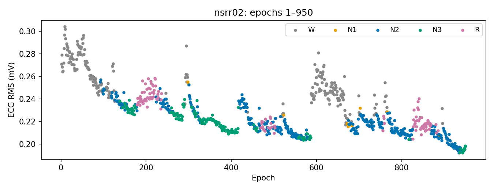
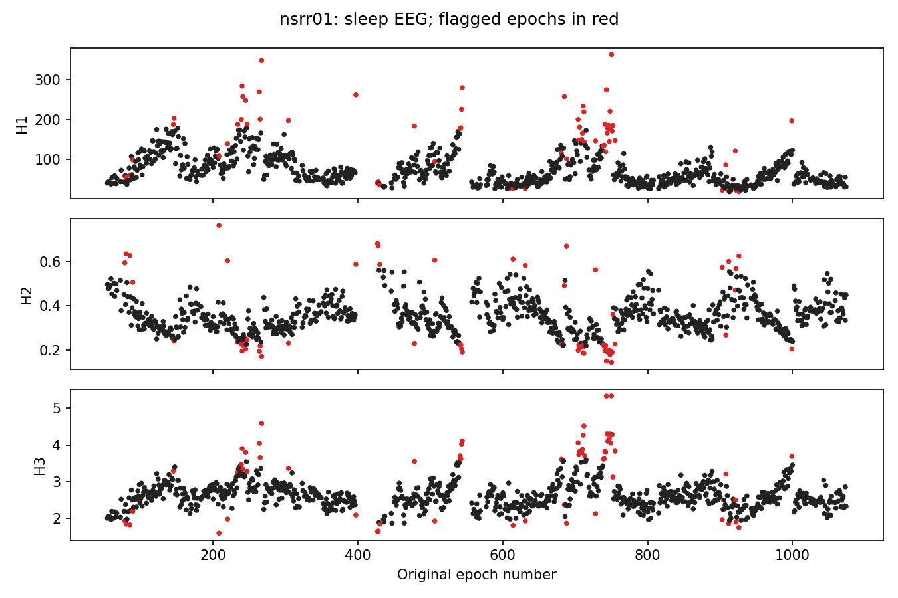
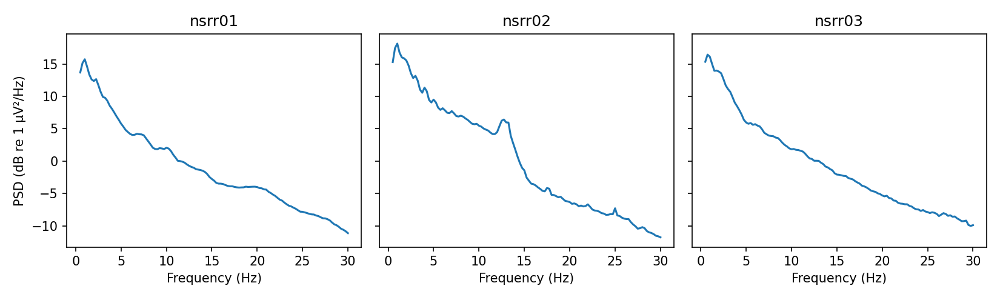

# Deeper dive in Python

This third page builds on [Quick start](python1.md) and [Take two](python2.md)
to examine overnight signal changes, sleep architecture, epoch masks,
signal transformations, artifacts, power spectra, and spindles. All
processing and plotting stay in Python. Follow the examples as notebook
cells, as described in [Quick start](python1.md).

## Setup

Use the same extracted tutorial folder. The setup below is complete
for a fresh notebook kernel; change `~/tutorial` to your data location:

```python
import os

import lunapi as lp
import numpy as np
import pandas as pd
import matplotlib.pyplot as plt

os.chdir(os.path.expanduser("~/tutorial"))
```

```python
proj = lp.proj()
proj.sample_list("s.lst")

os.makedirs("python-output", exist_ok=True)
```

Run the cells in order, retrieving any result tables you want to keep
before the next Luna command. Several sections start a different
analysis, so they use `proj.reinit()` to clear previous settings before
loading the inputs again.

Plots appear below their cells. The main figures are also saved under
`python-output/`.

## Epoch-level summaries

An epoch is a fixed-length interval used to organize a recording. Sleep
stages here are scored in 30-second epochs. Calculate per-epoch ECG
and EMG statistics for the second recording:

```python
p = proj.inst("nsrr02")
result = p.proc("""
    EPOCH len=30
    STATS epoch sig=ECG,EMG
""")
epoch_stats = result.table("STATS", "CH_E")
epoch_stats["E"] = pd.to_numeric(epoch_stats["E"])
epoch_stats["RMS"] = pd.to_numeric(epoch_stats["RMS"])

ecg = epoch_stats.loc[epoch_stats["CH"] == "ECG"].sort_values("E").copy()
len(ecg)
```

```text
1195
```

```python
ecg[["ID", "E", "RMS"]].head(3).round(4)
```

```text
       ID  E     RMS
0  nsrr02  1  0.2711
1  nsrr02  2  0.2790
2  nsrr02  3  0.2684
```

The 1,195 epochs represent 35,850 seconds, or 9 hours 57 minutes
30 seconds. `RMS` is the root mean square of the ECG values in each
epoch, in the ECG's recorded units (mV for these inputs).

Plotting every epoch exposes large changes toward the recording's end:

```python
fig, ax = plt.subplots(figsize=(9, 3))
ax.scatter(ecg["E"], ecg["RMS"], s=8)
ax.set(xlabel="Epoch", ylabel="ECG RMS (mV)", title="nsrr02: full recording")
fig.tight_layout()
plt.show()
plt.close(fig)
```

To see how these changes relate to sleep, combine the ECG statistics
with the manual stage labels. Matching on recording ID (`ID`) and epoch
number (`E`) ensures that each measurement gets the correct stage,
even if the tables have different row orders:

```python
stages = p.stages()
stages["E"] = pd.to_numeric(stages["E"])
ecg = ecg.merge(stages[["ID", "E", "STAGE"]], on=["ID", "E"],
                validate="one_to_one")
stages["STAGE"].value_counts().sort_index()
```

```text
STAGE
N1     11
N2    399
N3    185
R     120
W     480
Name: count, dtype: int64
```

The unusual final epochs are wake. For a clearer view of earlier
variation, show the first 950 epochs and color points by stage:

```python
stage_colors = {"W": "#888888", "N1": "#e69f00", "N2": "#0072b2",
                "N3": "#009e73", "R": "#cc79a7"}
shown = ecg.loc[ecg["E"] <= 950]
fig, ax = plt.subplots(figsize=(9, 3.5))
for stage, color in stage_colors.items():
    group = shown.loc[shown["STAGE"] == stage]
    ax.scatter(group["E"], group["RMS"], s=9, color=color, label=stage)
ax.set(xlabel="Epoch", ylabel="ECG RMS (mV)", title="nsrr02: epochs 1–950")
ax.legend(ncol=5, fontsize=9)
fig.tight_layout()
fig.savefig("python-output/ecg-rms.png", dpi=150)
plt.show()
plt.close(fig)
```

{width="100%"}

Restricting the plot is only for display; `ecg` still contains the full
recording. `epoch_stats` also retains the EMG statistics for further
analysis.

## Hypnograms

For a simple overview, count the minutes in each manually scored stage
of the first recording:

```python
p = proj.inst("nsrr01")
p.epoch("len=30")
stages = p.stages()
minutes = stages["STAGE"].value_counts().sort_index() * 0.5
minutes
```

```text
STAGE
N1     54.5
N2    261.5
N3      8.5
R     119.0
W     238.5
Name: count, dtype: float64
```

Multiplying the epoch counts by half a minute gives the time in each
stage. These stages come from the manual annotations supplied with the
data. We can plot them as a hypnogram to show how sleep progresses
through the night:

```python
stages["E"] = pd.to_numeric(stages["E"])
stages = stages.sort_values("E")
stage_order = ["W", "R", "N1", "N2", "N3"]
levels = {stage: level for level, stage in enumerate(stage_order)}
fig, ax = plt.subplots(figsize=(9, 2.5))
ax.step((stages["E"] - 1) / 120, stages["STAGE"].map(levels), where="post")
ax.set_yticks(range(len(stage_order)), stage_order)
ax.invert_yaxis()
ax.set(xlabel="Hours from recording start", title="nsrr01: manual sleep stages")
fig.tight_layout()
plt.show()
plt.close(fig)
```

We can also just use Lunapi's convenience function to plot a hypnogram:
```python
p.hypno()
```

---

For detailed measures of sleep architecture, run `HYPNO` across all
three individuals:

```python
result = proj.proc("""
    EPOCH len=30
    HYPNO epoch
""")
night = result.table("HYPNO", "BL")
stage_minutes = result.table("HYPNO", "SS")
cycles = result.table("HYPNO", "C")
hyp_epochs = result.table("HYPNO", "E")

summary = night[["ID", "TST", "SE"]].copy()
summary[["TST", "SE"]] = summary[["TST", "SE"]].astype(float)
summary.round(2)
```

```text
       ID    TST     SE
0  nsrr01  443.5  65.03
1  nsrr02  357.5  59.83
2  nsrr03  224.0  32.84
```

`TST` is total sleep time in minutes; `SE` is sleep efficiency in
percent. The other tables describe stage totals (`SS`), cycles (`C`),
and individual epochs (`E`). For example, compare NREM and REM minutes
across recordings:

```python
sleep_minutes = stage_minutes.loc[stage_minutes["SS"].isin(["N1", "N2", "N3", "R"])]
sleep_minutes = sleep_minutes.pivot(index="ID", columns="SS", values="MINS")
sleep_minutes.reindex(columns=["N1", "N2", "N3", "R"]).astype(float)
```

```text
SS        N1     N2    N3      R
ID
nsrr01  54.5  261.5   8.5  119.0
nsrr02   5.5  199.5  92.5   60.0
nsrr03  26.0  187.5  10.5    0.0
```

The [HYPNO reference](../ref/hypnograms.md#hypno) describes the additional
measures and their definitions, including persistent sleep and cycle
criteria.

## Epoch-level masks

A mask excludes epochs from subsequent analyses. To illustrate
combining criteria, select epochs in `nsrr01` that:

- overlap 11pm–3am;
- are in persistent sleep;
- are N2;
- do not overlap obstructive-apnea or hypopnea events.

First open the original recording again. We will use `HYPNO` to find
epochs in persistent sleep, then turn their start and stop times into
an annotation that we can use for masking:

```python
p = proj.inst("nsrr01")
p.epoch("len=30")
epochs = p.epochs()
result = p.proc("HYPNO epoch")
h = result.table("HYPNO", "E")
persistent_ids = pd.to_numeric(h.loc[pd.to_numeric(h["PERSISTENT_SLEEP"]) == 1, "E"])
persistent = epochs.loc[pd.to_numeric(epochs["E"]).isin(persistent_ids),
                        ["START", "STOP"]].astype(float)
p.insert_annot("persistent_sleep", list(persistent.itertuples(index=False, name=None)))
```

`insert_annot()` expects start and stop times in seconds, which we get
from the epoch timing table. Here persistent sleep follows Luna's
default hypnogram criteria; it does not include every non-wake epoch.

Each mask below narrows the selection further. The later restrictions
use `mask-ifnot`, which leaves previously excluded epochs excluded.
This ensures that the final selection meets all four criteria:

```python
p.eval("""
    MASK none
    MASK hms=23:00:00-03:00:00
    MASK mask-ifnot=persistent_sleep
    MASK mask-ifnot=N2
    MASK mask-if=Obstructive_Apnea,Hypopnea
""")

result = p.proc("DUMP-MASK")
mask = result.table("DUMP_MASK", "E")
mask["EMASK"] = pd.to_numeric(mask["EMASK"])
mask["EMASK"].value_counts().sort_index()
```

```text
EMASK
0      86
1    1278
Name: count, dtype: int64
```

The `DUMP-MASK` command produces a table named `DUMP_MASK` in Python.
In its `EMASK` column, 0 means retained and 1 means excluded, leaving
86 epochs in this example. Both clock-time and annotation matching
count any overlap, including a partial epoch at a boundary.

Now restructure the recording to retain only the unmasked epochs:

```python
p.eval("RE")
kept = p.epochs()
kept[["E", "E1", "START", "STOP"]].head(3)
```

```text
     E E1   START    STOP
0  124  1  3690.0  3720.0
1  127  2  3780.0  3810.0
2  128  3  3810.0  3840.0
```

```python
len(kept)
```

```text
86
```

`E` preserves the original epoch number; `E1` counts the retained epochs
consecutively. Start and stop times remain seconds from the original
recording start. `RE` changes only the in-memory recording. To return
to the input files, use `p.refresh()` or open a new instance.

Use `p.eval()` for the separate mask steps above. The convenience method
`p.mask()` also restructures immediately, so it is not a substitute
when you want to inspect masks before restructuring.

## Manipulating EDFs

Now rescale, resample, filter, re-reference, and export the two EEG
channels. Reset engine settings, load the tutorial aliases, and select
only those channels before processing:

```python
proj.reinit()
proj.sample_list("s.lst")
proj.include("cmd/vars.txt")
proj.vars("sig", "EEG1,EEG2")
```

Here `EEG1` aliases source channel `EEG` and `EEG2` aliases `EEG(sec)`.
The following pipeline:

1. Converts signal units to millivolts.
2. Resamples both EEGs to 100 Hz.
3. Applies a 0.3–35 Hz band-pass FIR filter.
4. Subtracts `EEG1` from `EEG2`.
5. Writes new EDFs and a sample list for them.

Save the new EDFs in `new-edfs/` and their sample list in `new.lst`:

```python
proj.proc("""
    mV
    RESAMPLE sr=100
    FILTER bandpass=0.3,35 ripple=0.02 tw=1 fft
    REFERENCE sig=EEG2 ref=EEG1
    WRITE edf-tag=v2 edf-dir=new-edfs/ sample-list=new.lst
""")
```

Reference signals must have matching sampling rates. `WRITE` creates
`new-edfs/` if needed and appends to `new.lst`; remove `new.lst` before
rerunning this cell to avoid duplicate entries.

Inspect the exported headers, then restore the original sample list:

```python
proj.sample_list("new.lst")
result = proj.proc("HEADERS")
new_headers = result.table("HEADERS", "CH")
new_headers[["ID", "CH", "SR", "PDIM"]]
```

```text
       ID    CH     SR PDIM
0  nsrr01  EEG1  100.0   mV
1  nsrr02  EEG1  100.0   mV
2  nsrr03  EEG1  100.0   mV
3  nsrr01  EEG2  100.0   mV
4  nsrr02  EEG2  100.0   mV
5  nsrr03  EEG2  100.0   mV
```

```python
proj.sample_list("s.lst")
```

Each exported recording has two EEG channels, sampled at 100 Hz and
expressed in mV. The original EDFs are unchanged. The new sample list
contains the exported EDF paths; it does not automatically retain the
XML annotation-file links. Subsequent sections explicitly return to
the original annotated inputs.

## Artifact detection

This example screens the original first EEG for likely artifacts. It
first drops wake, filters the EEG, and calculates epoch-level Hjorth
parameters. Reset engine settings so that `EEG` again means the
original channel, rather than the alias `EEG1`:

```python
proj.reinit()
proj.sample_list("s.lst")
proj.vars("sig", "EEG")
p = proj.inst("nsrr01")

result = p.proc("""
    EPOCH len=30
    MASK if=W
    RE
    FILTER sig=EEG bandpass=0.3,35 ripple=0.02 tw=1 fft
    SIGSTATS sig=EEG epoch
""")
hjorth = result.table("SIGSTATS", "CH_E")
whole_hjorth = result.table("SIGSTATS", "CH")
whole_hjorth[["ID", "CH", "H1", "H2", "H3"]]
```

```text
       ID   CH         H1        H2        H3
0  nsrr01  EEG  78.383424  0.353618  2.651092
```

The Hjorth parameters describe signal activity (`H1`), mobility (`H2`),
and complexity (`H3`). Looking at them epoch by epoch helps reveal
unusual periods that a whole-night summary can hide.

Refresh the instance to restore the input signal, then apply the same
preprocessing plus two artifact checks:

```python
p.refresh()
result = p.proc("""
    EPOCH len=30
    MASK if=W
    RE
    FILTER sig=EEG bandpass=0.3,35 ripple=0.02 tw=1 fft
    SIGSTATS sig=EEG epoch
    ARTIFACTS sig=EEG mask
    CHEP-MASK sig=EEG ep-th=3,3,3
    CHEP epochs
    DUMP-MASK
""")
hjorth = result.table("SIGSTATS", "CH_E")
artifact_mask = result.table("DUMP_MASK", "E")
artifact_mask["EMASK"] = pd.to_numeric(artifact_mask["EMASK"])
artifact_mask["EMASK"].value_counts().sort_index()
```

```text
EMASK
0    823
1     64
Name: count, dtype: int64
```

`ARTIFACTS` uses a sleep-EEG artifact screen. `CHEP-MASK` flags channel/epoch
outliers using repeated thresholds on signal statistics; the three `3`
values request three iterations. `CHEP epochs` turns flagged channel/epoch
pairs into epoch exclusions. For this single-channel example, 64 of
887 sleep epochs are flagged by the combined checks.

Join the Hjorth values to the mask and plot flagged epochs in red:

```python
qc = hjorth.merge(artifact_mask[["ID", "E", "EMASK"]], on=["ID", "E"],
                  validate="one_to_one")
for column in ["E", "H1", "H2", "H3", "EMASK"]:
    qc[column] = pd.to_numeric(qc[column])
qc = qc.sort_values("E")

fig, axes = plt.subplots(3, 1, figsize=(9, 6), sharex=True)
colors = np.where(qc["EMASK"] == 1, "#d62728", "#222222")
for ax, metric in zip(axes, ["H1", "H2", "H3"]):
    ax.scatter(qc["E"], qc[metric], c=colors, s=7)
    ax.set_ylabel(metric)
axes[-1].set_xlabel("Original epoch number")
fig.suptitle("nsrr01: sleep EEG; flagged epochs in red")
fig.tight_layout()
fig.savefig("python-output/artifact-hjorth.png", dpi=150)
plt.show()
plt.close(fig)
```

{width="100%"}

These thresholds illustrate the method. Inspect the signals and decide
whether stage-specific thresholds or other criteria suit your study;
statistical outliers do not automatically mean unusable physiology.

### Inspecting a flagged epoch

Choose a flagged epoch from the result rather than assuming a fixed
number. Reload the raw signal, extract that epoch, and convert the
returned array to a pandas data frame:

```python
flagged_epoch = int(qc.loc[qc["EMASK"] == 1, "E"].iloc[0])
p.refresh()
p.epoch("len=30")
columns, values = p.slice(p.e2i(flagged_epoch), "EEG", time=True)
raw = pd.DataFrame(values, columns=columns)
len(raw)
```

```text
3750
```

```python
fig, ax = plt.subplots(figsize=(9, 3))
ax.plot(raw["T"] - raw["T"].iloc[0], raw["EEG"], linewidth=0.7)
ax.set(xlabel="Seconds within epoch", ylabel="EEG (µV)",
       title=f"nsrr01: original epoch {flagged_epoch}")
fig.tight_layout()
plt.show()
plt.close(fig)
```

The 3,750 samples are what we expect for 30 seconds at 125 Hz.
`p.slice()` returns column names and a NumPy array, which we combine
into a data frame above. `p.e2i()` converts the epoch number into the
time interval that `slice()` needs. For a window specified in seconds,
use `p.s2i([(start_seconds, stop_seconds)])` instead.

## Spectral and spindle analyses

We will now retain N2 sleep, clean the first EEG, estimate its power
spectrum, detect spindles, and save the spindle annotations. Reset the
engine, load the EEG aliases, and select `EEG1`:

```python
proj.reinit()
proj.sample_list("s.lst")
proj.include("cmd/vars.txt")
proj.vars("sig", "EEG1")

result = proj.proc("""
    EPOCH len=30
    MASK ifnot=N2
    RE
    FILTER sig=EEG1 bandpass=0.3,35 ripple=0.02 tw=1 fft
    ARTIFACTS sig=EEG1 mask
    CHEP-MASK sig=EEG1 ep-th=3,3,3
    CHEP epochs
    RE
    PSD sig=EEG1 spectrum max=30
    SPINDLES sig=EEG1 fc=11,15 annot=spindles per-spindle
    WRITE-ANNOTS file=python-output/spindles-^.annot annot=spindles
""")
spectrum = result.table("PSD", "CH_F")
band_power = result.table("PSD", "B_CH")
density = result.table("SPINDLES", "CH_F")
spindles = result.table("SPINDLES", "CH_F_SPINDLE")

for column in ["F", "PSD"]:
    spectrum[column] = pd.to_numeric(spectrum[column])
spectrum.loc[spectrum["ID"] == "nsrr01",
                   ["ID", "CH", "F", "PSD"]].head(3).round(3)
```

```text
       ID    CH     F     PSD
0  nsrr01  EEG1  0.50  23.343
3  nsrr01  EEG1  0.75  32.652
6  nsrr01  EEG1  1.00  37.380
```

The first `RE` removes non-N2 epochs. The second removes epochs flagged
by the artifact checks. `PSD spectrum` estimates power spectral density
using Welch's method and returns both standard-band summaries and
frequency-bin output. `CH_F` identifies channel and frequency; `B_CH`
identifies a frequency band and channel. Inspect `band_power` for those
band summaries.

`F` is in Hz and `PSD` in µV²/Hz for these original EEG inputs. Plot the
cleaned N2 spectra on a decibel scale, using `10 * log10(PSD)`:

```python
fig, axes = plt.subplots(1, 3, figsize=(11, 3.3), sharey=True)
for ax, individual_id in zip(axes, ["nsrr01", "nsrr02", "nsrr03"]):
    group = spectrum.loc[spectrum["ID"] == individual_id].sort_values("F")
    ax.plot(group["F"], 10 * np.log10(group["PSD"]))
    ax.set(xlabel="Frequency (Hz)", title=individual_id)
axes[0].set_ylabel("PSD (dB re 1 µV²/Hz)")
fig.tight_layout()
fig.savefig("python-output/n2-spectra.png", dpi=150)
plt.show()
plt.close(fig)
```

{width="100%"}

The sigma-frequency peak is especially visible for `nsrr02`. A peak
in this range is consistent with spindle activity; the next analysis
identifies individual candidate spindle events.

### Comparing unfiltered spectra

For comparison, calculate spectra on both original EEG channels,
excluding wake but without the band-pass filter or artifact screen.
Reload settings to include both channels:

```python
proj.reinit()
proj.sample_list("s.lst")
proj.include("cmd/vars.txt")
proj.vars("sig", "EEG1,EEG2")
result = proj.proc("""
    EPOCH len=30
    MASK if=W
    RE
    PSD sig=EEG1,EEG2 spectrum max=62
""")
raw_spectrum = result.table("PSD", "CH_F")
for column in ["F", "PSD"]:
    raw_spectrum[column] = pd.to_numeric(raw_spectrum[column])

fig, axes = plt.subplots(2, 3, figsize=(11, 6), sharex=True)
for row, channel in enumerate(["EEG1", "EEG2"]):
    for col, individual_id in enumerate(["nsrr01", "nsrr02", "nsrr03"]):
        group = raw_spectrum.loc[(raw_spectrum["ID"] == individual_id) &
                                 (raw_spectrum["CH"] == channel)].sort_values("F")
        axes[row, col].plot(group["F"], 10 * np.log10(group["PSD"]))
        axes[row, col].set(title=f"{individual_id}: {channel}", xlabel="Frequency (Hz)")
    axes[row, 0].set_ylabel("PSD (dB re 1 µV²/Hz)")
fig.tight_layout()
plt.show()
plt.close(fig)
```

The 62 Hz limit stays below the original EEG's 62.5 Hz Nyquist
frequency. Compare the low-frequency contamination and line-frequency
peaks with the cleaned spectra. Both channel and individual matter;
a single preprocessing choice may not suit all recordings.

### Spindle densities and annotations

We saved the cleaned N2 results in `density` and `spindles` before
running the unfiltered analysis, so we can return to them now.
Here is the spindle density for each detector frequency:

```python
density["F"] = pd.to_numeric(density["F"])
density["DENS"] = pd.to_numeric(density["DENS"])
wide_density = density.pivot(index=["ID", "CH"], columns="F", values="DENS")
wide_density.round(3)
```

```text
F             11.0   15.0
ID     CH
nsrr01 EEG1  0.771  0.661
nsrr02 EEG1  1.447  2.218
nsrr03 EEG1  0.784  0.167
```

`F` here is the spindle detector's target frequency: 11 Hz for slower
spindles and 15 Hz for faster spindles. `DENS` is detections per minute
of the retained N2 data. The two detectors can produce overlapping
candidates; their counts should not simply be added as a count of
unique physiological events.

The `per-spindle` option provides individual-event measurements:

```python
for column in ["F", "START", "STOP"]:
    spindles[column] = pd.to_numeric(spindles[column])
second_spindles = spindles.loc[spindles["ID"] == "nsrr02"].sort_values("START")
second_spindles[["CH", "F", "START", "STOP"]].head(3).round(3)
```

```text
     CH     F     START      STOP
1  EEG1  11.0  2747.704  2748.392
4  EEG1  11.0  2751.304  2751.896
7  EEG1  11.0  2764.040  2764.592
```

`START` and `STOP` are seconds from recording start, even though the
analysis excluded other epochs. `WRITE-ANNOTS` also saved these events
under the class name `spindles`, with `^` replaced by each individual's
ID: `python-output/spindles-nsrr01.annot`, and similarly for `nsrr02`
and `nsrr03`. The files include event metadata as well as timing.

Reload the original EEG and attach the generated annotations to inspect
one detected event in the raw signal:

```python
proj.vars("sig", "EEG1")
p = proj.inst("nsrr02")
p.epoch("len=30")
p.attach_annot("python-output/spindles-nsrr02.annot")
events = p.fetch_fulls_annots("spindles")

event = events.iloc[len(events) // 2]
window = (float(event["Start"]) - 5, float(event["Stop"]) + 5)
columns, values = p.slice(p.s2i([window]), "EEG1", annots="spindles", time=True)
segment = pd.DataFrame(values, columns=columns)

fig, axes = plt.subplots(2, 1, figsize=(9, 4), sharex=True)
seconds = segment["T"] - segment["T"].iloc[0]
axes[0].plot(seconds, segment["EEG1"], linewidth=0.8)
axes[0].set_ylabel("Raw EEG1 (µV)")
axes[1].step(seconds, segment["spindles"], where="post", color="#0072b2")
axes[1].set(xlabel="Seconds within window", ylabel="Spindle", yticks=[0, 1])
fig.tight_layout()
plt.show()
plt.close(fig)
```

The annotation table identifies each event's detector frequency in
`Instance` and signal in `Channel`. We choose one event and use `s2i()`
to convert its surrounding window from seconds to an interval for
`slice()`. In the extracted data, `T` is seconds from recording start,
and `spindles` is 1 inside a detected event and 0 outside.

The `ARTIFACTS`, `CHEP-MASK`, `PSD`, and `SPINDLES` commands have many
additional options. Their [reference pages](../ref/index.md) provide
those details. The three Python tutorial pages give you a complete path
from the input files to pandas results and plots; you can extend the
same project/instance workflow to other Luna analyses.
