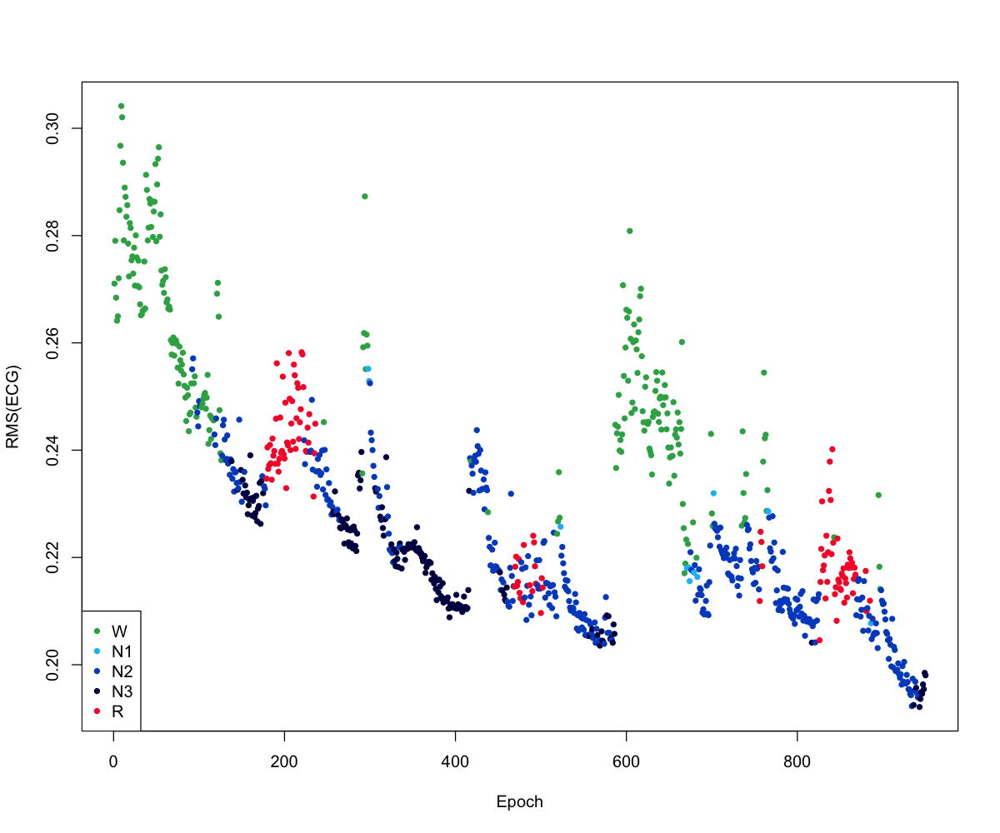
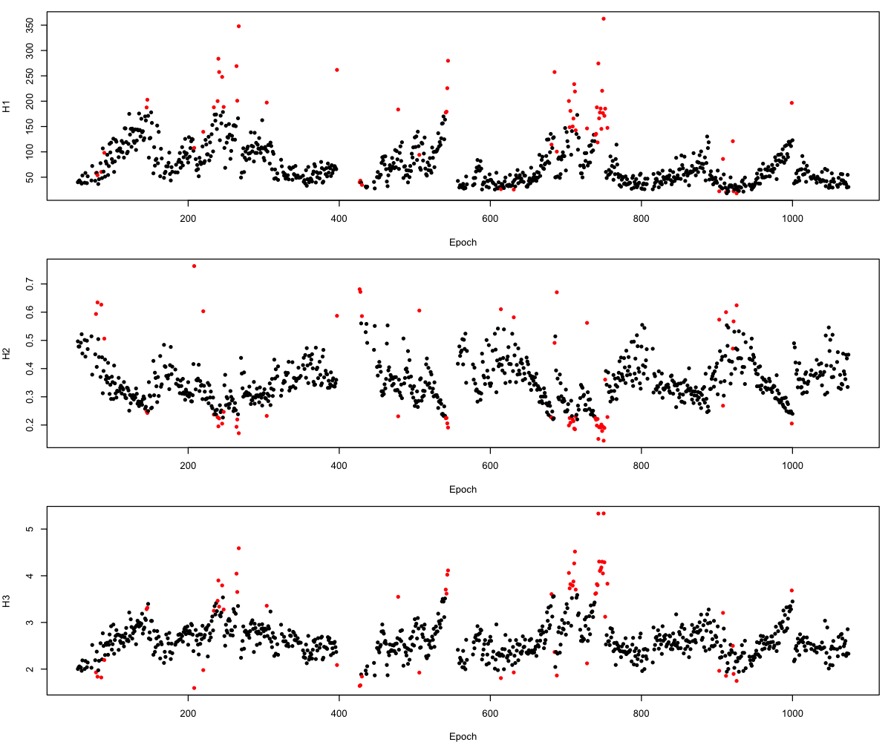
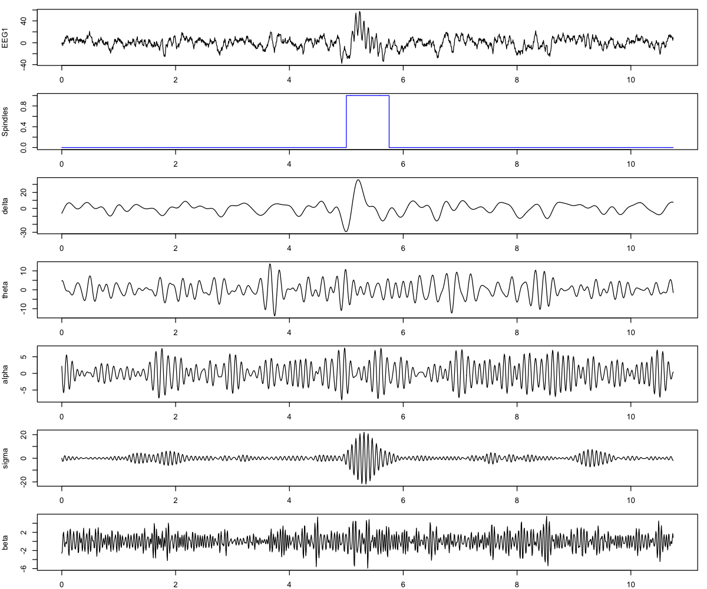

# /R/epeat

This tutorial repeats the analyses from [Quick start](tut1.md),
[Take two](tut2.md), and [Deeper dive](tut3.md) using the **`luna` 1.8.0
R package**. It uses the same Luna commands, with projects and recording
instances in R:

```r
library(luna)
p <- lp$proj()
```

If you have not installed the package, follow the
[R installation notes](../download/lunar.md). The latest GitHub route is
`pak::pak("remnrem/lunaR")`; use `pak::pak("remnrem/lunaR@v1.8.0")` for
the fixed R release. Those notes also explain how to pin lunapi or
select an existing Python environment before loading Luna. Docker is
optional.

The examples below show selected outputs from the tutorial data, with
short tables and rounded values to keep the results easy to follow.

## Obtaining the data

Download and extract the [tutorial data](../download/data.md). Change
the path below to the extracted folder containing `s.lst`, `edfs`, and
`cmd`. If you use a Docker image with the data at `/tutorial`, copy that
folder to a writable location first.

```r
setwd("~/tutorial")
list.files()
p$sample_list("s.lst")
p$sample_list()
valid <- p$validate()
print(unique(valid[, c("ID", "Valid")]), row.names = FALSE)
```

```text
     ID Valid
 nsrr01  TRUE
 nsrr02  TRUE
 nsrr03  TRUE
```

Check that the input files have `Valid = TRUE`. All subsequent paths in
this tutorial are relative to this directory. Output files will also be
written here; use a fresh working copy if you have already run the
file-writing examples.

## Displaying EDF files

Open the first individual, using either its ID or its 1-based
sample-list position:

```r
i <- p$inst("nsrr01")
i$desc()
i$chs()
i$headers()
```

`p$inst(1)` selects the same individual. `i` now holds the recording,
including the annotation files listed in `s.lst`. Sampling rates vary
between channels; for example:

```r
headers <- i$headers()
print(headers[headers$CH %in% c("ECG", "EEG", "SaO2"), c("CH", "SR")],
      row.names = FALSE)
```

```text
   CH  SR
  ECG 250
  EEG 125
 SaO2   1
```

`SR` is the sampling rate in Hz.

To run the same [`DESC`](../ref/summaries.md#desc) command as in the
command-line tutorial:

```r
i$eval("DESC")
```

Use `i$eval()` when you want to run commands on this recording. Use
`i$proc()` when you also want to keep their output tables. For all
recordings in the sample list, use `p$proc()`.

## Signal summary statistics

Run [`STATS`](../ref/summaries.md#stats) on the open recording:

```r
k <- i$proc("STATS")
print(k$strata(), row.names = FALSE)
d <- k$table("STATS", "CH")
print(d[d$CH %in% c("ECG", "EEG", "EMG"), c("CH", "MEAN", "RMS")],
      row.names = FALSE, digits = 4)
```

```text
 Command Strata
   STATS     CH
  CH      MEAN     RMS
 ECG  0.009396  0.2667
 EEG -0.301199 37.8014
 EMG -6.855696 13.9701
```

`k` is a saved result (`ProcResult`); `d` is an ordinary R data frame.
`CH` selects the table with one row per channel. Display all of this
run's tables with `k$tables`, or list their names with `k$keys()`.

To process all three tutorial individuals:

```r
k <- p$proc("STATS")
d <- k$table("STATS", "CH")
print(head(d[d$CH %in% c("ECG", "EMG", "SaO2"), c("ID", "CH", "MEAN")], 3),
      row.names = FALSE, digits = 4)
```

```text
     ID  CH     MEAN
 nsrr01 ECG 0.009396
 nsrr02 ECG 0.005671
 nsrr03 ECG 0.003571
```

This is the R equivalent of `luna s.lst -o out.db -s STATS` followed by
extracting the channel-level table with destrat. In R, the results are
already data frames.

Commands on `i` retain changes to its in-memory signals and masks.
Project runs with `p$proc()` load each recording from its source files,
so edits made to `i` do not become edits to the whole cohort. To restore
an instance after filtering or masking, use `i$refresh()`.

## Working with annotations

Open `nsrr01` and list its annotations:

```r
i <- p$inst("nsrr01")
i$annots()
```

Annotation names are **case-sensitive**. These tutorial data include
`Arousal`, `Obstructive_Apnea`, and `Hypopnea`; use those spellings in
commands and R methods.

Retrieve apnea events as a data frame with start/stop seconds:

```r
apneas <- i$fetch_annots("Obstructive_Apnea")
print(head(apneas, 3), row.names = FALSE)
```

```text
             Class  Start   Stop
 Obstructive_Apnea 2300.7 2310.7
 Obstructive_Apnea 2329.6 2343.1
 Obstructive_Apnea 4933.6 4953.2
```

Use `i$fetch_full_annots("Obstructive_Apnea")` if you also want event
instance IDs, channel labels, and metadata.

Set 30-second epochs and inspect stages and annotation coverage:

```r
i$epoch("len=30")
epochs <- i$epochs()
stages <- i$stages()
head(epochs)
table(stages$STAGE)
coverage <- i$proc("ESPAN annot=Arousal,Obstructive_Apnea,Hypopnea has=T")
coverage$strata()
head(coverage$table("ESPAN", c("ANNOT", "E")))
```

The stage counts from `table(stages$STAGE)` are:

```text
 N1  N2  N3   R   W
109 523  17 238 477
```

`epochs()` returns epoch timing; `stages()` returns a data frame with
one sleep-stage label per epoch. These read the manual staging
annotations, rather than predicting stages from the signals.
[`ESPAN`](../ref/annotations.md#espan) describes annotation coverage per
epoch, including the `HAS` indicator requested here.

Count annotation events across all individuals:

```r
k <- p$proc("ANNOTS")
d <- k$table("ANNOTS", "ANNOT")
print(d[d$ANNOT == "Obstructive_Apnea", c("ID", "COUNT", "DUR")],
      row.names = FALSE)
```

```text
     ID COUNT    DUR
 nsrr01    37  824.5
 nsrr02     5   67.7
 nsrr03   163 3795.6
```

`COUNT` is the event count and `DUR` is the total event duration in seconds.

For REM-specific counts, restrict the epochs before running `ANNOTS`:

```r
k_rem <- p$proc("EPOCH len=30 & MASK ifnot=R & ANNOTS")
d_rem <- k_rem$table("ANNOTS", "ANNOT")
print(d_rem[d_rem$ANNOT == "Obstructive_Apnea", c("ID", "COUNT", "DUR")],
      row.names = FALSE)
```

```text
     ID COUNT   DUR
 nsrr01    27 668.4
 nsrr02     3  43.4
```

The [`ANNOTS`](../ref/annotations.md#annots) reference explains how event
counts and durations interact with masks. Individuals without REM may
have no rows in this result.

## Putting it together

The tutorial's `cmd/first.txt` file sets 30-second epochs, labels the
output by a `${stage}` variable, retains that stage, and runs EEG
statistics. Read it from R:

```r
commands <- lp$cmdfile("cmd/first.txt")
cat(commands)
```

`cmdfile()` reads the text; Luna handles its comments and command syntax.
Set the variable, then run the file across the sample list:

```r
p$vars("stage", "N1")
p$vars("stage")
k <- p$proc(commands)
k$strata()
d <- k$table("STATS", c("CH", "STAGE"))
d[, c("ID", "CH", "STAGE", "RMS")]
```

The script's [`TAG`](../ref/summaries.md#tag) adds a `STAGE` factor to
the output, so this table has strata `CH_STAGE`, rather than just `CH`.

Repeat for several stages, keeping each run's results:

```r
stgs <- c("N1", "N2", "N3", "R")
by_stage <- list()
for (stage in stgs) {
  p$vars("stage", stage)
  by_stage[[stage]] <- p$proc(commands)
}
d <- lp$concat(by_stage, "STATS: CH_STAGE")
print(with(d, tapply(RMS, list(ID, STAGE), mean)), digits = 4)
p$clear_vars("stage")
```

```text
           N1    N2    N3      R
nsrr01  7.355 10.65 13.01  7.564
nsrr02 10.362 14.74 20.05 14.146
nsrr03 12.302 14.50 18.98     NA
```

`lp$concat()` collects the same table from the saved runs. The results
for earlier stages remain available after subsequent runs. `nsrr03` has
no REM in these data, so a missing REM result for that individual is
expected.

Each `p$proc()` run starts from the source recordings; the N1 mask from
one run does not carry over into the N2 run. In contrast, consecutive
commands on an instance share its current state.

### Inspecting signal values in R

You can also extract a signal directly, without defining epochs:

```r
i <- p$inst("nsrr01")
x <- i$data("EEG")$EEG
length(x)
median(x)
hist(x[x > -10 & x < 10], breaks = 100,
     xlab = "EEG", main = "Signal values near zero")
rm(x)
```

The discrete signal values reflect the EDF's digital-to-physical scaling.
For a short interval instead of the whole recording, use `i$slice()`
with intervals from `i$s2i()`; examples appear below.

## Using destrat

For analyses run in R, retrieve tables directly and save them with the
usual R functions:

```r
saveRDS(by_stage$N2$tables, "N2-results.rds")
write.csv(by_stage$N2$table("STATS", "CH_STAGE"),
          "N2-stats.csv", row.names = FALSE)
```

You can also import SQLite output databases created by the command-line
Luna tools. For example, in a terminal with `luna` installed:

```bash
luna s.lst -o out.db -s 'EPOCH & STATS sig=ECG,EEG epoch'
destrat out.db
```

If you use the Python command-line tools, `luna.py` and `destrat.py`
provide the corresponding route. A separate command-line installation
is only needed to run this terminal example, not for the other R
analyses on this page.

Back in R, import the database and retrieve its tables:

```r
p$import_db("out.db")
p$strata()
db_stats <- p$table("STATS", c("CH", "E"))
head(db_stats)
```

This reads results, not the source EDFs. For R-only workflows, keep
using `p$proc()` and `i$proc()` to collect results directly.

## Parameter files

The file `cmd/vars.txt` supplies aliases and variables used by later
scripts. Reset the shared engine and reopen the sample list before
this next analysis:

```r
p$reinit()
p$sample_list("s.lst")
p$include("cmd/vars.txt")
i <- p$inst("nsrr01")
i$chs()
unlist(p$vars(c("eeg", "myepoch", "nrem")))
```

```text
        eeg     myepoch        nrem
"EEG1,EEG2"        "10"  "N1,N2,N3"
```

`p$reinit()` clears engine state, so create new instances afterwards.
The parameter file defines `EEG1` and `EEG2` as aliases for the two EEG
channels, and `OXSTAT` for the oximeter status channel. It also sets
`${eeg}`, `${myepoch}`, and `${nrem}`.

The commands in `cmd/second.txt` use those variables to calculate
statistics on the EEG channels during NREM sleep:

```r
cat(lp$cmdfile("cmd/second.txt"))
k <- i$proc(lp$cmdfile("cmd/second.txt"))
k$table("STATS", "CH")
```

Load parameters **before opening the instance** so the input labels and
signal selection are applied as intended. Use `p$vars(key, value)` for
individual assignments and `p$include(file)` for a parameter file.

## Epoch-level summaries

Open `nsrr02` and calculate per-epoch ECG statistics. Explicitly set
30-second epochs instead of inheriting the preceding script's 10-second
choice:

```r
i <- p$inst("nsrr02")
k <- i$proc("EPOCH len=30 & STATS epoch sig=ECG")
d <- k$table("STATS", c("CH", "E"))
stages <- i$stages()
m <- merge(d, stages[, c("ID", "E", "STAGE")], by = c("ID", "E"))
m <- m[order(m$E), ]
print(head(m[, c("ID", "E", "RMS", "STAGE")], 3),
      row.names = FALSE, digits = 4)
```

```text
     ID E    RMS STAGE
 nsrr02 1 0.2711     W
 nsrr02 2 0.2790     W
 nsrr02 3 0.2684     W
```

Join on `ID` and `E`, rather than assuming signal statistics and stages
have the same row order. This also works after epochs have been
excluded.

As in the command-line tutorial, plot the first 950 epochs to focus on
the earlier portion of this recording:

```r
shown <- m[m$E <= 950, ]
plot(shown$E, shown$RMS, pch = 20, col = lp$stgcol(shown$STAGE),
     xlab = "Epoch", ylab = "RMS(ECG)")
legend("bottomleft", legend = c("W", "N1", "N2", "N3", "R"),
       col = lp$stgcol(c("W", "N1", "N2", "N3", "R")), pch = 20)
```

{width="100%"}

## Hypnograms

For a quick count of minutes in each stage, open `nsrr01` with
30-second epochs:

```r
i <- p$inst("nsrr01")
i$epoch("len=30")
stages <- i$stages()
table(stages$STAGE) / 2
i$hypno()
```

Run [`HYPNO`](../ref/hypnograms.md#hypno) across the whole sample list
for more detailed architecture measures:

```r
hyp <- p$proc("EPOCH len=30 & HYPNO epoch")
hyp$strata()
night <- hyp$table("HYPNO", "BL")
print(night[, c("ID", "TST", "SE")], row.names = FALSE, digits = 4)
stage_minutes <- hyp$table("HYPNO", "SS")
stage_minutes[stage_minutes$SS %in% c("N1", "N2", "N3", "R"),
              c("ID", "SS", "MINS")]
cycles <- hyp$table("HYPNO", "C")
epoch_hyp <- hyp$table("HYPNO", "E")
```

The selected whole-night measures are:

```text
     ID   TST    SE
 nsrr01 443.5 65.03
 nsrr02 357.5 59.83
 nsrr03 224.0 32.84
```

`TST` is total sleep time in minutes; `SE` is sleep efficiency as a
percentage. `BL` is the individual-level table, `SS` is stage-level output, `C`
contains cycle summaries, and `E` contains per-epoch information.

## Epoch-level masks

This example selects epochs that are:

- between 11pm and 3am;
- in persistent sleep;
- in N2;
- free of obstructive-apnea and hypopnea events.

First create an annotation from the persistent-sleep output:

```r
i <- p$inst("nsrr01")
i$epoch("len=30")
epochs <- i$epochs()
h <- i$proc("HYPNO epoch")
hyp_epochs <- h$table("HYPNO", "E")
persistent <- epochs[epochs$E %in%
                       hyp_epochs$E[hyp_epochs$PERSISTENT_SLEEP == 1],
                     c("START", "STOP")]
i$insert_annot("persistent_sleep", persistent)
i$annots()
```

`insert_annot()` takes start/stop **seconds**, which are supplied by
`epochs()` here. By contrast, `e2i()` returns internal nanosecond
intervals for signal extraction; do not pass those directly to
`insert_annot()`.

Apply the masks without restructuring yet:

```r
i$eval(c(
  "MASK none",
  "MASK hms=23:00:00-03:00:00",
  "MASK mask-ifnot=persistent_sleep",
  "MASK mask-ifnot=N2",
  "MASK mask-if=Obstructive_Apnea,Hypopnea"
))
mask_result <- i$proc("DUMP-MASK")
mask <- mask_result$table("DUMP-MASK", "E")
table(mask$EMASK)
head(mask[mask$EMASK == 0, ])
```

The mask counts are:

```text
   0    1
  86 1278
```

`EMASK = 1` means excluded and `0` means retained. Use `eval()` for
these separate mask steps: the convenience `i$mask()` method also runs
`RE` immediately.

Now remove masked epochs from the in-memory recording:

```r
i$eval("RE")
kept_epochs <- i$epochs()
print(head(kept_epochs[, c("E", "E1", "START", "STOP")], 3),
      row.names = FALSE)
nrow(kept_epochs)
```

```text
   E E1 START STOP
 124  1  3690 3720
 127  2  3780 3810
 128  3  3810 3840
[1] 86
```

The 86 retained epochs keep their original epoch numbers in `E`;
`E1` numbers them consecutively after restructuring. `START` and `STOP`
remain seconds from the recording start. Use this timing table to map
retained epochs back to the recording.
The on-disk EDF is unchanged; `i$refresh()` restores it.

## Manipulating EDFs

The `cmd/fourth.txt` script rescales, resamples, filters, re-references,
and writes new EDFs. Start with a clean engine, load the channel
aliases, and select the two EEGs before running it:

```r
p$reinit()
p$sample_list("s.lst")
p$include("cmd/vars.txt")
p$vars("sig", "EEG1,EEG2")
cat(lp$cmdfile("cmd/fourth.txt"))
written <- p$proc(lp$cmdfile("cmd/fourth.txt"))
```

The script writes files under `newedfs/` and a sample list `new.lst`.
Use a fresh output location when repeating it: the sample-list output
can be appended to if it already exists.

Inspect the resulting recordings:

```r
p$sample_list("new.lst")
p$proc("DESC")
new_headers <- p$proc("HEADERS")
headers <- new_headers$table("HEADERS", "CH")
print(headers[, c("ID", "CH", "SR")], row.names = FALSE)
p$sample_list("s.lst")
```

```text
     ID   CH  SR
 nsrr01 EEG1 100
 nsrr02 EEG1 100
 nsrr03 EEG1 100
 nsrr01 EEG2 100
 nsrr02 EEG2 100
 nsrr03 EEG2 100
```

Both output EEG channels now have a sampling rate of 100 Hz.

Reading `new.lst` replaced the project's sample list. The final line
switches back to the original inputs for subsequent analyses.

## Artifact detection

Reset again so that this section uses the original `EEG` label and a
single input channel:

```r
p$reinit()
p$sample_list("s.lst")
p$vars("sig", "EEG")
i <- p$inst("nsrr01")
k <- i$proc(lp$cmdfile("cmd/fifth.txt"))
k$table("SIGSTATS", "CH")
d <- k$table("SIGSTATS", c("CH", "E"))
stages <- i$stages()
m <- merge(d, stages[, c("ID", "E", "STAGE")], by = c("ID", "E"))
```

This script excludes wake, filters the EEG, and reports Hjorth
parameters. Plot them by sleep stage:

```r
par(mfrow = c(3, 1), mar = c(4, 4, 1, 1))
for (metric in c("H1", "H2", "H3")) {
  plot(m$E, m[[metric]], pch = 20, col = lp$stgcol(m$STAGE),
       xlab = "Epoch", ylab = metric)
}
par(mfrow = c(1, 1))
```

The saved result `k` still contains `SIGSTATS` after calling `stages()`.

Refresh before running `cmd/sixth.txt`, which adds artifact masks to
the same preprocessing:

```r
i$refresh()
qc <- i$proc(lp$cmdfile("cmd/sixth.txt"))
qc$strata()
mask <- qc$table("DUMP-MASK", "E")
table(mask$EMASK)
head(mask[mask$EMASK == 1, ])
hj <- qc$table("SIGSTATS", c("CH", "E"))
m <- merge(hj, mask, by = c("ID", "E"))
```

The artifact mask counts from `table(mask$EMASK)` are:

```text
  0   1
823  64
```

Of the 887 sleep epochs considered here, 64 are flagged by these
criteria. Plot the metrics with masked epochs in red:

```r
par(mfrow = c(3, 1), mar = c(4, 4, 1, 1))
for (metric in c("H1", "H2", "H3")) {
  plot(m$E, m[[metric]], pch = 20,
       col = ifelse(m$EMASK == 1, "red", "black"),
       xlab = "Epoch", ylab = metric)
}
par(mfrow = c(1, 1))
```

{width="100%"}

Inspect a flagged epoch in the original EEG. Select one from the mask
rather than relying on a fixed epoch number:

```r
flagged <- mask$E[mask$EMASK == 1]
epoch_to_view <- if (length(flagged)) flagged[1] else hj$E[which.max(hj$H1)]
i$refresh()
i$epoch("len=30")
y <- i$slice(i$e2i(epoch_to_view), "EEG", time = TRUE)
plot(y$T - min(y$T), y$EEG, type = "l",
     xlab = "Seconds within epoch", ylab = "EEG")
```

The artifact criteria illustrate the earlier tutorial; inspect the
signals and choose appropriate thresholds for your study. See
[`ARTIFACTS`](../ref/artifacts.md#artifacts) and
[`CHEP-MASK`](../ref/artifacts.md#chep-mask) for details.

## Spectral and spindle analyses

Here is the R equivalent of the tutorial's final analysis script,
with individual-spindle output requested explicitly. Prepare the
`EEG1` alias in a fresh engine:

```r
p$reinit()
p$sample_list("s.lst")
p$include("cmd/vars.txt")
p$vars("sig", "EEG1")
analysis <- c(
  "EPOCH len=30",
  "MASK ifnot=N2",
  "RE",
  "FILTER sig=EEG1 bandpass=0.3,35 ripple=0.02 tw=1 fft",
  "ARTIFACTS sig=EEG1 mask",
  "CHEP-MASK sig=EEG1 ep-th=3,3,3",
  "CHEP epochs",
  "RE",
  "PSD sig=EEG1 spectrum max=30",
  "SPINDLES sig=EEG1 fc=11,15 annot=spindles per-spindle",
  "WRITE-ANNOTS file=spindles-^.annot annot=spindles"
)
clean <- p$proc(analysis)
clean$strata()
spectrum <- clean$table("PSD", c("CH", "F"))
```

This retains N2, filters and cleans the EEG, estimates power, detects
11 Hz and 15 Hz spindles, and writes their annotations. It creates
`spindles-nsrr01.annot`, `spindles-nsrr02.annot`, and
`spindles-nsrr03.annot` in the working directory.

Plot the cleaned N2 spectra for each individual:

```r
par(mfrow = c(1, 3))
for (id in unique(spectrum$ID)) {
  d <- spectrum[spectrum$ID == id, ]
  plot(d$F, 10 * log10(d$PSD), type = "l", lwd = 2,
       xlab = "Frequency (Hz)", ylab = "Power (dB)", main = id)
}
par(mfrow = c(1, 1))
```

For comparison, estimate spectra on both unfiltered EEG channels,
excluding wake, out to 62 Hz (below the 125 Hz signals' Nyquist
frequency). Use a fresh engine to select both channels:

```r
p$reinit()
p$sample_list("s.lst")
p$include("cmd/vars.txt")
p$vars("sig", "EEG1,EEG2")
raw_spectra <- p$proc("EPOCH len=30 & MASK if=W & RE & PSD sig=EEG1,EEG2 spectrum max=62")
d <- raw_spectra$table("PSD", c("CH", "F"))
par(mfrow = c(2, 3))
for (ch in c("EEG1", "EEG2")) {
  for (id in unique(d$ID)) {
    z <- d[d$ID == id & d$CH == ch, ]
    plot(z$F, 10 * log10(z$PSD), type = "l",
         xlab = "Frequency (Hz)", ylab = "Power (dB)", main = paste(id, ch))
  }
}
par(mfrow = c(1, 1))
```

The earlier `clean` result remains available after the new project
run. Retrieve its spindle densities:

```r
density <- clean$table("SPINDLES", c("CH", "F"))
print(density[, c("ID", "CH", "F", "DENS")], row.names = FALSE, digits = 4)
```

```text
     ID   CH  F   DENS
 nsrr01 EEG1 11 0.7714
 nsrr02 EEG1 11 1.4468
 nsrr03 EEG1 11 0.7840
 nsrr01 EEG1 15 0.6612
 nsrr02 EEG1 15 2.2181
 nsrr03 EEG1 15 0.1667
```

`F` is the detector's target frequency in Hz; `DENS` is detected
spindles per minute of the retained N2 data.

### Inspecting individual spindles

Now repeat the cleaned analysis for `nsrr02`. Reset the input selection
so only `EEG1` is loaded:

```r
p$reinit()
p$sample_list("s.lst")
p$include("cmd/vars.txt")
p$vars("sig", "EEG1")
i <- p$inst("nsrr02")
individual <- i$proc(analysis)
sp <- individual$table("SPINDLES", c("CH", "F", "SPINDLE"))
table(sp$F)
head(sp[, c("CH", "F", "START", "STOP")])
```

The counts from `table(sp$F)` are:

```text
 11  15
272 417
```

`per-spindle` produces this table. `START` and `STOP` are seconds from
the EDF start. Plot the detected events by target frequency:

```r
plot(sp$START / 3600, sp$F, pch = "|",
     col = ifelse(sp$F == 11, "orange", "purple"),
     xlab = "Hours from recording start", ylab = "Spindle target frequency (Hz)")
```

Restore the original raw EEG, then attach the saved spindle annotations
for viewing:

```r
i$refresh()
i$epoch("len=30")
i$attach_annot("spindles-nsrr02.annot")
events <- i$fetch_full_annots("spindles")
head(events)
recording_end <- max(i$epochs()$STOP)
```

`Instance` identifies the spindle target frequency and `Channel`
identifies the signal. The class `spindles` is the name we chose in the
analysis; it is distinct from the tutorial's manual `Arousal` annotations.

Select an event near the middle of the list, add five seconds on each
side, and extract the raw EEG and annotation indicator:

```r
stopifnot(nrow(events) > 0)
event <- events[ceiling(nrow(events) / 2), ]
window <- c(max(0, event$Start - 5), min(recording_end, event$Stop + 5))
d <- i$slice(i$s2i(window), "EEG1", annots = "spindles", time = TRUE)
print(head(d[, c("T", "EEG1", "spindles")], 3), row.names = FALSE, digits = 8)
par(mfrow = c(2, 1), mar = c(4, 4, 1, 1))
plot(d$T - min(d$T), d$EEG1, type = "l", xlab = "Seconds", ylab = "EEG1")
plot(d$T - min(d$T), d$spindles, type = "s", col = "blue",
     xlab = "Seconds", ylab = "Spindles")
par(mfrow = c(1, 1))
```

The first three extracted samples are:

```text
         T        EEG1 spindles
 21344.640 -2.45098039        0
 21344.648  0.49019608        0
 21344.656 -5.39215686        0
```

Times in `window` are seconds; `s2i()` converts them to the intervals
expected by `slice()`. `T` is elapsed seconds, and `spindles` is 1 for
samples inside a spindle and 0 otherwise. There is no separate `SEC`
or `INT` column in the new interface.

### Band-filtered signals and repeated plots

Create copies of the EEG and filter each into a frequency band using
Luna commands:

```r
bands <- list(delta = c(0.5, 4), theta = c(4, 8), alpha = c(8, 12),
              sigma = c(12, 16), beta = c(16, 30))
for (band in names(bands)) {
  label <- paste0("EEG1_", band)
  limits <- bands[[band]]
  i$eval(sprintf(
    "COPY sig=EEG1 new=%s & FILTER sig=%s bandpass=%s,%s ripple=0.02 tw=1 fft",
    label, label, limits[1], limits[2]
  ))
}
channels <- c("EEG1", paste0("EEG1_", names(bands)))
i$chs()
```

Extract the same window for all these channels and draw the traces:

```r
plot_spindle <- function(d) {
  par(mfrow = c(7, 1), mar = c(2, 4, 1, 1))
  elapsed <- d$T - min(d$T)
  plot(elapsed, d$EEG1, type = "l", xlab = "", ylab = "EEG1")
  plot(elapsed, d$spindles, type = "s", col = "blue", xlab = "", ylab = "Spindles")
  for (band in names(bands)) {
    plot(elapsed, d[[paste0("EEG1_", band)]], type = "l",
         xlab = "Seconds", ylab = band)
  }
  par(mfrow = c(1, 1))
}
d <- i$slice(i$s2i(window), channels, annots = "spindles", time = TRUE)
plot_spindle(d)
```

{width="100%"}

Use `slices()` and a normal R loop to repeat this for the first five
events, with eight seconds on either side. Save the plots to a PDF so
each event gets its own page:

```r
selected <- head(events, 5)
windows <- cbind(pmax(0, selected$Start - 8),
                 pmin(recording_end, selected$Stop + 8))
parts <- i$slices(i$s2i(windows), channels, annots = "spindles", time = TRUE)
pdf("spindle-examples.pdf", width = 9, height = 9)
for (part in parts) plot_spindle(part)
dev.off()
```

For long recordings or many events, extract and plot smaller batches
rather than loading every event window into R at once.

The [R reference](../ext/R/ref.md) lists the project, instance, and
results methods. See [R plotting](../ext/R/viz.md) for the built-in
hypnogram, spectrum, spectrogram, and channel-map helpers, and the
[command reference](../ref/index.md) for analysis parameters.
